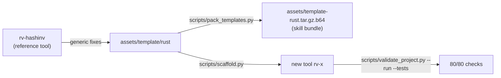

# Rakvor Tool Forge

Source of the `rakvor-tool-forge` skill: the procedure, scripts and reference project templates that turn "we need a
tool that does X" into a Rakvor DFIR tool that builds, passes its tests and meets the forensic contract from the
first commit. `SKILL.md` is the procedure; this repository is where its files live, versioned and pinned by commit.



## Layout

| Path | What it is |
| --- | --- |
| `SKILL.md` | the procedure (phases 0–8); the saved skill fetches a pinned commit of this repo |
| `references/` | contracts and how-tos read by the phase agents |
| `scripts/scaffold.py` | copies a template and renames it (fresh installer AppId, case role, `cargo fmt`) |
| `scripts/validate_project.py` | the contract check (`--run --tests`, `--json`) |
| `scripts/decision_matrix.py` | language-council ADR |
| `scripts/pack_templates.py` | packs `assets/template/<profile>/` into `assets/template-<profile>.tar.gz.b64` |
| `assets/template/rust` | Profile A reference project (rv-hashinv, release state reset to 0.1.0) |
| `assets/template/python` | Profile B reference project |
| `evals/` | skill evals |

## Using a pinned commit

| Version | Commit |
| --- | --- |
| v1.1.0 | `b8487c8cbba7b1af572112a34c15b8d8ae0d60d6` |
| v1.2.0 | `7c3a71ad601bf411a64c62aa9c237a787e54341f` (Python template: TSA signature and chain checks, pip-audit) |
| v1.2.1 | `168f10da27a397a87f6109d89c4309433048867d` (Rust template: `deny.toml` allows IJG, identical to the tool repos) |
| v1.3.0 | `40f55bb46e807a787e28937b17766708f52aed0e` (Windows clippy in CI, reproducible bundles, `--no-council`, scripts fixed for Windows) |

```bash
git init -q <tmp>/forge && git -C <tmp>/forge fetch -q --depth 1 https://github.com/Panacota96/rakvor-tool-forge <commit>
git -C <tmp>/forge checkout -q FETCH_HEAD
python <tmp>/forge/scripts/scaffold.py --profile rust --name rv-x --title "RV X" --description "…" --out <parent>
python <tmp>/forge/scripts/validate_project.py <parent>/rv-x --run --tests
```

## Changing the forge

1. Fix the reference tool (rv-hashinv) or the template, keeping its tests green. Code shared by every tool
   (`src/core/src/trust.rs`) is byte-identical in every tool repo and in the template: change them together.
2. Refresh `assets/template/<profile>` from the reference (`git archive`, then reset `version.txt` and
   `.release-please-manifest.json` to 0.1.0 and keep the template's CHANGELOG).
3. Scaffold a throwaway tool and run `validate_project.py --run --tests`, `cargo deny check`, `cargo clippy` and
   `cargo fmt --check` on it.
4. `python scripts/pack_templates.py`, commit, push, add the version and commit to the table above, and point
   `SKILL.md` ("Get the current forge first") at the new commit.

The reference tool's licence and admissibility texts are drafts pending a lawyer's review. Templates contain no
private keys: the signing root under `packaging/signing/` is the public certificate only.
