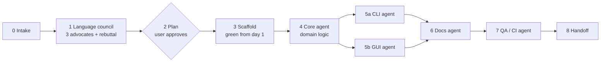

# Rakvor Tool Forge

Turns "we need a tool that does X" into a court-defensible project that builds and passes its tests from the
first commit. You never start from an empty folder: `scripts/scaffold.py` copies a **working, tested reference
tool** (an evidence inventory, "rv-hashinv") in Rust or Python and renames it; the agents then replace the domain
logic while the forensic plumbing (audit chain, hashing, reports, CLI, GUI, CI) stays intact.
`scripts/validate_project.py` proves the contract at every step.

## Get the current forge first

The scripts, references and templates live in **github.com/Panacota96/rakvor-tool-forge**; the copies bundled with
this skill are an offline fallback. Before phase 1, fetch the pinned commit (forge v1.3.1; a commit, not a tag,
because a tag can be moved) and use its files — `<forge>` below is that checkout, and `references/…` means
`<forge>/references/…`:

```bash
git init -q <tmp>/forge && git -C <tmp>/forge fetch -q --depth 1 \
    https://github.com/Panacota96/rakvor-tool-forge 01175f8e25d3a4396019d61b5808d5d065a6cc9f \
    && git -C <tmp>/forge checkout -q FETCH_HEAD
```

If the fetch fails (offline, no GitHub access), use the bundled copy as `<forge>` and tell the user it predates
forge v1.1.0: its Rust template lacks the hardened TSA verification in `src/core/src/trust.rs`, blinded RSA signing,
`deny.toml` with advisory checks, the full installer AppId table, `describe` and `--case-dir` for RV Hub, and
declares Rust 1.85. Copy `src/core/src/trust.rs`, `deny.toml` and `.github/workflows/ci.yml` from rv-hashinv before
the first commit, then validate. Its Python template checks only a token's file digest and imprint — not the TSA
signature or chain (`verify-log --tsa-ca`) — and has no pip-audit step: prefer the Rust profile until the fetch
works, or say so in the ADR.

Every phase and every sub-agent prompt is written in **CRAFT** form — Context, Role, Action, Format, Target —
because sub-agents start with no memory: ready-made prompts are in `references/craft.md`.



## What every generated tool must have

| Area | Requirement (checked by `validate_project.py`) |
| --- | --- |
| Shape | One core library that never prints; CLI and GUI are thin front-ends rendering the core's events |
| CLI | `scan` (or domain verb), `verify-log`, `self-test`, hidden `docs-cli`; `--help` sections DESCRIPTION, Options (each with `Default:` and `Example:`), EXAMPLES, EXIT CODES, FILES WRITTEN, FORENSIC NOTES; exit codes 0/1/2/3/130; `--progress bar|jsonl|none` |
| GUI | Windows 10/11; pickers + drag & drop; hash checkboxes (max 2); report language; interface language ES/EN/FR switchable in the window; trust section (timestamp, certificate, jurisdiction); progress bar, live elapsed time, ETA, Cancel, Open report; rules in a tested `state` module; user actions audited |
| Input | single file, folder (bulk, `--recursive`), list file |
| Hashing | 1 or 2 of md5, sha1, sha256, sha512, sha3-256, blake3 in one read; 3 → refused (exit 2); known-answer self-test |
| Audit | `<out>/logs/<run-id>/`: `audit.jsonl` (hash-chained), `audit.log`, `hashes.csv`, `environment.json`; every output file hashed and logged; evidence read-only |
| Reports | `statistics.*` + per item `items/NNNNN-name/technical.*`, `summary.*` and `custody.*`, each JSON + HTML + PDF, EN/ES/FR; findings say what they show **and what they do not prove**; limitations; name lists capped so 50k-file runs stay small |
| Trust (on by default) | RFC 3161 timestamp of the audit chain head (`--tsa-url`, offline → `timestamp_pending` + `timestamp <logdir>` later); PDFs signed with the examiner's `.p12` (`--sign-cert`, password from env or prompt, never logged); custody form per item for `--jurisdiction co` (ES, Fiscalía style) or `fr` (FR, scellés) plus English; code signing in `release.yml` guarded by secrets |
| Brand | Rakvor palette, placeholder RV mark, descriptor + tagline from i18n `brand`; dark header band on light printable pages; dark GUI theme; installer/exe icon |
| Repo | README, CHANGELOG (Keep a Changelog), CONTRIBUTING, LICENSE (Rakvor source-auditable, `assets/licence/`), NOTICE with third-party licences, SECURITY, `deny.toml` (licence allow-list, sources, RustSec advisories), `src/ docs/ tests/ examples/`, ≥1 Mermaid diagram per docs page |
| Toolkit | shared case folder (`references/case-folder.md`): `--case-dir`, `--evidence`, `verify-case [--rehash]`; the intake tool (rv-hashinv) registers evidence, every analysis tool re-verifies it against the registry and links its audit chain to the hash-chained case log |
| Docs | README + architecture/forensic-audit/reports/usage-cli/usage-gui/development/case-folder **and** `docs/theory.md` (Part A plain language, Part B expert), `docs/admissibility.md` (Colombia, France/EU, ISO, US/UK, gaps, examiner checklist), `docs/installation.md`, `docs/usage.md` — English, Markdown + Mermaid, every claim matching the code |
| CI/CD | tests on ubuntu + windows, lint, dependency advisories (`cargo deny check advisories licenses bans sources`; Python: `pip-audit` over the locked export), docs drift, verifiers; release: portable zip + Inno Setup installer, SHA256SUMS, SBOM, build provenance; release-please + Conventional Commits |

## Phase 0 — Intake

The skill is generic: it has no recipes per tool type, so the tool itself always comes from the user. If the
request does not already describe the tool, the **first** question is "Describe the tool: what goes in, what it
must find or produce, and who reads the result" — ask it before anything else, then ask (AskUserQuestion, one
round, ≤4 questions) only for what is still missing and changes the build:

1. **Purpose** — input types and sizes, what the tool must detect/convert/extract, what the report must answer.
2. **Audience** — delivered to clients / used in court (→ preset `client`), internal examiner tool (`internal`), or
   huge inputs on modest hardware (`performance`).
3. **Constraints** — hardware (8 GB laptops? VMs without GPU?), offline/air-gapped, libraries that must be used,
   data that must never leave the machine.
4. **Name and repo** — kebab-case name with a prefix (`rv-…`), display title, GitHub repo (private by default) or local only.

5. **Jurisdiction** — Colombia (`co`) or France (`fr`) as the default custody form (both stay available per run).

Defaults when unanswered: Rakvor source-auditable licence (tools are used locally, not distributed; customers and
courts may audit the source — the licence text is a draft pending legal review), reports EN (all three available), sha256, Windows x64, local only, Rakvor
brand, trust features on, jurisdiction `co`.
Write the answers into a short CONTEXT block — it is pasted into every later prompt.

## Phase 1 — Language council

Goal: pick the profile on evidence, not habit (criteria: speed, transferability, storage, hardware/RAM, Windows
GUI, CLI help, packaging/antivirus, auditability, team velocity, DFIR ecosystem, CI/CD).

1. Spawn three advocates **in the same turn** (Rust, Python, C-with-assembly) with the CRAFT prompt in
   `references/craft.md` §2 and the baseline table from `references/language-council.md`.
2. Run one rebuttal round that turns their arguments into at most three `lang.criterion=score:reason` overrides each.
3. Decide and write the ADR:
   ```bash
   python <forge>/scripts/decision_matrix.py --preset <client|internal|performance> --tool "<Title>" \
       --context "<one paragraph>" --override "python.dfir_ecosystem=5:needs pyevtx" --out <tmp>/0001-language.md
   ```
   Profiles: **A** Rust (core + clap CLI + egui GUI) · **B** Python (click/rich CLI + PySide6 GUI, Nuitka) ·
   C hybrids only through `references/stack-hybrid.md`. Assembly is never hand-written; C only wraps existing libraries.

No sub-agents available? Write the three advocate tables yourself, then the rebuttal — same format.
The owner may also pick the language without a council (for example, Rust for a batch of planned tools): then pass
`--no-council`, so the ADR names the owner as decider and labels the overrides as yours, never as argued by advocates.

## Phase 2 — Plan (approval gate)

Present the plan and **wait for approval** (use plan mode if the harness has it): ADR summary, profile, domain
design (what the analyzer does per item and across items, new finding codes with severity, new outputs),
CLI additions, GUI additions, sample evidence you will synthesise, a Mermaid `gantt` of phases 3–8, and the risks.
Nothing is written to the user's repo before approval. Changing language later costs a rescaffold.

## Phase 3 — Scaffold (must be green before any domain work)

```bash
python <forge>/scripts/scaffold.py --profile <rust|python> --name rv-x --title "RV X" \
    --description "**One-line purpose.** One or two sentences." --out <parent-folder> [--repo-url URL] [--command scan] \
    [--case-role analysis|intake]   # default analysis: verifies evidence against the case registry
# --command only records the planned verb; the template's verb stays `scan` until the CLI agent renames it
cp <tmp>/0001-language.md rv-x/docs/adr/0001-language.md
# Rust:   cargo test --workspace && cargo run -q -p rv-x-cli -- docs-cli > docs/usage-cli.md
# Python: uv sync --extra gui && uv run pytest && uv run rv-x docs-cli > docs/usage-cli.md
python <forge>/scripts/validate_project.py rv-x --run
git init -b main && git add -A && git commit -m "chore: scaffold rv-x with rakvor-tool-forge"
```

Set `RV_TEST_PYTHON` to a Python that has `pyhanko` so the trust tests and the validator's trust checks run
against the bundled local TSA (`tests/fake_tsa.py`) — public TSAs are often unreachable from sandboxes and CI.
The scaffold already meets the whole contract (the reference passes every validator check). If it is not green now, fix
the environment first — never start domain work on a red baseline. Read `references/stack-rust.md` or
`references/stack-python.md` for the profile you scaffolded.

## Phase 4 — Core agent (domain logic)

CRAFT prompt: `references/craft.md` §3. The agent replaces `analyzer.rs|py`, adds finding codes to the three
i18n catalogues (title / shows / does_not_prove), adds limitations, adds audit actions for every new step and
output (`references/forensic-audit.md`), and replaces `examples/sample/evidence` with small **synthetic** files that
trigger every finding (never real case data), regenerating `expected_hashes.csv` with an independent tool.
If the domain parses whole files, uses a native library or can hang on hostile input, read
`references/heavy-analyzers.md` first: freeze the data model and `analyze_item` before splitting the work between
agents, isolate each item in a worker process, and ship `expected_findings.json` as ground truth.
Done when core tests are green and the static validator passes.

## Phase 5 — CLI agent ‖ GUI agent (parallel)

Spawn both in the same turn, each in its own git worktree (`isolation: "worktree"`), coded only against the core's
event API; merge both, then rerun the tests.

- **CLI** (`craft.md` §4 + `references/cli-contract.md`): domain wording in DESCRIPTION/EXAMPLES/FILES WRITTEN/FORENSIC
  NOTES, domain options with Default/Example, regenerate `docs/usage-cli.md`. If the main verb changes, update
  `.forge.json` `run_command`.
- **GUI** (`craft.md` §5 + `references/gui-contract.md`): domain settings in `state` (audited `ui_*` actions with
  `at_utc`) and in the window, every new label in the i18n `ui` section for en/es/fr (identical key sets);
  screenshot of a finished sample run to `docs/images/gui-main.png`.

## Phase 6 — Docs agent

CRAFT prompt §6 + `references/docs-style.md` + `references/reports.md`. Every page is updated for the domain and
keeps ≥1 Mermaid diagram; render-check them with `mmdc` when available. The findings catalogue table in
`docs/reports.md` must list every code with shows / does-not-prove.

The four audit pages come from the template with the domain parts fenced by `<!-- forge:domain -->` markers:
rewrite those, keep the shared sections (hashing, audit chain, case folder, trust, installation). For
`docs/admissibility.md`, start from the sourced research `claude/admissibility-research.md` in the Rakvor project
(read it with the Projects tool) and keep its "to be verified" markers — never upgrade an unverified citation.
The tools are used locally and audited by customers and courts, so the docs agent must read the code and write
down every place where docs and code disagree: those become fixes before handoff, not footnotes.

## Phase 7 — QA / CI agent

CRAFT prompt §7 + `references/cicd.md`:

```bash
python <forge>/scripts/validate_project.py <project> --run --tests     # must exit 0
actionlint .github/workflows/*.yml                                     # with shellcheck on PATH
```

If a GitHub repo was approved: push, watch `ci.yml`, then run `release.yml` with `workflow_dispatch` and confirm on
`windows-latest`: build, self-test + sample run, portable zip, installer, SBOM, SHA256SUMS, attestation. Tell the
user about the one-time setting "Allow GitHub Actions to create and approve pull requests" for release-please.
Creating repos and pushing need the user's explicit approval; never push to a repo they did not name.

## Phase 8 — Handoff

Reply briefly: what the tool does, the profile and why (one line from the ADR), validator result, CI/release run
links, how to run it (CLI one-liner + GUI), what is **not** verified (e.g. Windows 10 manual check, code signing
without a real certificate, real-TSA timestamps if only the local test TSA ran, the placeholder logo),
and one next step. Do not paste file contents.

## Pitfalls (each one happened while building the reference tools)

- Starting domain code before the scaffold is green → you cannot tell your bugs from the environment's.
- Floats or unsorted keys in audit details → Rust and Python verifiers disagree. Integers and strings only.
- Printing from the core, or crashing on a closed stdout (`| head`) → incomplete audit log. Stop printing, keep working.
- Loading whole evidence files into memory → fails on 8 GB laptops. Stream in 1 MiB chunks; check cancel per chunk.
- Writing outputs without logging their digests → reports cannot be proven unaltered.
- A finding without `does_not_prove` → over-reading in court. Add it in en, es and fr.
- Help text re-wrapped by the terminal → `docs/usage-cli.md` drifts. Fix the width; regenerate with `docs-cli`.
- Onefile Python freezers / UPX → antivirus false positives. Nuitka standalone; no packers.
- Real case data in `examples/` → privacy breach. Synthetic samples only.
- Per-item reports that list every other file (duplicates, siblings) → 3 GB of reports and a 1,222-page PDF at 50k
  files. Cap name lists (`capped_list`: 10 names, then "… (+N)") and test with a large synthetic folder.
- Trusting a TSA's `genTime` parser: real TSAs send fractional seconds that strict ASN.1 types reject. Parse
  TSTInfo leniently and test against `tests/fake_tsa.py`, never only a public TSA.
- Logging the certificate password, or failing silently on a wrong one → log `signing_certificate_loaded` with the
  fingerprint, `run_failed` on a bad password, and never the secret itself.
- A timestamp claims more than it proves: it shows the log existed at that time, not that its content is true —
  keep `TIMESTAMP_PROVES_EXISTENCE_ONLY` in the limitations.
- Sub-agents cannot always write `.md` with the Write tool → have them write via the shell or give them a
  non-`.md` path and rename.
- `mmdc` needs a Chromium: point puppeteer's `executablePath` at the pre-installed headless shell instead of downloading.
- A shared `CARGO_TARGET_DIR` across projects with identically named binaries mixes them up → one target dir per
  project (or per eval run). Builds fill disks fast: `CARGO_PROFILE_DEV_DEBUG=0 CARGO_INCREMENTAL=0`, delete
  worktree target dirs after merging.
- Releasing by bumping a version that lives in a lockfile breaks every `--locked` step → product version in
  `version.txt` (Rust) / dynamic hatch version (Python), crate/project versions fixed.
- An unpinned compiler in CI brings new clippy lints you cannot see locally → `rust-toolchain.toml` pins it; locally
  use `RUSTUP_TOOLCHAIN=stable` when rustup cannot download the pinned name.
- Clippy only in the Linux lint job never compiles `#[cfg(windows)]` code (file pickers, signature checks, registry), so
  every tool failed `clippy -D warnings` on Windows unnoticed → the Windows test job runs clippy too.
- CI job logs are often unreachable from the sandbox → test and clippy steps re-emit failures as `::error::`
  annotations; read them with the check-runs annotations API.
- Tests that only pass on one OS: string paths with `/` (compare `Path` components), `iterdir()`/`read_dir` order
  (sort before picking), absolute paths without a drive letter, case-sensitive path matching on Windows.
- Nuitka `--include-distribution-metadata` for a package the entry point does not import fails the build → embed
  metadata per front-end; reproduce Linux-side with `patchelf` before pushing.
- Docs written from intent instead of code drift silently → the docs agent reads the code and lists every mismatch;
  fix the code or the doc before release.
- Forking the shared `src/core/src/trust.rs` → tools verify timestamps differently and fixes miss some of them.
  Keep it byte-identical across every tool repo and the template; change all of them in one go. Same for
  `src/core/src/outputs.rs` (re-hash of the outputs an audit log records).
- `verify-log` checking only the audit chain → a report edited after the run still verified (the chain vouches for
  the recorded digests, not the files). `outputs.rs` re-hashes every recorded output; record every file a run
  writes with its digests, in a shape `outputs.rs` knows.
- CI that checks licences but not advisories → a yanked tokio and a timing-leaky dependency shipped unnoticed.
  `cargo deny check advisories licenses bans sources`; an exception in `deny.toml` says why it does not apply and
  when it is revisited. Fixed versions may need a higher `rust-version`: bump it (the build toolchain is pinned anyway).
- Signing through a library's plain `Signer` with rsa 0.9 → no RSA blinding (Marvin timing side channel). The
  examiner's key signs only through `BlindedSigningKey` in trust.rs.
- A container format (mbox) registered item by item as `<file>#<n>@<offset>` broke the Python register check, which
  opened that name as a file → derived items carry their byte range and the verifier re-hashes it
  (`references/heavy-analyzers.md`, "Containers").
- Passing a run-wide cache to every worker on the command line overflowed the Windows limit → per-item data only.
- Two tools with the same installer AppId upgrade or uninstall each other → `scaffold.py` mints a fresh one and adds
  it to `RAKVOR_APP_IDS` (`src/cli/tests/packaging.rs`); add the new tool's AppId to that table in every tool repo.
- Heuristics that "unwrap if it looks like DER" on random key bytes fail about 1 time in 65 536 → require the exact
  declared length, reject degenerate values (the EC point at infinity), and test with thousands of random keys.

## Reference index

| File | Read when |
| --- | --- |
| `references/craft.md` | writing any sub-agent prompt (phases 1, 4–7) |
| `references/language-council.md` | phase 1: criteria, baseline scores, presets, decision rules |
| `references/stack-rust.md` / `stack-python.md` / `stack-hybrid.md` | after phase 1, for the chosen profile |
| `references/cli-contract.md` | CLI agent; any change to options, exit codes, events |
| `references/gui-contract.md` | GUI agent |
| `references/forensic-audit.md` | core agent; any new action or output; timestamps and signing |
| `references/reports.md` | core + docs agents; findings, schemas, PDF/HTML rules, custody forms, brand |
| `references/cicd.md` | QA agent; workflows, release, installer, signing |
| `references/heavy-analyzers.md` | whole-file parsers, native libraries, worker processes, expected findings, fuzzing |
| `references/case-folder.md` | toolkit linking: case folder layout, registry, case log, `verify-case`, intake vs analysis role |
| `references/docs-style.md` | docs agent |

Scripts: `scripts/scaffold.py` (new project), `scripts/decision_matrix.py` (ADR), `scripts/validate_project.py`
(contract check, `--json` for graders). Templates: complete projects in `assets/template/<profile>` in the forge repo,
also packed as `assets/template-<profile>.tar.gz.b64` for the skill bundle (`scaffold.py` unpacks them). The Rust
reference project is rv-hashinv. To improve the forge, follow "Changing the forge" in the repo README: fix the
reference, refresh the template, scaffold a throwaway tool and validate it, pack, commit, push, and update the pinned commit in
"Get the current forge first".
