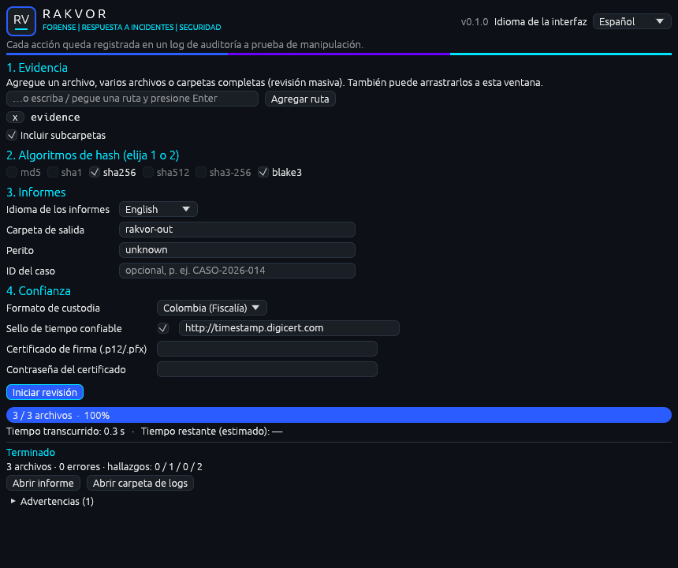
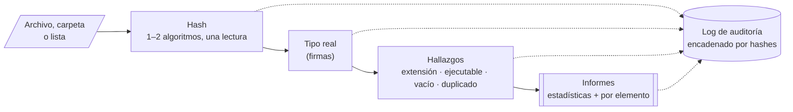
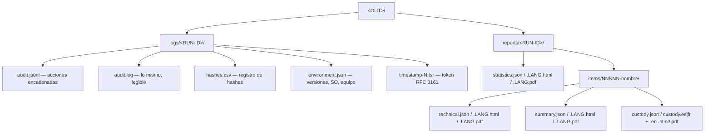

> La versión de referencia es la inglesa ([README.md](README.md)); esta traducción la sigue.

<p align="center"></p>

# RV HashInv

[English](README.md) · **Español** · [Français](README.fr.md)

<!-- forge:description -->
**Inventario de evidencia para informática forense.** RV HashInv calcula el hash de cada archivo que se le entrega
(un archivo, una carpeta o una lista), detecta el tipo real de cada archivo, señala anomalías y escribe informes
aptos para presentar ante un tribunal, con cada acción registrada en un log de auditoría a prueba de manipulación.
<!-- /forge:description -->

[](https://github.com/Panacota96/rv-hashinv/actions/workflows/ci.yml)






## Contenido

- [Qué ofrece](#qué-ofrece)
- [Instalación](#instalación)
- [Inicio rápido](#inicio-rápido)
- [Salidas](#salidas)
- [Documentación](#documentación)
- [Estructura del proyecto](#estructura-del-proyecto)
- [Contribuir, seguridad, licencia](#contribuir-seguridad-licencia)
- [Licencia](#licencia)

## Qué ofrece

| | |
| --- | --- |
| **Dos formas de usarla** | `rv-hashinv` (línea de comandos) y `rv-hashinv-gui` (aplicación de escritorio para Windows 10/11). Mismo motor, mismos resultados. |
| **Uno o muchos** | Un archivo, varios archivos, carpetas completas (`--recursive`) o un archivo de lista (`--input-list`). |
| **Hash** | Elija 1 o 2 de md5, sha1, sha256, sha512, sha3-256, blake3. Ambos se calculan en la misma lectura. |
| **Progreso** | Barra de progreso, tiempo transcurrido, velocidad y tiempo restante estimado (CLI y GUI). Se puede cancelar en cualquier momento. |
| **Auditable** | Cada acción va a `logs/<RUN-ID>/audit.jsonl`, donde cada entrada lleva el hash de la anterior. `verify-log` detecta cualquier edición. |
| **Informes** | Un informe estadístico por ejecución y, para **cada archivo**, una revisión técnica y un resumen para el cliente, en HTML, PDF y JSON, en inglés, español o francés. |
| **Carpeta del caso** | `--case-dir` enlaza las herramientas Rakvor de un caso: rv-hashinv (la herramienta de ingreso) registra cada archivo como `E0001`, `E0002`, … para que las herramientas posteriores prueben que examinaron copias idénticas bit a bit; `verify-case` verifica toda la carpeta. Ver [docs/case-folder.md](docs/case-folder.md) (en inglés). |

## Instalación

**Windows 10/11**: descargue desde la página [Releases](https://github.com/Panacota96/rv-hashinv/releases):

- `rv-hashinv-<version>-windows-x64-setup.exe`: instalador (acceso en el menú Inicio, agrega la CLI al PATH), o
- `rv-hashinv-<version>-windows-x64.zip`: portable; se descomprime y se ejecuta, no se instala nada.

Verifique la descarga antes de usarla (ver [SECURITY.md](SECURITY.md#verifying-a-release)).

**Desde el código fuente** (cualquier sistema, Rust 1.85+):

```bash
cargo build --release
# binarios: target/release/rv-hashinv y target/release/rv-hashinv-gui
```

## Inicio rápido

```powershell
# Primero verifique el programa: cada algoritmo frente a vectores de prueba publicados
rv-hashinv self-test

# Revisar una carpeta con SHA-256 + MD5, informes en español, para el caso CASE-2026-014
rv-hashinv scan -i D:\evidence -r --hash sha256,md5 --lang es --case CASE-2026-014 --actor "Ana Ruiz"

# Caso francés: formato de custodia en francés + inglés, cada PDF firmado con su certificado
$env:RV_SIGN_PASSWORD = Read-Host -AsSecureString | ConvertFrom-SecureString -AsPlainText
rv-hashinv scan -i D:\evidence -r --jurisdiction fr --sign-cert C:\certs\examiner.p12 --lang fr

# Más tarde, pruebe que el log no fue alterado (también verifica el sello de tiempo RFC 3161 y la firma de la TSA;
# agregue --tsa-ca <raíces de la TSA.pem> para validar la cadena del certificado de la TSA)
rv-hashinv verify-log rakvor-out\logs\<RUN-ID>

# ¿La ejecución fue sin red? Agregue el sello de tiempo confiable cuando vuelva la red
rv-hashinv timestamp rakvor-out\logs\<RUN-ID>
```

Las cinco tareas más comunes, paso a paso: [docs/quick-guide.es.md](docs/quick-guide.es.md).
Cada opción, ejemplo y código de salida: [docs/usage-cli.md](docs/usage-cli.md) (en inglés, generado desde `--help`).
La aplicación de escritorio: [docs/usage-gui.es.md](docs/usage-gui.es.md). Un ejemplo listo: [examples/](examples/README.md).

## Salidas



| Código de salida | Significado |
| :-: | --- |
| 0 | Terminado, ningún hallazgo de severidad alta |
| 1 | Error de ejecución |
| 2 | Error de uso (p. ej. tres algoritmos de hash) |
| 3 | Terminado con hallazgos de severidad alta / cadena de auditoría rota |
| 130 | Cancelado (se escribieron informes parciales) |

## Documentación

| Página | Para |
| --- | --- |
| [docs/quick-guide.es.md](docs/quick-guide.es.md) | Las cinco tareas más comunes (scan, carpeta del caso, verify-log, verify-case, timestamp), cada botón de la GUI, códigos de salida |
| [docs/usage.es.md](docs/usage.es.md) | Recorrido completo de un caso: ingreso, análisis, `verify-case`, lectura de cada salida, solución de problemas |
| [docs/installation.es.md](docs/installation.es.md) | Instalar y verificar una versión (SHA256SUMS, procedencia, Authenticode), compilar desde el código fuente para auditores |
| [docs/theory.md](docs/theory.md) | Por qué funciona cada paso: parte en lenguaje sencillo para clientes y tribunales, parte experta con algoritmos y valores reales (en inglés) |
| [docs/admissibility.md](docs/admissibility.md) | Requisitos de Colombia, Francia/UE, ISO/IEC y EE. UU./Reino Unido frente a la herramienta, lista de brechas, lista de control del perito (en inglés) |
| [docs/usage-cli.md](docs/usage-cli.md) | Cada comando y opción (generado desde `--help`, en inglés) |
| [docs/usage-gui.es.md](docs/usage-gui.es.md) | Uso de la aplicación de escritorio |
| [docs/architecture.md](docs/architecture.md) | Cómo encajan el motor, la CLI y la GUI (en inglés) |
| [docs/forensic-audit.md](docs/forensic-audit.md) | Registro de auditoría, cadena de hashes, manejo de evidencia, correspondencia con ISO/IEC 27037 (en inglés) |
| [docs/reports.md](docs/reports.md) | Tipos de informe, campos, esquemas JSON, idiomas (en inglés) |
| [docs/case-folder.md](docs/case-folder.md) | Carpeta compartida del caso: registro de evidencia, log del caso, herramientas de ingreso y de análisis, `verify-case` (en inglés) |
| [docs/development.md](docs/development.md) | Compilación, pruebas, CI/CD y publicación de versiones (en inglés) |
| [docs/release-process.md](docs/release-process.md) | Paquetes para Windows, firma de código y versiones en GitHub, paso a paso (en inglés) |
| [docs/adr/](docs/adr/) | Decisiones de arquitectura (p. ej. por qué Rust; en inglés) |

El README, la guía rápida, la guía de uso, la guía de la aplicación de escritorio y la guía de instalación existen
también en español (`.es.md`) y en francés (`.fr.md`); las páginas en inglés son la referencia.

## Estructura del proyecto

```text
rv-hashinv/
├── src/
│   ├── core/      biblioteca del motor: entradas, hash, análisis, log de auditoría, informes (nunca imprime)
│   ├── cli/       línea de comandos rv-hashinv (clap)
│   └── gui/       aplicación de escritorio rv-hashinv-gui (egui); state.rs contiene todas las reglas comprobables
├── templates/     plantillas HTML de los informes + CSS (compatibles con Jinja2/minijinja)
├── i18n/          textos de los informes: en.json, es.json, fr.json
├── schemas/       esquemas JSON de los tres tipos de informe
├── docs/          documentación (los diagramas Mermaid se muestran en GitHub)
├── tests/         verificaciones en otro lenguaje (verificador Python de la cadena de auditoría)
├── scripts/       verificaciones de la documentación (las traducciones conservan la forma de las páginas en inglés)
├── examples/      evidencia de ejemplo + scripts de ejecución + hashes esperados
├── packaging/     instalador de Windows (Inno Setup)
└── .github/       flujos de CI y de publicación
```

## Contribuir, seguridad, licencia

- Cómo contribuir: [CONTRIBUTING.md](CONTRIBUTING.md) · Cambios: [CHANGELOG.md](CHANGELOG.md)
- Reportar una vulnerabilidad de forma privada: [SECURITY.md](SECURITY.md)
- Licencia: ver [Licencia](#licencia). Avisos de terceros: [NOTICE](NOTICE).

## Licencia

Código disponible, uso no comercial: [PolyForm Noncommercial 1.0.0](LICENSE). Cualquiera puede usar, estudiar,
modificar y compartir RV HashInv con fines no comerciales. Se exige el crédito en todo uso: "RV HashInv by Rakvor", y
conservar la línea `Required Notice:` de [LICENSE](LICENSE). El uso comercial (venderla, servicios pagos, uso en el
trabajo remunerado de una empresa con fines de lucro) requiere una licencia escrita de Rakvor: ver
[COMMERCIAL.md](COMMERCIAL.md). Rakvor conserva todos los derechos comerciales como titular de los derechos de autor.
Los textos de licencia de Rakvor ([COMMERCIAL.md](COMMERCIAL.md), [NOTICE](NOTICE), esta sección) son borradores,
pendientes de verificación por un abogado (*to be verified*; Colombia, Francia), y no constituyen asesoría legal. Los
componentes de terceros conservan sus propias licencias: [NOTICE](NOTICE).
