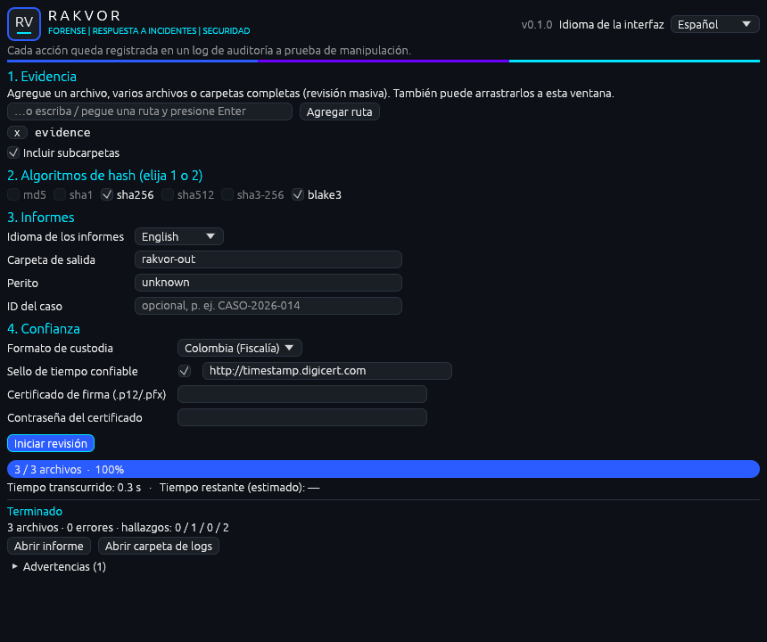
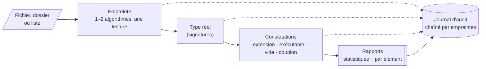
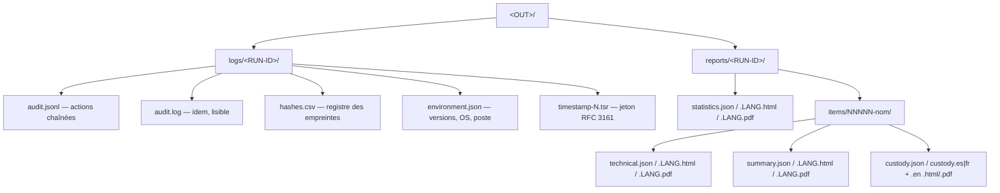

> La version de référence est la version anglaise ([README.md](README.md)) ; cette traduction la suit.

<p align="center"></p>

# RV HashInv

[English](README.md) · [Español](README.es.md) · **Français**

<!-- forge:description -->
**Inventaire des éléments de preuve pour l'investigation numérique.** RV HashInv calcule l'empreinte de chaque
fichier qu'on lui confie (un fichier, un dossier ou une liste), détecte le type réel de chaque fichier, signale les
anomalies et rédige des rapports utilisables en justice, chaque action étant inscrite dans un journal d'audit
infalsifiable.
<!-- /forge:description -->

[](https://github.com/Panacota96/rv-hashinv/actions/workflows/ci.yml)






## Sommaire

- [Ce que vous obtenez](#ce-que-vous-obtenez)
- [Installation](#installation)
- [Démarrage rapide](#démarrage-rapide)
- [Sorties](#sorties)
- [Documentation](#documentation)
- [Organisation du projet](#organisation-du-projet)
- [Contribuer, sécurité, licence](#contribuer-sécurité-licence)
- [Licence](#licence)

## Ce que vous obtenez

| | |
| --- | --- |
| **Deux façons de l'utiliser** | `rv-hashinv` (ligne de commande) et `rv-hashinv-gui` (application de bureau pour Windows 10/11). Même moteur, mêmes résultats. |
| **Un ou plusieurs** | Un fichier, plusieurs fichiers, des dossiers entiers (`--recursive`) ou un fichier de liste (`--input-list`). |
| **Empreintes** | Choisissez 1 ou 2 parmi md5, sha1, sha256, sha512, sha3-256, blake3. Les deux sont calculées en une seule lecture. |
| **Progression** | Barre de progression, temps écoulé, débit et temps restant estimé (CLI et GUI). Annulation possible à tout moment. |
| **Auditable** | Chaque action est inscrite dans `logs/<RUN-ID>/audit.jsonl`, où chaque entrée porte l'empreinte de la précédente. `verify-log` détecte toute modification. |
| **Rapports** | Un rapport statistique par exécution et, pour **chaque fichier**, une revue technique et une synthèse pour le client, en HTML, PDF et JSON, en anglais, espagnol ou français. |
| **Dossier de l'affaire** | `--case-dir` relie les outils Rakvor d'une même affaire : rv-hashinv (l'outil d'enregistrement) enregistre chaque fichier sous `E0001`, `E0002`, … afin que les outils suivants prouvent qu'ils ont examiné des copies identiques bit à bit ; `verify-case` vérifie tout le dossier. Voir [docs/case-folder.md](docs/case-folder.md) (en anglais). |

## Installation

**Windows 10/11** : téléchargez depuis la page [Releases](https://github.com/Panacota96/rv-hashinv/releases) :

- `rv-hashinv-<version>-windows-x64-setup.exe` : programme d'installation (raccourci dans le menu Démarrer, ajoute la CLI au PATH), ou
- `rv-hashinv-<version>-windows-x64.zip` : version portable ; on décompresse et on lance, rien n'est installé.

Vérifiez le téléchargement avant usage (voir [SECURITY.md](SECURITY.md#verifying-a-release)).

**À partir des sources** (tout système, Rust 1.85+) :

```bash
cargo build --release
# binaires : target/release/rv-hashinv et target/release/rv-hashinv-gui
```

## Démarrage rapide

```powershell
# Vérifiez d'abord le programme : chaque algorithme face à des vecteurs de test publiés
rv-hashinv self-test

# Analyser un dossier avec SHA-256 + MD5, rapports en espagnol, pour l'affaire CASE-2026-014
rv-hashinv scan -i D:\evidence -r --hash sha256,md5 --lang es --case CASE-2026-014 --actor "Ana Ruiz"

# Affaire française : fiche de possession en français + anglais, chaque PDF signé avec votre certificat
$env:RV_SIGN_PASSWORD = Read-Host -AsSecureString | ConvertFrom-SecureString -AsPlainText
rv-hashinv scan -i D:\evidence -r --jurisdiction fr --sign-cert C:\certs\examiner.p12 --lang fr

# Plus tard, prouvez que le journal n'a pas été modifié (vérifie aussi l'horodatage RFC 3161 et la signature de la TSA ;
# ajoutez --tsa-ca <racines de la TSA.pem> pour valider la chaîne de certificats de la TSA)
rv-hashinv verify-log rakvor-out\logs\<RUN-ID>

# L'exécution était hors ligne ? Ajoutez l'horodatage une fois le réseau revenu
rv-hashinv timestamp rakvor-out\logs\<RUN-ID>
```

Les cinq tâches les plus courantes, pas à pas : [docs/quick-guide.fr.md](docs/quick-guide.fr.md).
Chaque option, exemple et code de sortie : [docs/usage-cli.md](docs/usage-cli.md) (en anglais, généré à partir de `--help`).
L'application de bureau : [docs/usage-gui.fr.md](docs/usage-gui.fr.md). Un exemple prêt à l'emploi : [examples/](examples/README.md).

## Sorties



| Code de sortie | Signification |
| :-: | --- |
| 0 | Terminé, aucune constatation de gravité élevée |
| 1 | Erreur d'exécution |
| 2 | Erreur d'utilisation (p. ex. trois algorithmes d'empreinte) |
| 3 | Terminé avec des constatations de gravité élevée / chaîne d'audit rompue |
| 130 | Annulé (rapports partiels écrits) |

## Documentation

| Page | Pour |
| --- | --- |
| [docs/quick-guide.fr.md](docs/quick-guide.fr.md) | Les cinq tâches les plus courantes (scan, dossier de l'affaire, verify-log, verify-case, timestamp), chaque bouton de la GUI, codes de sortie |
| [docs/usage.fr.md](docs/usage.fr.md) | Parcours complet d'une affaire : enregistrement, analyse, `verify-case`, lecture de chaque sortie, dépannage |
| [docs/installation.fr.md](docs/installation.fr.md) | Installer et vérifier une version (SHA256SUMS, provenance, Authenticode), compiler à partir des sources pour les auditeurs |
| [docs/theory.md](docs/theory.md) | Pourquoi chaque étape fonctionne : partie en langage simple pour les clients et les juridictions, partie experte avec algorithmes et valeurs réelles (en anglais) |
| [docs/admissibility.md](docs/admissibility.md) | Exigences de la Colombie, de la France/UE, de l'ISO/IEC et des États-Unis/Royaume-Uni rapportées à l'outil, liste des lacunes, liste de contrôle de l'expert (en anglais) |
| [docs/usage-cli.md](docs/usage-cli.md) | Chaque commande et option (généré à partir de `--help`, en anglais) |
| [docs/usage-gui.fr.md](docs/usage-gui.fr.md) | Utilisation de l'application de bureau |
| [docs/architecture.md](docs/architecture.md) | Comment s'articulent le moteur, la CLI et la GUI (en anglais) |
| [docs/forensic-audit.md](docs/forensic-audit.md) | Journal d'audit, chaîne d'empreintes, traitement des éléments de preuve, correspondance avec ISO/IEC 27037 (en anglais) |
| [docs/reports.md](docs/reports.md) | Types de rapports, champs, schémas JSON, langues (en anglais) |
| [docs/case-folder.md](docs/case-folder.md) | Dossier partagé de l'affaire : registre des éléments, journal de l'affaire, outils d'enregistrement et d'analyse, `verify-case` (en anglais) |
| [docs/development.md](docs/development.md) | Compilation, tests, CI/CD et publication des versions (en anglais) |
| [docs/release-process.md](docs/release-process.md) | Paquets Windows, signature de code et versions GitHub, pas à pas (en anglais) |
| [docs/adr/](docs/adr/) | Décisions d'architecture (p. ex. pourquoi Rust ; en anglais) |

Le README, le guide rapide, le guide d'utilisation, le guide de l'application de bureau et le guide d'installation
existent aussi en espagnol (`.es.md`) et en français (`.fr.md`) ; les pages en anglais font référence.

## Organisation du projet

```text
rv-hashinv/
├── src/
│   ├── core/      bibliothèque du moteur : entrées, empreintes, analyse, journal d'audit, rapports (n'affiche rien)
│   ├── cli/       ligne de commande rv-hashinv (clap)
│   └── gui/       application de bureau rv-hashinv-gui (egui) ; state.rs contient toutes les règles testables
├── templates/     modèles HTML des rapports + CSS (compatibles Jinja2/minijinja)
├── i18n/          textes des rapports : en.json, es.json, fr.json
├── schemas/       schémas JSON des trois types de rapport
├── docs/          documentation (les diagrammes Mermaid s'affichent sur GitHub)
├── tests/         vérifications dans un autre langage (vérificateur Python de la chaîne d'audit)
├── scripts/       vérifications de la documentation (les traductions gardent la forme des pages en anglais)
├── examples/      éléments d'exemple + scripts d'exécution + empreintes attendues
├── packaging/     programme d'installation Windows (Inno Setup)
└── .github/       workflows de CI et de publication
```

## Contribuer, sécurité, licence

- Comment contribuer : [CONTRIBUTING.md](CONTRIBUTING.md) · Modifications : [CHANGELOG.md](CHANGELOG.md)
- Signaler une vulnérabilité en privé : [SECURITY.md](SECURITY.md)
- Licence : voir [Licence](#licence). Mentions des tiers : [NOTICE](NOTICE).

## Licence

Code source disponible, usage non commercial : [PolyForm Noncommercial 1.0.0](LICENSE). Toute personne peut
utiliser, étudier, modifier et partager RV HashInv à des fins non commerciales. La mention est obligatoire dans tout
usage : « RV HashInv by Rakvor », en conservant la ligne `Required Notice:` de [LICENSE](LICENSE). L'usage commercial
(la vendre, des services payants, l'usage dans le travail rémunéré d'une entreprise à but lucratif) nécessite une
licence écrite de Rakvor : voir [COMMERCIAL.md](COMMERCIAL.md). Rakvor conserve tous les droits commerciaux en tant
que titulaire du droit d'auteur. Les textes de licence de Rakvor ([COMMERCIAL.md](COMMERCIAL.md), [NOTICE](NOTICE),
cette section) sont des projets, à faire vérifier par un avocat (*to be verified* ; Colombie, France), et ne
constituent pas un avis juridique. Les composants tiers conservent leurs propres licences : [NOTICE](NOTICE).
