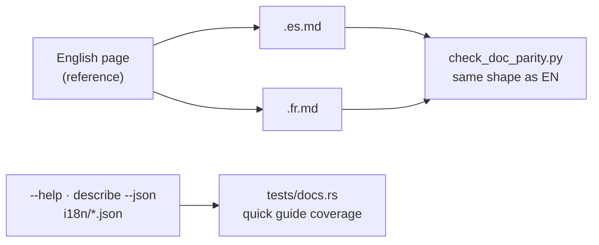
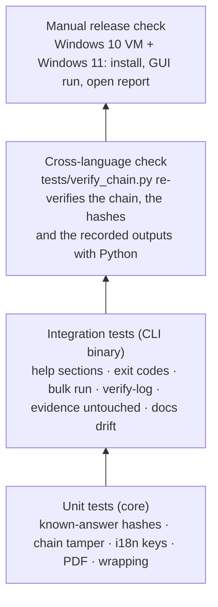
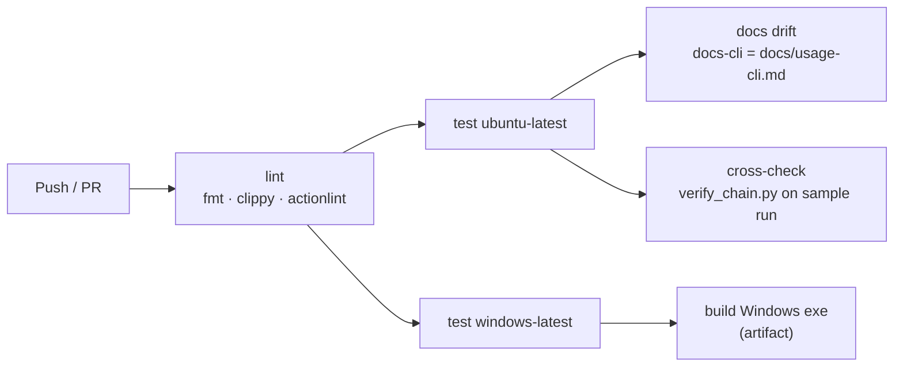
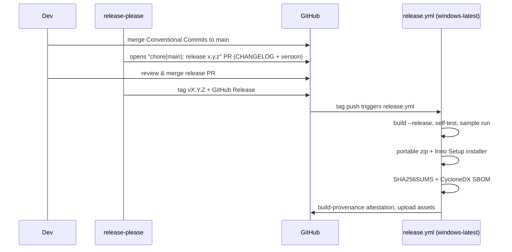

# Development, CI/CD and releases

## Build and test locally

```bash
cargo build --workspace                 # debug build of core, CLI and GUI
cargo test  --workspace                 # unit + integration tests (GUI tests are headless)
cargo clippy --workspace --all-targets -- -D warnings
cargo fmt --all -- --check
cargo run -p rv-hashinv-cli -- scan -i examples/sample/evidence --lang all
cargo run -p rv-hashinv-gui
```

Linux needs no system packages to build. On Windows use the MSVC toolchain (`rustup default stable-msvc`);
binaries are linked with the static C runtime (`.cargo/config.toml`), so they run on a clean Windows 10/11.

## Documentation

User pages exist in English (the reference version), Spanish and French: `README{,.es,.fr}.md` and
`docs/{quick-guide,usage,usage-gui,installation}{,.es,.fr}.md`. Change the English page first, then both
translations in the same pull request. `python -I scripts/check_doc_parity.py` (CI, lint job) fails when a
translation's headings, numbered steps, code blocks, table rows or "to be verified" markers differ from English;
`src/cli/tests/docs.rs` fails when the quick guide misses a subcommand, a flag of the five common tasks, a GUI button
(its label in `i18n/<lang>.json`) or an exit code. `docs/usage-cli.md` is generated (`rv-hashinv docs-cli`), and
every worked example in a command's `--help` is run against the sample by `src/cli/tests/examples.rs`.

Note for the docs agent of a tool scaffolded from rv-hashinv:

- `docs/usage.md`: sections 1, 2.3, 3 (shared rows), 6, 7, 8 and the shared troubleshooting tables apply to every
  Rakvor tool. Rewrite the parts between `forge:domain` markers: the walkthrough steps that show what this tool does
  in the case (intake here; analysis in a new tool), the domain outputs, the findings table and the domain messages.
- `docs/installation.md`: steps 1–5 and 7–11 are shared (release assets, verification, installer, offline use,
  build from source, uninstall). Rewrite the parts between `forge:domain` markers: native libraries the tool needs,
  and the expected result of the sample run.
- Apply the same changes to the `.es.md` and `.fr.md` translations, which carry the same markers.



## Test pyramid



## Continuous integration



`ci.yml` runs on every push and pull request with read-only permissions.

## Releasing



| Artifact | Built by |
| --- | --- |
| `rv-hashinv-X.Y.Z-windows-x64.zip` | portable: both exes + README + LICENSE + COMMERCIAL.md + NOTICE + examples |
| `rv-hashinv-X.Y.Z-windows-x64-setup.exe` | Inno Setup (`packaging/windows/installer.iss`), per-user install, adds CLI to PATH |
| `SHA256SUMS` | `sha256sum` over the assets |
| `sbom.cdx.json` | `cargo cyclonedx` |
| Attestation | `actions/attest-build-provenance` |

### Code signing

Unsigned executables trigger SmartScreen warnings. Options (decide per legal entity):

| Option | Notes |
| --- | --- |
| Azure Artifact Signing (Trusted Signing) | Low cost, integrates with GitHub Actions; available to organisations in eligible countries (the French entity qualifies, the Colombian one currently does not). |
| OV code-signing certificate (HSM/cloud key) | Works for either entity; slower reputation build-up. |

Signing is a step in `release.yml` guarded by `if: secrets…` so unsigned builds still work for testing.

Full procedure (secrets, signing certificate, test packages, rebuilding a release, manual packaging): [release-process.md](release-process.md).

### Release checklist (manual)

- [ ] `rv-hashinv self-test` on the released exe passes on Windows 10 **and** Windows 11
- [ ] GUI opens, runs the sample, *Open report* works
- [ ] `SHA256SUMS` matches the downloaded files; `gh attestation verify` passes
- [ ] CHANGELOG entry reviewed by a human
