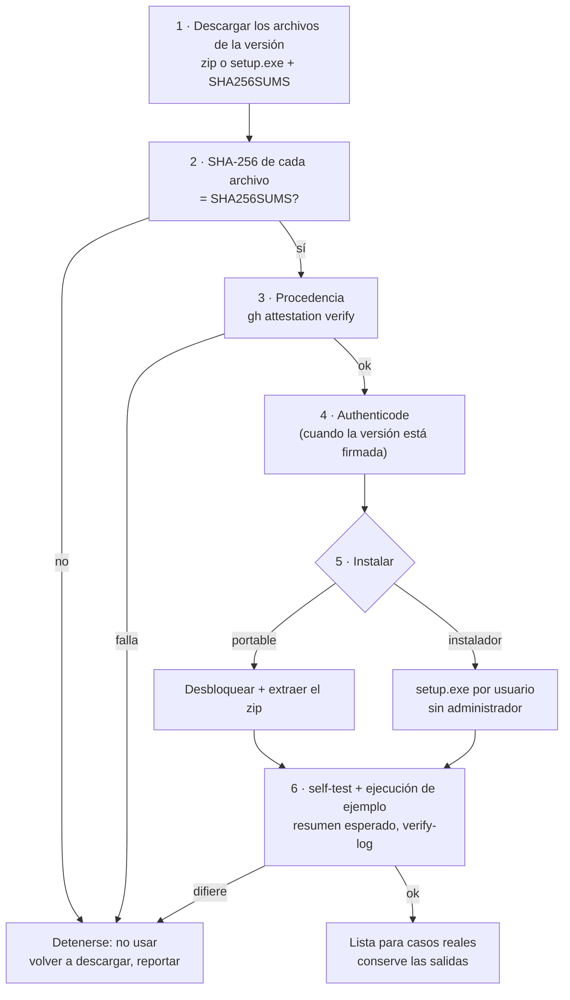

> La versión de referencia es la inglesa ([installation.md](installation.md)); esta traducción la sigue.

# Instalación y verificación (Windows 10/11)

RV HashInv se ejecuta **localmente** en el equipo Windows 10 u 11 (x64) del perito. No necesita derechos de
administrador, ni entorno de ejecución (runtime de C estático), ni red, salvo para el sello de tiempo RFC 3161
opcional y la verificación opcional de versiones. Esta página cubre: obtener una versión, **probar que es la
compilación auténtica**, instalarla (zip portable o instalador por usuario), el self-test de la primera ejecución, el
uso sin red, la compilación desde el código fuente para auditores, dónde quedan los archivos y la desinstalación.

Por qué importa la verificación: un tribunal puede preguntar cómo sabe usted que el programa que ejecutó es aquel cuyo
código fuente revisó un experto. Los pasos 2–4 y 6 dan esa respuesta; conserve su salida en el expediente del caso
([admissibility.md](admissibility.md#examiner-checklist-before-filing-a-report), paso 3, en inglés).



## Requisitos

| Elemento | Requisito |
| --- | --- |
| Sistema operativo | Windows 10 u 11, x64 (`MinVersion=10.0`, `ArchitecturesAllowed=x64compatible` en el instalador). Linux/macOS: compilar desde el código fuente. |
| Derechos | Usuario estándar. El instalador es por usuario (`PrivilegesRequired=lowest`). |
| Disco | Los dos ejecutables y la documentación (unos pocos MB); las salidas necesitan unos 11 archivos de informe por elemento para un idioma (19 con `--lang all`) más los logs. |
| Memoria | Los archivos se leen en bloques de 1 MiB: el uso de memoria no crece con el tamaño del archivo. |
| Gráficos | Ninguno: la GUI también funciona en máquinas virtuales sin controlador de GPU (renderizado por software). |
| Red | Ninguna, salvo la solicitud opcional de sello de tiempo (ver el [paso 7](#7-uso-sin-red-y-en-equipos-aislados)). |
| Verificación de versiones | Opcional, solo aviso: la aplicación de escritorio al arrancar y `rv-hashinv update-check` leen la página pública de la última versión en github.com ([Verificación de versiones](#verificación-de-versiones)); `RV_NO_UPDATE_CHECK=1` la desactiva. |

## 1. Descarga

Archivos de la versión en la página GitHub Releases del repositorio (`Panacota96/rv-hashinv`):

| Archivo | Qué es |
| --- | --- |
| `rv-hashinv-X.Y.Z-windows-x64.zip` | Portable: `rv-hashinv.exe`, `rv-hashinv-gui.exe`, README, LICENSE, COMMERCIAL.md, NOTICE, CHANGELOG, `docs/`, `examples/` |
| `rv-hashinv-X.Y.Z-windows-x64-setup.exe` | Instalador Inno Setup, por usuario |
| `SHA256SUMS` | SHA-256 del zip, del instalador y del SBOM (formato `sha256sum`: `<hash>  ./<archivo>`) |
| `sbom.cdx.json` | Lista de materiales de software CycloneDX (cada dependencia Rust y su versión) |

Póngalos en una carpeta, p. ej. `C:\Rakvor\downloads\rv-hashinv-0.1.0\`.

## 2. Verificar la descarga

```powershell
cd C:\Rakvor\downloads\rv-hashinv-0.1.0
Get-Content .\SHA256SUMS | ForEach-Object {
    $hash, $name = $_ -split '\s+', 2
    $name = $name.TrimStart('*').Replace('./', '')
    if (Test-Path $name) {
        $actual = (Get-FileHash -Algorithm SHA256 $name).Hash.ToLower()
        if ($actual -eq $hash) { "OK    $name" } else { "FAIL  $name  (got $actual)" }
    } else { "skip  $name (not downloaded)" }
}
```

```bash
sha256sum -c --ignore-missing SHA256SUMS      # Linux, or Git Bash on Windows
```

Cada archivo descargado debe imprimir `OK`. `SHA256SUMS` lo produce el mismo flujo de trabajo y no está atestado él
mismo: el paso 3 es la verificación más fuerte.

## 3. Verificar la procedencia de la compilación

Cada zip e instalador lleva una atestación de procedencia de compilación de GitHub (`actions/attest-build-provenance`):
una declaración firmada de que ese archivo exacto lo compiló el flujo de publicación del repositorio a partir de un
commit dado. En un equipo con acceso a internet y la CLI de GitHub:

```powershell
gh attestation verify .\rv-hashinv-0.1.0-windows-x64.zip --repo Panacota96/rv-hashinv
gh attestation verify .\rv-hashinv-0.1.0-windows-x64-setup.exe --repo Panacota96/rv-hashinv
```

La salida nombra el flujo de trabajo (`.github/workflows/release.yml`) y el commit de origen; anote ambos. Para un
laboratorio aislado, verifique en un equipo conectado y lleve los archivos verificados en un soporte protegido contra
escritura (la CLI de GitHub también puede descargar el paquete de atestación y la raíz de confianza para
verificaciones sin red; ver `gh attestation verify --help`). `SHA256SUMS` y el SBOM no están atestados.

## 4. Verificar la firma Authenticode (versiones firmadas)

El flujo de publicación firma `rv-hashinv.exe`, `rv-hashinv-gui.exe` y el instalador **solo cuando hay un
certificado de firma de código configurado** para el repositorio. Las versiones se firman con el certificado de firma
de código **interno** de Rakvor ("Rakvor Code Signing (internal)", emitido por "Rakvor Internal Code Signing Root
CA"). No es un certificado público: Windows solo confía en él en los equipos donde está instalada la raíz de Rakvor
(los portátiles de Rakvor, ya que la herramienta se usa localmente y no se distribuye). Auditores y clientes
verifican las versiones con los pasos 2–3 y pueden inspeccionar la firma con la huella de la raíz que figura abajo.

Instale la raíz una vez por equipo Rakvor (PowerShell como el usuario que ejecuta la herramienta; el archivo es
`packaging/signing/rakvor-code-signing-root.cer` en el repositorio):

```powershell
# Check the fingerprint first — it must be exactly:
#   SHA-256 DC9BA1A2FCD4F0633C5214B7CCEB25BED8F3F7D9EBAF111590250CBCAA83DF60
(New-Object System.Security.Cryptography.X509Certificates.X509Certificate2 .\rakvor-code-signing-root.cer).GetCertHashString([System.Security.Cryptography.HashAlgorithmName]::SHA256)
Import-Certificate -FilePath .\rakvor-code-signing-root.cer -CertStoreLocation Cert:\CurrentUser\Root
```

Windows muestra un cuadro de confirmación para la nueva raíz; acéptelo solo si la huella coincidió. Sin la raíz,
`Get-AuthenticodeSignature` informa `UnknownError` (cadena hacia una raíz no confiable) y SmartScreen puede advertir
igualmente en la primera ejecución. Verifique:

```powershell
Get-AuthenticodeSignature .\rv-hashinv-0.1.0-windows-x64-setup.exe |
    Format-List Status, StatusMessage, SignerCertificate, TimeStamperCertificate
# after extracting the zip:
Get-AuthenticodeSignature .\rv-hashinv.exe, .\rv-hashinv-gui.exe | Format-Table Status, Path
```

| Estado | Significado |
| --- | --- |
| `Valid` | Firmado e intacto; el firmante debe ser "Rakvor Code Signing (internal)" |
| `UnknownError` | Firmado, pero la raíz de Rakvor no está instalada en este equipo (instálela como arriba) |
| `NotSigned` | La versión se compiló sin certificado de firma: apóyese en los pasos 2–3; Windows SmartScreen advertirá |
| `HashMismatch` / otro | Deténgase: el archivo fue alterado después de firmarse |

Con el Windows SDK, `signtool verify /pa /v rv-hashinv.exe` da la cadena completa.

## 5. Instalar

### 5a. Zip portable

```powershell
# only after steps 2–4
Unblock-File .\rv-hashinv-0.1.0-windows-x64.zip
Expand-Archive .\rv-hashinv-0.1.0-windows-x64.zip -DestinationPath C:\Rakvor\tools\rv-hashinv-0.1.0
cd C:\Rakvor\tools\rv-hashinv-0.1.0
.\rv-hashinv.exe --version
```

Conserve una carpeta por versión para poder volver a ejecutar un caso antiguo con la versión exacta registrada en su
`environment.json`. Opcional, solo para la sesión actual: `$env:Path += ";C:\Rakvor\tools\rv-hashinv-0.1.0"`.

### 5b. Instalador (por usuario, sin administrador)

Haga doble clic en `rv-hashinv-X.Y.Z-windows-x64-setup.exe` (asistente en inglés, español o francés). Instala en
`%LOCALAPPDATA%\Programs\Rakvor\RV HashInv\`, crea un grupo *Rakvor* en el menú Inicio (aplicación + documentación) y
ofrece dos tareas: **Add the rv-hashinv command to PATH** (PATH del usuario, marcada en la primera instalación) y un
icono en el escritorio. Abra luego una terminal **nueva** para que el PATH se aplique.

Sin intervención:

```powershell
.\rv-hashinv-0.1.0-windows-x64-setup.exe /VERYSILENT /SUPPRESSMSGBOXES /NORESTART /TASKS="addtopath"
```

El instalador copia los ejecutables, README, LICENSE, COMMERCIAL.md, NOTICE, CHANGELOG, `docs\` y la evidencia de
ejemplo (`examples\sample\evidence\`), no los scripts de ejemplo ni `expected_hashes.csv` (que están en el zip y en el
árbol de fuentes).

<!-- forge:domain -->
### 5c. Bibliotecas nativas

Ninguna. RV HashInv son dos ejecutables autónomos: el hash, el generador de PDF, el cliente RFC 3161 y el firmante CMS
están compilados dentro (crates Rust puras, listadas en el SBOM), y el runtime de C se enlaza estáticamente
(`.cargo/config.toml`). No hay ninguna DLL que verificar ni que mantener junto a los ejecutables.
<!-- /forge:domain -->

## 6. Self-test de la primera ejecución y ejemplo

```powershell
rv-hashinv --version
rv-hashinv self-test
```

`self-test` imprime `PASS` para md5, sha1, sha256, sha512, sha3-256 y blake3 (respuestas conocidas para `"abc"`), con
código de salida 0. Solo prueba las implementaciones de hash. Después ejecute el ejemplo sintético, que pone a prueba
la detección de tipos, los duplicados, los informes y la cadena de auditoría:

```powershell
# portable zip (script included): self-test, sample scan, verify-log, hashes.csv vs expected_hashes.csv
.\examples\sample\run.ps1 -Bin .\rv-hashinv.exe

# installer (no script installed): run it by hand into a temporary folder
$app = "$env:LOCALAPPDATA\Programs\Rakvor\RV HashInv"
$out = Join-Path $env:TEMP "rv-hashinv-check"
rv-hashinv scan -i "$app\examples\sample\evidence" --hash sha256,md5 --out $out --progress none --no-timestamp
$LASTEXITCODE                                  # 0
rv-hashinv verify-log (Get-ChildItem "$out\logs" | Select-Object -Last 1).FullName   # OK … chain intact
```

<!-- forge:domain -->
Resumen esperado: **3 elementos, 0 errores, hallazgos high 0, medium 1, low 0, info 2**, código de salida 0 (un
`EXTENSION_MISMATCH` para `foto-vacaciones.jpg`, un par `DUPLICATE` `acta.txt` / `acta-copia.txt`). La columna SHA-256
de `hashes.csv` debe ser igual a `examples\sample\expected_hashes.csv` (calculado de forma independiente con Python):

| Archivo | Tamaño | SHA-256 |
| --- | --: | --- |
| `acta-copia.txt` | 61 | `80e089ad6704c831e386b430adf92c5f5b72ec4428566d3580660e103c183c3c` |
| `acta.txt` | 61 | `80e089ad6704c831e386b430adf92c5f5b72ec4428566d3580660e103c183c3c` |
| `foto-vacaciones.jpg` | 112 | `42503ebb0f9892b30b72e11cfa0cbf5bcb5d60f667d611fa9598c9b4e835c643` |

`run.ps1` / `run.sh` hacen esta comparación por sí mismos: leen el `logs\<RUN-ID>\hashes.csv` de la herramienta y
comparan tamaño, SHA-256 y MD5 de cada archivo con `expected_hashes.csv`, imprimen
`hashes.csv matches expected_hashes.csv (3 files: size, SHA-256, MD5)` y terminan con salida 3 ante cualquier
diferencia. Para el instalador (sin script instalado), compare la tabla de arriba con `$out\logs\<RUN-ID>\hashes.csv`,
o ejecute `python tests\verify_chain.py <carpeta de logs>` desde el árbol de fuentes, que vuelve a calcular el hash de
cada archivo de `hashes.csv` y de cada salida registrada en el log de auditoría.
<!-- /forge:domain -->

Conserve la salida de la consola y la carpeta de la ejecución como registro de esta verificación.

## 7. Uso sin red y en equipos aislados

Además de la verificación opcional de versiones ([Verificación de versiones](#verificación-de-versiones)), el **único**
acceso a la red en el código es la solicitud de sello de tiempo RFC 3161 (un HTTP POST de un hash de 32 bytes a la
TSA, [src/core/src/trust.rs](../src/core/src/trust.rs)). No hay telemetría ni verificación de licencia.

| Para desactivar el sello de tiempo | Cómo |
| --- | --- |
| Una ejecución de la CLI | `--no-timestamp` |
| Todas las ejecuciones de la CLI en este equipo / sesión | `$env:RV_NO_TIMESTAMP = "1"` (o defínala como variable de entorno del usuario) |
| GUI | desmarque **4. Confianza → Sello de tiempo confiable** antes de *Iniciar revisión* |

Una ejecución sin red con el sello de tiempo activado termina igualmente: registra `timestamp_pending` y el informe
estadístico muestra una advertencia. Más tarde, en un equipo que pueda llegar a la TSA, ejecute
`rv-hashinv timestamp <carpeta de logs>` (vuelve a verificar la cadena y luego agrega `timestamp_obtained`). Para usar
una TSA interna o cualificada, indique `--tsa-url` (ver
[admissibility.md](admissibility.md#53-eidas--regulation-eu-9102014-as-amended-by-eu-20241183)). El sistema operativo
no impone la restricción de red; en un equipo conectado, una regla de salida del Firewall de Windows para
`rv-hashinv.exe` / `rv-hashinv-gui.exe` que solo permita el servidor de la TSA la impone.

## 8. Compilar desde el código fuente para auditores

### Cadena de herramientas

| Elemento | Versión |
| --- | --- |
| Rust | Fijada por [rust-toolchain.toml](../rust-toolchain.toml): **1.97.0** con rustfmt y clippy; `rustup` la instala y la selecciona automáticamente dentro del árbol de fuentes. `Cargo.toml` declara `rust-version = "1.88"` (edición 2024) como mínimo. Para coincidir exactamente con una versión publicada, use el compilador registrado en el `environment.json` de esa versión → `tool.rustc` (p. ej. `rustc 1.97.0 (2d8144b78 2026-07-07)`). |
| Enlazador de Windows | Visual Studio 2022 Build Tools, carga de trabajo *Desktop development with C++* (MSVC + Windows SDK); destino `x86_64-pc-windows-msvc`. El CRT estático se define en `.cargo/config.toml`. |
| Linux | No hacen falta paquetes del sistema para compilar la CLI. |
| Opcional | Python 3.12 con `blake3 jsonschema pyhanko` para los verificadores independientes y las pruebas de confianza (`RV_TEST_PYTHON=python`). |

### Compilación

```powershell
git clone https://github.com/Panacota96/rv-hashinv.git
cd rv-hashinv
git checkout v0.1.0                       # the tag of the release under review
rustc --version                           # must print the pinned 1.97.0
cargo build --release --locked -p rv-hashinv-cli -p rv-hashinv-gui
.\target\release\rv-hashinv.exe self-test
.\examples\sample\run.ps1 -Bin .\target\release\rv-hashinv.exe
cargo test --workspace --locked            # unit + integration tests (trust tests skip without pyhanko)
```

```bash
# Linux
cargo build --release --locked -p rv-hashinv-cli
target/release/rv-hashinv self-test && examples/sample/run.sh target/release/rv-hashinv
python3 tests/verify_chain.py examples/sample/out/logs/$(ls examples/sample/out/logs | tail -n 1)
# cross-profile: a case folder written by the Python profile must verify with this build
python3 tests/golden/unpack.py tests/golden/case-by-python.zip.b64 /tmp/golden
target/release/rv-hashinv verify-case /tmp/golden/CASE-GOLDEN
```

`--locked` se niega a compilar si `Cargo.lock` tuviera que cambiar, así que el conjunto de dependencias es igual al
listado en `environment.json` → `dependencies` y en `sbom.cdx.json`. La versión del producto viene de `version.txt`;
las versiones de las crates en `Cargo.toml` no cambian, así que una versión nunca modifica el archivo de bloqueo.

### Reproducir los hashes de una versión

Sea preciso sobre lo que puede y no puede coincidir bit a bit en esta versión (brecha G22):

| Artefacto | ¿Idéntico bit a bit a la versión publicada? | Cómo verificarlo |
| --- | --- | --- |
| Archivos de `docs/`, `examples/` | Sí (desde git; finales de línea LF salvo `*.ps1`, `*.iss`) | `git ls-files` + `Get-FileHash` frente al zip extraído |
| `rv-hashinv.exe`, `rv-hashinv-gui.exe` | **No garantizado**: las rutas no se reasignan y la cabecera PE lleva datos del momento del enlace. El compilador es el fijado en `rust-toolchain.toml` (ambos flujos ejecutan `rustup toolchain install`, que lee ese archivo; confírmelo con `environment.json` → `tool.rustc` de una ejecución de la versión) | La atestación de procedencia (paso 3) vincula el binario publicado al flujo de trabajo y al commit; luego compare el comportamiento (abajo) |
| zip, instalador | No (marcas de tiempo del archivo comprimido) | Atestación (paso 3) |

**Equivalencia funcional**: ejecute el ejemplo con el binario publicado y con su compilación, y luego compare los
hashes y los hallazgos de cada elemento:

```bash
python - "<release-out>/reports/<RUN-ID>" "<your-out>/reports/<RUN-ID>" <<'EOF'
import glob, json, sys
def load(run):
    out = {}
    for p in sorted(glob.glob(f"{run}/items/*/technical.json")):
        t = json.load(open(p, encoding="utf-8"))
        out[t["item"]["file_name"]] = (t["hashes"], t["item"]["detected_type"],
                                       [(f["code"], f["severity"], f["params"]) for f in t["findings"]])
    return out
a, b = load(sys.argv[1]), load(sys.argv[2])
print("identical findings and digests" if a == b else "DIFFERENT: " + ", ".join(k for k in a if a.get(k) != b.get(k)))
EOF
```

El mismo script compara esta compilación con el perfil Python de la herramienta (medido idéntico con el ejemplo).

## 9. Dónde quedan las cosas

| Qué | Ubicación |
| --- | --- |
| Programa (instalador) | `%LOCALAPPDATA%\Programs\Rakvor\RV HashInv\` (`rv-hashinv.exe`, `rv-hashinv-gui.exe`, `docs\`, `examples\sample\evidence\`, `unins000.exe`) |
| Programa (portable) | la carpeta que extrajo |
| Entrada del PATH (tarea del instalador) | variable de entorno del usuario `Path` (`HKCU\Environment`) |
| Salidas de las ejecuciones | `--out` (por defecto `.\rakvor-out` **relativo a la carpeta actual**): `logs\<RUN-ID>\`, `reports\<RUN-ID>\`. Con `--case-dir`: `<CASE>\runs\rv-hashinv\<RUN-ID>\`. La GUI usa su campo *Carpeta de salida* (o la carpeta del caso) |
| Carpeta del caso | donde la cree con `--case-dir` (`case.json`, `case-log.jsonl`, `evidence\`, `runs\`) |
| Ajustes de la GUI | no se guardan: cada inicio usa los valores por defecto; cada cambio hecho antes de una ejecución se registra en el log de auditoría de esa ejecución (`ui_*`) |
| Certificado de firma | donde usted lo guarde; solo se registran su ruta, su sujeto y su huella SHA-256, nunca la contraseña |
| Datos locales, cachés, archivos temporales | ninguno |

## 10. Desinstalar

- **Instalador:** *Configuración → Aplicaciones → Aplicaciones instaladas → RV HashInv → Desinstalar*, o ejecute
  `"%LOCALAPPDATA%\Programs\Rakvor\RV HashInv\unins000.exe"`. Quita los archivos instalados y los accesos directos.
  **La entrada del PATH del usuario no se quita** en esta versión; quítela con:

  ```powershell
  $dir = "$env:LOCALAPPDATA\Programs\Rakvor\RV HashInv"
  $p = [Environment]::GetEnvironmentVariable("Path", "User").Split(";") | Where-Object { $_ -and $_ -ne $dir }
  [Environment]::SetEnvironmentVariable("Path", ($p -join ";"), "User")
  ```

- **Portable:** borre la carpeta.
- **Se conservan a propósito** (en ambos casos): las salidas de las ejecuciones y las carpetas de caso (material del
  caso). Conserve el zip de la versión y `SHA256SUMS` de cada versión usada en un caso, para poder volver a ejecutarlo.

## 11. Problemas de instalación

| Síntoma | Causa y solución |
| --- | --- |
| SmartScreen "Windows protegió su PC" (editor desconocido) | SmartScreen juzga un archivo por la **reputación** de un certificado de confianza pública; la raíz interna de Rakvor no lo es, así que la advertencia aparece incluso cuando la firma es `Valid` (y siempre cuando es `NotSigned`). Solo después de pasar los pasos 2–4: *Más información → Ejecutar de todas formas*, o quite antes la marca de archivo descargado con `Unblock-File .\<archivo>` (hágalo sobre el zip **antes** de extraerlo). Solo desaparece del todo con un certificado público (ver `docs/release-process.md` §5). |
| `rv-hashinv` no se reconoce | No se eligió la tarea del PATH, o la terminal se abrió antes de instalar: abra una terminal nueva o use la ruta completa. |
| `self-test` imprime `FAIL` | No use esta compilación para evidencia; vuelva a descargar y repita los pasos 2–4. |
| El resumen del ejemplo difiere del paso 6 | Versión equivocada o archivos de ejemplo modificados; compare `environment.json` con las notas de la versión y los hashes del ejemplo con `expected_hashes.csv`. |
| Ventana de la GUI en blanco o muy lenta en una máquina virtual | Sin controlador de GPU se usa el renderizado por software; asigne más CPU a la máquina virtual. |
| La compilación desde el código fuente descarga otro compilador | Es lo esperado: rustup instala la 1.97.0 fijada en `rust-toolchain.toml`. Sin red, instálela antes (`rustup toolchain install 1.97.0 --profile minimal`). |

## Verificación de versiones

¿Hay una versión más reciente publicada? La herramienta puede decírselo; nunca se actualiza sola.

| | |
| --- | --- |
| Cuándo | La aplicación de escritorio verifica una vez al arrancar, en segundo plano (solo aparece un aviso con la página de la versión cuando hay una más reciente). La CLI solo verifica con `rv-hashinv update-check` (`--json` para scripts; salida 0 = última, 3 = versión más reciente, 1 = no se pudo verificar). Ningún otro comando contacta la red para esto. RV Hub verifica cada herramienta que lista. |
| Qué se envía | Un HTTPS GET de `https://github.com/Panacota96/rv-hashinv/releases/latest` (se lee la redirección, no se sigue) con `User-Agent: rv-hashinv/<version>` y ninguna otra cabecera, cookie ni parámetro: nada sobre el caso, la evidencia, el perito ni el equipo. |
| Qué hace | Nombra la versión más reciente y su página. Nunca descarga ni instala nada: descargue la versión y verifíquela (`SHA256SUMS`, cadena Authenticode hasta la raíz de Rakvor) como en [Verificar la descarga](#2-verificar-la-descarga) antes de usarla. |
| Auditoría | La verificación no forma parte de una ejecución y no se escribe en ningún log de auditoría; una verificación fallida o lenta (sin red, límite de 5 s) nunca bloquea la herramienta. |
| Desactivarla | `RV_NO_UPDATE_CHECK=1` (cualquier valor salvo vacío o `0`), o el archivo `update-check-off` en `%APPDATA%\Rakvor` (lo escribe el ajuste de RV Hub): desactivada para toda herramienta Rakvor en este equipo. |
| Código | [src/core/src/update.rs](../src/core/src/update.rs) (compartido, idéntico byte a byte, en toda herramienta Rakvor) |
