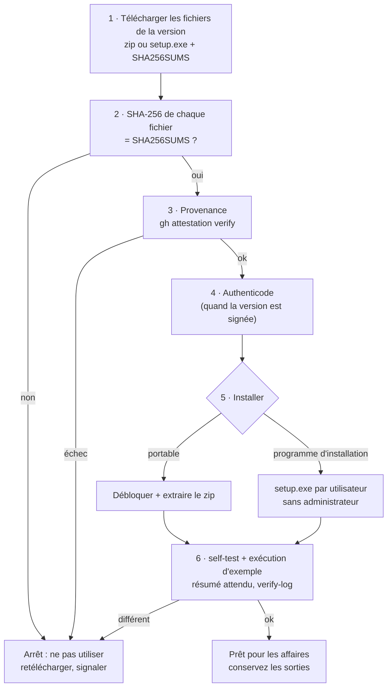

> La version de référence est la version anglaise ([installation.md](installation.md)) ; cette traduction la suit.

# Installation et vérification (Windows 10/11)

RV HashInv s'exécute **localement** sur le poste Windows 10 ou 11 (x64) de l'expert. Il ne demande ni droits
d'administrateur, ni environnement d'exécution (runtime C statique), ni réseau, sauf pour l'horodatage RFC 3161
facultatif et la vérification facultative des versions. Cette page couvre : obtenir une version, **prouver qu'il
s'agit de la compilation authentique**, l'installer (zip portable ou programme d'installation par utilisateur), le
self-test au premier lancement, l'usage hors ligne, la compilation à partir des sources pour les auditeurs,
l'emplacement des fichiers et la désinstallation.

Pourquoi la vérification compte : un tribunal peut demander comment vous savez que le programme exécuté est celui
dont un expert a examiné le code source. Les étapes 2–4 et 6 apportent cette réponse ; conservez leur sortie au
dossier ([admissibility.md](admissibility.md#examiner-checklist-before-filing-a-report), étape 3, en anglais).



## Prérequis

| Élément | Exigence |
| --- | --- |
| Système d'exploitation | Windows 10 ou 11, x64 (`MinVersion=10.0`, `ArchitecturesAllowed=x64compatible` dans le programme d'installation). Linux/macOS : compiler à partir des sources. |
| Droits | Utilisateur standard. Le programme d'installation est par utilisateur (`PrivilegesRequired=lowest`). |
| Disque | Les deux exécutables et la documentation (quelques Mo) ; les sorties demandent environ 11 fichiers de rapport par élément pour une langue (19 avec `--lang all`) plus les journaux. |
| Mémoire | Les fichiers sont lus par blocs de 1 Mio : la mémoire utilisée ne croît pas avec la taille du fichier. |
| Graphisme | Aucun prérequis : la GUI fonctionne aussi sur des machines virtuelles sans pilote GPU (rendu logiciel). |
| Réseau | Aucun, sauf la demande facultative d'horodatage (voir l'[étape 7](#7-usage-hors-ligne-et-sur-poste-isolé)). |
| Vérification des versions | Facultative, simple avertissement : l'application de bureau au démarrage et `rv-hashinv update-check` lisent la page publique de la dernière version sur github.com ([Vérification des versions](#vérification-des-versions)) ; `RV_NO_UPDATE_CHECK=1` la désactive. |

## 1. Téléchargement

Fichiers de la version sur la page GitHub Releases du dépôt (`Panacota96/rv-hashinv`) :

| Fichier | Ce que c'est |
| --- | --- |
| `rv-hashinv-X.Y.Z-windows-x64.zip` | Portable : `rv-hashinv.exe`, `rv-hashinv-gui.exe`, README, LICENSE, COMMERCIAL.md, NOTICE, CHANGELOG, `docs/`, `examples/` |
| `rv-hashinv-X.Y.Z-windows-x64-setup.exe` | Programme d'installation Inno Setup, par utilisateur |
| `SHA256SUMS` | SHA-256 du zip, du programme d'installation et du SBOM (format `sha256sum` : `<empreinte>  ./<fichier>`) |
| `sbom.cdx.json` | Nomenclature logicielle CycloneDX (chaque dépendance Rust et sa version) |

Placez-les dans un même dossier, p. ex. `C:\Rakvor\downloads\rv-hashinv-0.1.0\`.

## 2. Vérifier le téléchargement

```powershell
cd C:\Rakvor\downloads\rv-hashinv-0.1.0
Get-Content .\SHA256SUMS | ForEach-Object {
    $hash, $name = $_ -split '\s+', 2
    $name = $name.TrimStart('*').Replace('./', '')
    if (Test-Path $name) {
        $actual = (Get-FileHash -Algorithm SHA256 $name).Hash.ToLower()
        if ($actual -eq $hash) { "OK    $name" } else { "FAIL  $name  (got $actual)" }
    } else { "skip  $name (not downloaded)" }
}
```

```bash
sha256sum -c --ignore-missing SHA256SUMS      # Linux, or Git Bash on Windows
```

Chaque fichier téléchargé doit afficher `OK`. `SHA256SUMS` est produit par le même workflow et n'est pas lui-même
attesté : l'étape 3 est le contrôle le plus fort.

## 3. Vérifier la provenance de la compilation

Chaque zip et programme d'installation porte une attestation de provenance de compilation GitHub
(`actions/attest-build-provenance`) : une déclaration signée indiquant que ce fichier précis a été compilé par le
workflow de publication du dépôt à partir d'un commit donné. Sur un poste connecté à internet, avec la CLI GitHub :

```powershell
gh attestation verify .\rv-hashinv-0.1.0-windows-x64.zip --repo Panacota96/rv-hashinv
gh attestation verify .\rv-hashinv-0.1.0-windows-x64-setup.exe --repo Panacota96/rv-hashinv
```

La sortie nomme le workflow (`.github/workflows/release.yml`) et le commit source ; notez les deux. Pour un
laboratoire isolé, vérifiez sur un poste connecté et transportez les fichiers vérifiés sur un support protégé en
écriture (la CLI GitHub peut aussi télécharger le paquet d'attestation et la racine de confiance pour des contrôles
hors ligne ; voir `gh attestation verify --help`). `SHA256SUMS` et le SBOM ne sont pas attestés.

## 4. Vérifier la signature Authenticode (versions signées)

Le workflow de publication signe `rv-hashinv.exe`, `rv-hashinv-gui.exe` et le programme d'installation **uniquement
lorsqu'un certificat de signature de code est configuré** pour le dépôt. Les versions sont signées avec le certificat
de signature de code **interne** de Rakvor (« Rakvor Code Signing (internal) », émis par « Rakvor Internal Code Signing
Root CA »). Ce n'est pas un certificat public : Windows ne lui fait confiance que sur les postes où la racine Rakvor
est installée (les ordinateurs portables de Rakvor, puisque l'outil est utilisé localement et n'est pas distribué).
Les auditeurs et les clients vérifient les versions avec les étapes 2–3 et peuvent inspecter la signature avec
l'empreinte de la racine ci-dessous.

Installez la racine une fois par poste Rakvor (PowerShell, en tant qu'utilisateur qui exécute l'outil ; le fichier est
`packaging/signing/rakvor-code-signing-root.cer` dans le dépôt) :

```powershell
# Check the fingerprint first — it must be exactly:
#   SHA-256 DC9BA1A2FCD4F0633C5214B7CCEB25BED8F3F7D9EBAF111590250CBCAA83DF60
(New-Object System.Security.Cryptography.X509Certificates.X509Certificate2 .\rakvor-code-signing-root.cer).GetCertHashString([System.Security.Cryptography.HashAlgorithmName]::SHA256)
Import-Certificate -FilePath .\rakvor-code-signing-root.cer -CertStoreLocation Cert:\CurrentUser\Root
```

Windows affiche une boîte de confirmation pour la nouvelle racine ; acceptez-la uniquement si l'empreinte correspond.
Sans la racine, `Get-AuthenticodeSignature` indique `UnknownError` (chaîne vers une racine non approuvée) et
SmartScreen peut quand même avertir au premier lancement. Vérifiez :

```powershell
Get-AuthenticodeSignature .\rv-hashinv-0.1.0-windows-x64-setup.exe |
    Format-List Status, StatusMessage, SignerCertificate, TimeStamperCertificate
# after extracting the zip:
Get-AuthenticodeSignature .\rv-hashinv.exe, .\rv-hashinv-gui.exe | Format-Table Status, Path
```

| Statut | Signification |
| --- | --- |
| `Valid` | Signé et intact ; le signataire doit être « Rakvor Code Signing (internal) » |
| `UnknownError` | Signé, mais la racine Rakvor n'est pas installée sur ce poste (installez-la comme ci-dessus) |
| `NotSigned` | La version a été compilée sans certificat de signature : appuyez-vous sur les étapes 2–3 ; Windows SmartScreen avertira |
| `HashMismatch` / autre | Arrêtez : le fichier a été modifié après sa signature |

Avec le Windows SDK, `signtool verify /pa /v rv-hashinv.exe` donne la chaîne complète.

## 5. Installer

### 5a. Zip portable

```powershell
# only after steps 2–4
Unblock-File .\rv-hashinv-0.1.0-windows-x64.zip
Expand-Archive .\rv-hashinv-0.1.0-windows-x64.zip -DestinationPath C:\Rakvor\tools\rv-hashinv-0.1.0
cd C:\Rakvor\tools\rv-hashinv-0.1.0
.\rv-hashinv.exe --version
```

Gardez un dossier par version, afin de pouvoir relancer une ancienne affaire avec la version exacte consignée dans son
`environment.json`. Facultatif, pour la session en cours seulement : `$env:Path += ";C:\Rakvor\tools\rv-hashinv-0.1.0"`.

### 5b. Programme d'installation (par utilisateur, sans administrateur)

Double-cliquez sur `rv-hashinv-X.Y.Z-windows-x64-setup.exe` (assistant en anglais, espagnol ou français). Il installe
dans `%LOCALAPPDATA%\Programs\Rakvor\RV HashInv\`, crée un groupe *Rakvor* dans le menu Démarrer (application +
documentation) et propose deux tâches : **Add the rv-hashinv command to PATH** (PATH de l'utilisateur, cochée à la
première installation) et une icône sur le bureau. Ouvrez ensuite un **nouveau** terminal pour que le PATH s'applique.

Sans intervention :

```powershell
.\rv-hashinv-0.1.0-windows-x64-setup.exe /VERYSILENT /SUPPRESSMSGBOXES /NORESTART /TASKS="addtopath"
```

Le programme d'installation copie les exécutables, README, LICENSE, COMMERCIAL.md, NOTICE, CHANGELOG, `docs\` et les
éléments d'exemple (`examples\sample\evidence\`), mais pas les scripts d'exemple ni `expected_hashes.csv` (présents
dans le zip et dans l'arborescence des sources).

<!-- forge:domain -->
### 5c. Bibliothèques natives

Aucune. RV HashInv se compose de deux exécutables autonomes : le hachage, le générateur de PDF, le client RFC 3161 et
le signataire CMS sont compilés à l'intérieur (crates Rust pures, listées dans le SBOM), et le runtime C est lié
statiquement (`.cargo/config.toml`). Il n'y a aucune DLL à vérifier ni à garder à côté des exécutables.
<!-- /forge:domain -->

## 6. Self-test au premier lancement et exemple

```powershell
rv-hashinv --version
rv-hashinv self-test
```

`self-test` affiche `PASS` pour md5, sha1, sha256, sha512, sha3-256 et blake3 (réponses connues pour `"abc"`), avec
le code de sortie 0. Il ne teste que les implémentations d'empreinte. Lancez ensuite l'exemple synthétique, qui
exerce la détection de type, les doublons, les rapports et la chaîne d'audit :

```powershell
# portable zip (script included): self-test, sample scan, verify-log, hashes.csv vs expected_hashes.csv
.\examples\sample\run.ps1 -Bin .\rv-hashinv.exe

# installer (no script installed): run it by hand into a temporary folder
$app = "$env:LOCALAPPDATA\Programs\Rakvor\RV HashInv"
$out = Join-Path $env:TEMP "rv-hashinv-check"
rv-hashinv scan -i "$app\examples\sample\evidence" --hash sha256,md5 --out $out --progress none --no-timestamp
$LASTEXITCODE                                  # 0
rv-hashinv verify-log (Get-ChildItem "$out\logs" | Select-Object -Last 1).FullName   # OK … chain intact
```

<!-- forge:domain -->
Résumé attendu : **3 éléments, 0 erreur, constatations high 0, medium 1, low 0, info 2**, code de sortie 0 (un
`EXTENSION_MISMATCH` pour `foto-vacaciones.jpg`, une paire `DUPLICATE` `acta.txt` / `acta-copia.txt`). La colonne
SHA-256 de `hashes.csv` doit être égale à `examples\sample\expected_hashes.csv` (calculé indépendamment avec Python) :

| Fichier | Taille | SHA-256 |
| --- | --: | --- |
| `acta-copia.txt` | 61 | `80e089ad6704c831e386b430adf92c5f5b72ec4428566d3580660e103c183c3c` |
| `acta.txt` | 61 | `80e089ad6704c831e386b430adf92c5f5b72ec4428566d3580660e103c183c3c` |
| `foto-vacaciones.jpg` | 112 | `42503ebb0f9892b30b72e11cfa0cbf5bcb5d60f667d611fa9598c9b4e835c643` |

`run.ps1` / `run.sh` font eux-mêmes cette comparaison : ils lisent le `logs\<RUN-ID>\hashes.csv` de l'outil et
comparent taille, SHA-256 et MD5 de chaque fichier avec `expected_hashes.csv`, affichent
`hashes.csv matches expected_hashes.csv (3 files: size, SHA-256, MD5)` et sortent avec le code 3 en cas de
différence. Pour le programme d'installation (aucun script installé), comparez le tableau ci-dessus avec
`$out\logs\<RUN-ID>\hashes.csv`, ou lancez `python tests\verify_chain.py <dossier des journaux>` depuis l'arborescence
des sources, qui recalcule l'empreinte de chaque fichier de `hashes.csv` et de chaque sortie consignée dans le journal
d'audit.
<!-- /forge:domain -->

Conservez la sortie de la console et le dossier de l'exécution comme trace de cette vérification.

## 7. Usage hors ligne et sur poste isolé

Outre la vérification facultative des versions ([Vérification des versions](#vérification-des-versions)), le **seul**
accès réseau dans le code est la demande d'horodatage RFC 3161 (un HTTP POST d'une empreinte de 32 octets vers la TSA,
[src/core/src/trust.rs](../src/core/src/trust.rs)). Il n'y a ni télémétrie ni contrôle de licence.

| Pour désactiver l'horodatage | Comment |
| --- | --- |
| Une exécution de la CLI | `--no-timestamp` |
| Toutes les exécutions de la CLI sur ce poste / cette session | `$env:RV_NO_TIMESTAMP = "1"` (ou définissez-la comme variable d'environnement de l'utilisateur) |
| GUI | décochez **4. Confiance → Horodatage qualifié** avant *Lancer l'analyse* |

Une exécution hors ligne avec l'horodatage activé se termine quand même : elle consigne `timestamp_pending` et le
rapport statistique affiche un avertissement. Plus tard, sur un poste qui peut joindre la TSA, lancez
`rv-hashinv timestamp <dossier des journaux>` (la commande revérifie la chaîne, puis ajoute `timestamp_obtained`).
Pour utiliser une TSA interne ou qualifiée, indiquez `--tsa-url` (voir
[admissibility.md](admissibility.md#53-eidas--regulation-eu-9102014-as-amended-by-eu-20241183)). Malgré le libellé
de la GUI, l'horodatage n'est qualifié au sens d'eIDAS que si l'adresse est celle d'un prestataire de services de
confiance qualifié (QTSP) inscrit sur une liste de confiance de l'UE ; l'adresse par défaut (DigiCert) ne l'est pas.
La restriction
réseau n'est pas imposée par le système ; sur un poste connecté, une règle sortante du pare-feu Windows pour
`rv-hashinv.exe` / `rv-hashinv-gui.exe` n'autorisant que le serveur de la TSA l'impose.

## 8. Compiler à partir des sources pour les auditeurs

### Chaîne d'outils

| Élément | Version |
| --- | --- |
| Rust | Fixée par [rust-toolchain.toml](../rust-toolchain.toml) : **1.97.0** avec rustfmt et clippy ; `rustup` l'installe et la sélectionne automatiquement dans l'arborescence des sources. `Cargo.toml` déclare `rust-version = "1.88"` (édition 2024) comme minimum. Pour reproduire exactement une version publiée, utilisez le compilateur consigné dans le `environment.json` de cette version → `tool.rustc` (p. ex. `rustc 1.97.0 (2d8144b78 2026-07-07)`). |
| Éditeur de liens Windows | Visual Studio 2022 Build Tools, charge de travail *Desktop development with C++* (MSVC + Windows SDK) ; cible `x86_64-pc-windows-msvc`. Le CRT statique est défini dans `.cargo/config.toml`. |
| Linux | Aucun paquet système n'est nécessaire pour compiler la CLI. |
| Facultatif | Python 3.12 avec `blake3 jsonschema pyhanko` pour les vérificateurs indépendants et les tests de confiance (`RV_TEST_PYTHON=python`). |

### Compilation

```powershell
git clone https://github.com/Panacota96/rv-hashinv.git
cd rv-hashinv
git checkout v0.1.0                       # the tag of the release under review
rustc --version                           # must print the pinned 1.97.0
cargo build --release --locked -p rv-hashinv-cli -p rv-hashinv-gui
.\target\release\rv-hashinv.exe self-test
.\examples\sample\run.ps1 -Bin .\target\release\rv-hashinv.exe
cargo test --workspace --locked            # unit + integration tests (trust tests skip without pyhanko)
```

```bash
# Linux
cargo build --release --locked -p rv-hashinv-cli
target/release/rv-hashinv self-test && examples/sample/run.sh target/release/rv-hashinv
python3 tests/verify_chain.py examples/sample/out/logs/$(ls examples/sample/out/logs | tail -n 1)
# cross-profile: a case folder written by the Python profile must verify with this build
python3 tests/golden/unpack.py tests/golden/case-by-python.zip.b64 /tmp/golden
target/release/rv-hashinv verify-case /tmp/golden/CASE-GOLDEN
```

`--locked` refuse de compiler si `Cargo.lock` devait changer : l'ensemble des dépendances est donc celui listé dans
`environment.json` → `dependencies` et dans `sbom.cdx.json`. La version du produit vient de `version.txt` ; les
versions des crates dans `Cargo.toml` restent fixes, si bien qu'une version publiée ne modifie jamais le fichier de
verrouillage.

### Reproduire les empreintes d'une version

Soyez précis sur ce qui peut ou non correspondre bit à bit dans cette version (lacune G22) :

| Artefact | Identique bit à bit à la version publiée ? | Comment le vérifier |
| --- | --- | --- |
| Fichiers de `docs/`, `examples/` | Oui (depuis git ; fins de ligne LF sauf `*.ps1`, `*.iss`) | `git ls-files` + `Get-FileHash` face au zip extrait |
| `rv-hashinv.exe`, `rv-hashinv-gui.exe` | **Non garanti** : les chemins ne sont pas réécrits et l'en-tête PE porte des données de l'édition de liens. Le compilateur est celui fixé dans `rust-toolchain.toml` (les deux workflows lancent `rustup toolchain install`, qui lit ce fichier ; confirmez avec `environment.json` → `tool.rustc` d'une exécution de la version) | L'attestation de provenance (étape 3) lie le binaire publié au workflow et au commit ; comparez ensuite le comportement (ci-dessous) |
| zip, programme d'installation | Non (horodatages de l'archive) | Attestation (étape 3) |

**Équivalence fonctionnelle** : lancez l'exemple avec le binaire publié et avec votre compilation, puis comparez les
empreintes et les constatations de chaque élément :

```bash
python - "<release-out>/reports/<RUN-ID>" "<your-out>/reports/<RUN-ID>" <<'EOF'
import glob, json, sys
def load(run):
    out = {}
    for p in sorted(glob.glob(f"{run}/items/*/technical.json")):
        t = json.load(open(p, encoding="utf-8"))
        out[t["item"]["file_name"]] = (t["hashes"], t["item"]["detected_type"],
                                       [(f["code"], f["severity"], f["params"]) for f in t["findings"]])
    return out
a, b = load(sys.argv[1]), load(sys.argv[2])
print("identical findings and digests" if a == b else "DIFFERENT: " + ", ".join(k for k in a if a.get(k) != b.get(k)))
EOF
```

Le même script compare cette compilation avec le profil Python de l'outil (mesuré identique sur l'exemple).

## 9. Emplacement des fichiers

| Quoi | Emplacement |
| --- | --- |
| Programme (programme d'installation) | `%LOCALAPPDATA%\Programs\Rakvor\RV HashInv\` (`rv-hashinv.exe`, `rv-hashinv-gui.exe`, `docs\`, `examples\sample\evidence\`, `unins000.exe`) |
| Programme (portable) | le dossier que vous avez extrait |
| Entrée du PATH (tâche du programme d'installation) | variable d'environnement de l'utilisateur `Path` (`HKCU\Environment`) |
| Sorties des exécutions | `--out` (par défaut `.\rakvor-out` **relatif au dossier courant**) : `logs\<RUN-ID>\`, `reports\<RUN-ID>\`. Avec `--case-dir` : `<CASE>\runs\rv-hashinv\<RUN-ID>\`. La GUI utilise son champ *Dossier de sortie* (ou le dossier de l'affaire) |
| Dossier de l'affaire | là où vous le créez avec `--case-dir` (`case.json`, `case-log.jsonl`, `evidence\`, `runs\`) |
| Réglages de la GUI | non conservés : chaque lancement repart des valeurs par défaut ; chaque modification faite avant une exécution est consignée dans le journal d'audit de cette exécution (`ui_*`) |
| Certificat de signature | là où vous le gardez ; seuls son chemin, son sujet et son empreinte SHA-256 sont journalisés, jamais le mot de passe |
| Données locales, caches, fichiers temporaires | aucun |

## 10. Désinstaller

- **Programme d'installation :** *Paramètres → Applications → Applications installées → RV HashInv → Désinstaller*,
  ou lancez `"%LOCALAPPDATA%\Programs\Rakvor\RV HashInv\unins000.exe"`. Il supprime les fichiers installés et les
  raccourcis. **L'entrée du PATH de l'utilisateur n'est pas supprimée** dans cette version ; supprimez-la avec :

  ```powershell
  $dir = "$env:LOCALAPPDATA\Programs\Rakvor\RV HashInv"
  $p = [Environment]::GetEnvironmentVariable("Path", "User").Split(";") | Where-Object { $_ -and $_ -ne $dir }
  [Environment]::SetEnvironmentVariable("Path", ($p -join ";"), "User")
  ```

- **Portable :** supprimez le dossier.
- **Conservés volontairement** (dans les deux cas) : les sorties des exécutions et les dossiers d'affaire (pièces de
  l'affaire). Gardez le zip de la version et `SHA256SUMS` de chaque version utilisée dans une affaire, pour pouvoir la
  relancer.

## 11. Dépannage de l'installation

| Symptôme | Cause et solution |
| --- | --- |
| SmartScreen « Windows a protégé votre ordinateur » (éditeur inconnu) | SmartScreen juge un fichier sur la **réputation** d'un certificat de confiance publique ; la racine interne Rakvor n'en est pas un, donc l'avertissement apparaît même lorsque la signature est `Valid` (et toujours quand elle est `NotSigned`). Uniquement après réussite des étapes 2–4 : *Informations complémentaires → Exécuter quand même*, ou retirez d'abord la marque de fichier téléchargé avec `Unblock-File .\<fichier>` (sur le zip, **avant** de l'extraire). L'avertissement ne disparaît définitivement qu'avec un certificat public (voir `docs/release-process.md` §5). |
| `rv-hashinv` n'est pas reconnu | La tâche PATH n'a pas été choisie, ou le terminal a été ouvert avant l'installation : ouvrez un nouveau terminal ou utilisez le chemin complet. |
| `self-test` affiche `FAIL` | N'utilisez pas cette compilation pour des éléments de preuve ; retéléchargez et refaites les étapes 2–4. |
| Le résumé de l'exemple diffère de l'étape 6 | Mauvaise version ou fichiers d'exemple modifiés ; comparez `environment.json` aux notes de version et les empreintes de l'exemple à `expected_hashes.csv`. |
| Fenêtre de la GUI vide ou très lente sur une machine virtuelle | Sans pilote GPU, le rendu logiciel est utilisé ; donnez plus de CPU à la machine virtuelle. |
| La compilation à partir des sources télécharge un autre compilateur | C'est attendu : rustup installe la 1.97.0 fixée dans `rust-toolchain.toml`. Hors ligne, installez-la au préalable (`rustup toolchain install 1.97.0 --profile minimal`). |

## Vérification des versions

Une version plus récente est-elle publiée ? L'outil peut vous le dire ; il ne se met jamais à jour tout seul.

| | |
| --- | --- |
| Quand | L'application de bureau vérifie une fois au démarrage, en arrière-plan (un bandeau avec la page de la version n'apparaît que lorsqu'une version plus récente existe). La CLI ne vérifie qu'avec `rv-hashinv update-check` (`--json` pour les scripts ; sortie 0 = dernière, 3 = version plus récente, 1 = vérification impossible). Aucune autre commande ne contacte le réseau pour cela. RV Hub vérifie chaque outil qu'il liste. |
| Ce qui est envoyé | Un HTTPS GET de `https://github.com/Panacota96/rv-hashinv/releases/latest` (la redirection est lue, pas suivie) avec `User-Agent: rv-hashinv/<version>` et aucun autre en-tête, cookie ni paramètre : rien sur l'affaire, les éléments, l'expert ou le poste. |
| Ce que cela fait | Cela nomme la version plus récente et sa page. Rien n'est jamais téléchargé ni installé : téléchargez la version et vérifiez-la (`SHA256SUMS`, chaîne Authenticode jusqu'à la racine Rakvor) comme dans [Vérifier le téléchargement](#2-vérifier-le-téléchargement) avant usage. |
| Audit | La vérification ne fait pas partie d'une exécution et n'est inscrite dans aucun journal d'audit ; une vérification en échec ou lente (hors ligne, délai de 5 s) ne bloque jamais l'outil. |
| La désactiver | `RV_NO_UPDATE_CHECK=1` (toute valeur sauf vide ou `0`), ou le fichier `update-check-off` dans `%APPDATA%\Rakvor` (écrit par le réglage de RV Hub) : désactivée pour chaque outil Rakvor de ce poste. |
| Code | [src/core/src/update.rs](../src/core/src/update.rs) (partagé, identique octet pour octet, par chaque outil Rakvor) |
