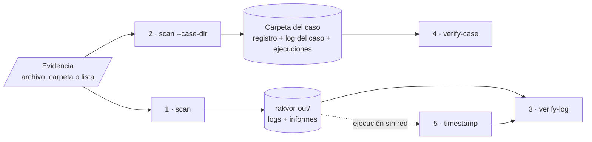
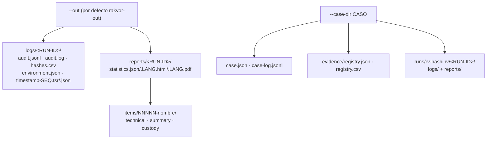

> La versión de referencia es la inglesa ([quick-guide.md](quick-guide.md)); esta traducción la sigue.

# Guía rápida

<!-- forge:domain -->
RV HashInv es la herramienta de recepción de evidencia de la suite Rakvor. Lee cada evidencia que se le entrega (un
archivo, una carpeta o una lista de archivos) sin modificarla. Calcula el hash de cada archivo con uno o dos
algoritmos, detecta el tipo real del archivo a partir de sus primeros bytes y señala anomalías: archivos vacíos,
extensiones que no corresponden al contenido, programas con otro nombre y duplicados. Escribe informes para el perito
y para el cliente, y registra cada acción en un log de auditoría encadenado por hashes. Sus hallazgos son **señales,
no veredictos**: cada uno dice lo que muestra y lo que no demuestra. Un archivo sin hallazgos no queda probado como
auténtico, y un hallazgo no muestra quién modificó un archivo, cuándo ni por qué. Esta página cubre las cinco tareas
más comunes. La guía completa es [usage.es.md](usage.es.md) y todas las opciones están en [usage-cli.md](usage-cli.md)
(en inglés, generada desde `--help`).
<!-- /forge:domain -->



## Dos formas de usarla

| Modo | Programa | Cuándo usarlo |
| --- | --- | --- |
| Aplicación de escritorio (GUI) | `rv-hashinv-gui.exe` (menú Inicio: *RV HashInv*) | Windows 10/11. Se eligen la evidencia y las opciones en una sola ventana y se pulsa **Iniciar revisión**. |
| Línea de comandos (CLI) | `rv-hashinv.exe` | Scripts, lotes y los comandos de verificación (`verify-log`, `verify-case`, `timestamp`). |

Ambos usan el mismo motor. Con la misma evidencia y las mismas opciones dan los mismos hashes y hallazgos, y
escriben los mismos archivos.

## Aplicación de escritorio: qué hace cada botón

No se escribe nada en disco hasta pulsar **Iniciar revisión**. Cada cambio hecho antes se guarda en memoria y se
escribe en el log de auditoría de la ejecución como una entrada `ui_*` cuando la ejecución empieza.

| Botón o casilla | Qué hace | Qué escribe |
| --- | --- | --- |
| **Agregar archivos…** | Abre el selector de archivos de Windows y agrega los archivos elegidos a la lista de evidencia. | `ui_input_added` (uno por archivo) |
| **Agregar carpeta…** | Agrega una carpeta completa. | `ui_input_added` |
| **Agregar ruta** | Agrega la ruta escrita en el cuadro de al lado (pulsar Enter hace lo mismo). | `ui_input_added` |
| Arrastrar y soltar | Los archivos o carpetas que se sueltan sobre la ventana se agregan a la lista de evidencia, como con **Agregar archivos…**. | `ui_input_added` |
| **x** (junto a una entrada) | Quita esa entrada de la lista de evidencia. | `ui_input_removed` |
| **Incluir subcarpetas** | Activada por defecto: las carpetas se leen con sus subcarpetas. | `ui_recursive_changed` |
| **Examinar…** junto a **Carpeta del caso** | Elige la carpeta compartida del caso. La carpeta de salida pasa a ser `<caso>/runs/rv-hashinv/<RUN-ID>` y ya no se puede editar. | `ui_case_dir_changed` |
| **Examinar…** junto a **Carpeta de salida** | Elige dónde se escriben `logs/` y `reports/` (por defecto `rakvor-out`). | Nada hasta la ejecución: la carpeta usada queda en `environment.json` |
| **Sello de tiempo confiable** (casilla y dirección) | Activado por defecto. Pide a la autoridad RFC 3161 de esa dirección un sello de tiempo para el log de auditoría. | `ui_timestamp_changed` |
| **Examinar…** junto a **Certificado de firma (.p12/.pfx)** | Elige su certificado. Cada informe PDF se firma entonces con él. Escriba la **Contraseña del certificado** en el campo de abajo. La contraseña solo se guarda en memoria y nunca se registra. | `ui_signing_certificate_changed` (solo la ruta) |
| **Iniciar revisión** | Inicia la ejecución con los ajustes mostrados. | `ui_start_clicked` y luego toda la ejecución (ver [Carpetas de salida](#carpetas-de-salida)) |
| **Cancelar** | Se detiene tras el archivo que se está leyendo y escribe informes parciales. | `item_cancelled`, `run_cancelled` |
| **Abrir informe** | Abre el informe estadístico (`statistics.<LANG>.html`) de la ejecución terminada. | Nada |
| **Abrir carpeta de logs** | Abre la carpeta `logs/<RUN-ID>` de la ejecución. | Nada |
| **Perito** e **ID del caso** (campos de texto) | El nombre del perito (por defecto, su usuario de Windows) y una referencia opcional del caso. | Nada hasta la ejecución: el perito se escribe en cada entrada de auditoría y en cada informe, el ID del caso en los informes |
| **ID de evidencia** (panel de resultado) | Tras una ejecución en una carpeta del caso, lista el ID de evidencia (E0001…) de cada elemento y su estado. Solo lectura. | Nada |
| **Advertencias** (panel de resultado) | Lista los errores encontrados durante la ejecución. Solo lectura. | Nada aquí: la ejecución registra cada error como `item_error` |

El sello de tiempo solo es cualificado según eIDAS si la dirección de la TSA es la de un prestador cualificado de servicios
de confianza (QTSP) inscrito en una lista de confianza de la UE; la dirección por defecto (DigiCert) no lo es.

Los selectores (algoritmos de hash, idioma de los informes, idioma de la interfaz, formato de custodia) también se
registran: `ui_hash_selection_changed`, `ui_language_changed`, `ui_interface_language_changed` y
`ui_jurisdiction_changed`.

## Tarea 1: revisar un archivo o una carpeta

1. Verifique el programa una vez en este equipo: `rv-hashinv self-test` debe imprimir `PASS` para cada algoritmo
   (código de salida 0).
2. Ejecute la revisión sobre una copia verificada de la evidencia, nunca sobre el soporte original. Omita
   `--no-timestamp` cuando el equipo pueda llegar a la TSA: la ejecución obtiene entonces también el sello de tiempo
   (`timestamp: ok …`).

   ```powershell
   rv-hashinv scan -i D:\evidence -r --hash sha256,md5 --lang es --case CASE-2026-014 --actor "Ana Ruiz" --no-timestamp
   ```

3. Lea el resumen. Con la evidencia de ejemplo, sin red (`--no-timestamp`), el comando de arriba imprime:

   ```text
   DONE  run 20261125T201247Z-464fbc
     items: 3  bytes: 234  errors: 0  elapsed: 0.1 s
     findings: high 0, medium 1, low 0, info 2
     timestamp: off
     report: rakvor-out\reports\20261125T201247Z-464fbc\statistics.es.html
     logs:   rakvor-out\logs\20261125T201247Z-464fbc
   ```

4. Abra el archivo indicado en `report:`. Después, para cada elemento, abra `technical.<LANG>.html` (para el perito)
   o `summary.<LANG>.html` (para el cliente).

**Qué escribe:** `rakvor-out/logs/<RUN-ID>/` (log de auditoría, `hashes.csv`, `environment.json`) y
`rakvor-out/reports/<RUN-ID>/` (informe estadístico y, por elemento, una revisión técnica, un resumen y un formato
de custodia).

**Cómo leer el resultado:** `DONE` con código de salida 0 significa que no hay hallazgos de severidad alta.
`DONE (high-severity findings)` con código de salida 3 es un resultado normal para evidencia, no un error: abra los
elementos cuyo estado es `problem`. Cada hallazgo indica lo que muestra y lo que no demuestra. `timestamp: pending`
significa que no se pudo contactar a la autoridad de sellado de tiempo (ver la tarea 5).

<!-- forge:domain -->
Opciones de `scan`:

| Opción | Qué define |
| --- | --- |
| `--input` (`-i`) | Un archivo o una carpeta a revisar. Repítala para varios. |
| `--input-list` (`-L`) | Un archivo de texto con una ruta por línea. |
| `--recursive` (`-r`) | Leer también las subcarpetas. |
| `--hash` (`-H`) | Uno o dos de md5, sha1, sha256, sha512, sha3-256, blake3 (por defecto sha256). |
| `--out` (`-o`) | Carpeta de salida (por defecto `rakvor-out`). |
| `--lang` (`-l`) | Idioma de los informes: en, es, fr o all. |
| `--actor` (`-a`) | Nombre del perito en el log de auditoría y en los informes. |
| `--case` (`-c`) | Identificador del caso impreso en los informes. |
| `--progress` (`-p`) | bar, jsonl (un evento JSON por línea) o none. |
| `--jurisdiction` (`-j`) | Formato de custodia: co (Colombia) o fr (Francia). |
| `--tsa-url` | Autoridad RFC 3161 (por defecto `http://timestamp.digicert.com`). |
| `--no-timestamp` | Sin solicitud de sello de tiempo (laboratorios sin red). |
| `--sign-cert` | Su certificado `.p12`/`.pfx`: cada informe PDF se firma con él. |
| `--sign-pass-env` | La variable de entorno que contiene su contraseña (por defecto `RV_SIGN_PASSWORD`). |
| `--case-dir` | La carpeta compartida del caso (tarea 2). |
| `--evidence` (`-E`) | ID de evidencia registrados que se vuelven a examinar (tarea 2). |
<!-- /forge:domain -->

## Tarea 2: revisar dentro de una carpeta del caso

<!-- forge:domain -->
1. Elija una carpeta para el caso, en el volumen del caso, por ejemplo `D:\cases\CASE-2026-014`.
2. Ejecute la recepción. La primera ejecución crea el caso, así que indique `--case` y `--jurisdiction`:

   ```powershell
   rv-hashinv scan --case-dir D:\cases\CASE-2026-014 --case CASE-2026-014 --jurisdiction co -i E:\export -r
   ```

3. Lea la última línea del resumen:

   ```text
     case:   CASE-2026-014 (intake) registered 3 (new 3), verified 0, mismatched 0, not in registry 0
   ```

4. Más adelante, para volver a examinar algunos elementos registrados, indique sus ID:
   `rv-hashinv scan --case-dir D:\cases\CASE-2026-014 --evidence E0001,E0002`.

**Qué escribe:** `case.json` (una sola vez, al crear el caso), `case-log.jsonl`, `evidence/registry.json` y `.csv`
(ID `E0001`, `E0002`, …) y la ejecución en `runs/rv-hashinv/<RUN-ID>/logs` y `/reports`.

**Cómo leer el resultado:** `new` cuenta los archivos registrados por primera vez. Un archivo en una ruta ya
registrada cuyo contenido cambió recibe un ID nuevo y el hallazgo `REGISTRY_PATH_CONTENT_CHANGED`. Un código de salida
3 antes de leer nada significa que la carpeta del caso no pasó la verificación: no se escribió nada en ella (ejecute
la tarea 4). El código de salida 2 indica un error de uso, por ejemplo una carpeta que pertenece a otro caso.
<!-- /forge:domain -->

## Tarea 3: verificar el log de auditoría de una ejecución

1. Indique a `verify-log` la carpeta de logs de la ejecución (o el `audit.jsonl` que contiene):

   ```powershell
   rv-hashinv verify-log rakvor-out\logs\20261125T201247Z-464fbc
   ```

2. Lea la salida:

   ```text
   OK  19 entries, chain intact: rakvor-out\logs\20261125T201247Z-464fbc\audit.jsonl
       truncation not detectable without a timestamp or case record
       outputs: 38 verified of 38 recorded (md5, sha256)
   ```

3. Si la ejecución tiene sello de tiempo, agregue `--tsa-ca <TSA roots.pem>` para verificar además la cadena del
   certificado de la TSA frente a los certificados raíz publicados por la propia TSA.

**Qué escribe:** nada. Solo lee.

**Cómo leer el resultado:** `OK` (código de salida 0) significa que ninguna entrada fue editada, borrada ni
reordenada, que cada token de sello de tiempo corresponde, y que cada informe, `hashes.csv` y `environment.json`
conservan el hash registrado en el log. `BROKEN` (código de salida 3) lista un problema por línea. La línea
`truncation` dice qué prueba que el log está completo; sin sello de tiempo ni registro del caso no se puede detectar
que se hayan quitado las últimas entradas. La revocación del certificado de la TSA nunca se verifica.

## Tarea 4: verificar un caso completo

1. Ejecute `verify-case` sobre la carpeta que contiene `case.json`:

   ```powershell
   rv-hashinv verify-case D:\cases\CASE-2026-014 --rehash
   ```

2. Lea la salida:

   ```text
   OK  case CASE-2026-014: 4 case-log entries, 3 registered items, 1 runs verified: D:\cases\CASE-2026-014
       outputs: 38 verified of 38 recorded by the runs' audit logs
       re-hashed 3 of 3 registered items: 3 match the registry
   ```

**Qué escribe:** nada. Solo lee.

**Cómo leer el resultado:** `OK` (código de salida 0) significa que el log del caso, el registro de evidencia, el
log de auditoría de cada ejecución y las salidas registradas están intactos. Las advertencias (por ejemplo, una
ejecución todavía en curso) se imprimen pero no hacen fallar la verificación. `--rehash` vuelve a leer cada archivo
registrado; un archivo no accesible desde este equipo es una advertencia. Un archivo que difiere del registro es un
problema. `BROKEN` (código de salida 3) lista cada verificación fallida. El código de salida 1 significa que la
carpeta no es una carpeta de caso (no tiene `case.json`).

## Tarea 5: agregar el sello de tiempo después de trabajar sin red

1. Sin red, ejecute la revisión como siempre, o con `--no-timestamp` (o `RV_NO_TIMESTAMP=1`) para que no se envíe
   ninguna solicitud. Sin `--no-timestamp`, el resumen muestra `timestamp: pending`.
2. Cuando vuelva la red, agregue el sello de tiempo a la carpeta de logs de la ejecución:

   ```powershell
   rv-hashinv timestamp rakvor-out\logs\20261125T181941Z-86dd6e
   ```

3. Lea el resultado: `OK  timestamp 2026-11-25T18:20:10Z by <TSA> covers entry #20`. Use `--tsa-url` para elegir
   otra autoridad y `--actor` para indicar el perito en la nueva entrada de auditoría.
4. Ejecute la tarea 3 sobre la misma carpeta. Ahora muestra la línea del sello de tiempo y `TSA signature valid`.

**Qué escribe:** `timestamp-<SEQ>.tsr` (el token RFC 3161) y `timestamp-<SEQ>.json` en la carpeta de logs, y la
entrada `timestamp_obtained` en `audit.jsonl`.

**Cómo leer el resultado:** el código de salida 0 significa que se obtuvo y registró el sello de tiempo. El código
de salida 1 significa que no se pudo contactar a la autoridad; no cambió nada, así que vuelva a intentarlo más tarde.
El código de salida 3 significa que el log falta o está roto; nunca se agrega un sello de tiempo a un log roto. El
sello de tiempo prueba cuándo existía el log, no que la evidencia sea auténtica.

## Otros comandos

| Comando | Qué hace |
| --- | --- |
| `rv-hashinv self-test` | Verifica cada algoritmo de hash con valores de prueba publicados. |
| `rv-hashinv update-check` | Indica si hay una versión más reciente publicada. Solo avisa: no descarga nada. `RV_NO_UPDATE_CHECK=1` lo desactiva. |
| `rv-hashinv describe --json` | Imprime la descripción de la herramienta para RV Hub. No lee ni escribe nada. |

## Códigos de salida

| Código | Significado | Lo devuelve |
| --- | --- | --- |
| 0 | Terminado; ningún hallazgo de severidad alta (comandos de verificación: todo lo verificado está intacto). | todos los comandos |
| 1 | Error de ejecución: entrada no encontrada, salida no escribible, log del caso bloqueado, TSA inaccesible (solo `timestamp`; `scan` muestra `timestamp: pending` y continúa), carpeta que no es de caso, un self-test fallido, o una verificación de actualizaciones que no se pudo hacer. | `scan`, `verify-log`, `verify-case`, `timestamp`, `self-test`, `update-check` |
| 2 | Error de uso: opción desconocida, valor incorrecto, más de dos algoritmos, carpeta de otro caso. | todos los comandos (opción desconocida); `scan` |
| 3 | Al menos un hallazgo de severidad alta, un log roto o truncado, una verificación del caso fallida, o (para `update-check`) una versión más reciente. | `scan`, `verify-log`, `verify-case`, `timestamp`, `update-check` |
| 130 | Cancelado con Ctrl+C: se escriben informes parciales y la cancelación queda en el log de auditoría. | `scan` |

## Carpetas de salida



Sin `--case-dir`, cada ejecución crea `logs/<RUN-ID>/` y `reports/<RUN-ID>/` dentro de `--out` (por defecto
`.\rakvor-out`, relativo a la carpeta actual). Con `--case-dir`, van a `<CASO>/runs/rv-hashinv/<RUN-ID>/`.
Conserve la carpeta de logs junto con los informes: es la prueba de lo que se hizo.
