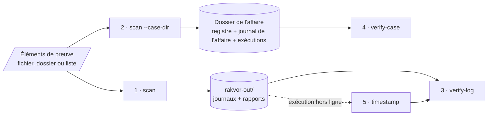
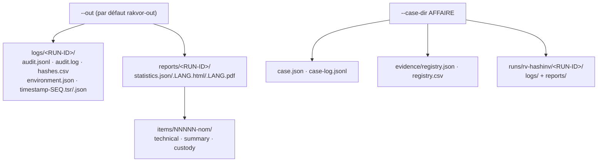

> La version de référence est la version anglaise ([quick-guide.md](quick-guide.md)) ; cette traduction la suit.

# Guide rapide

RV HashInv est l'outil d'enregistrement des éléments de preuve de la suite Rakvor. Il lit chaque élément qu'on lui
confie (un fichier, un dossier ou une liste de fichiers) sans le modifier. Il calcule l'empreinte de chaque fichier
avec un ou deux algorithmes, détecte le type réel du fichier d'après ses premiers octets et signale les anomalies :
fichiers vides, extensions qui ne correspondent pas au contenu, programmes sous un autre nom et doublons. Il rédige
des rapports pour l'expert et pour le client, et inscrit chaque action dans un journal d'audit chaîné par empreintes.
Ses constatations sont des **signaux, pas des verdicts** : chacune dit ce qu'elle montre et ce qu'elle ne prouve pas.
Un fichier sans constatation n'est pas prouvé authentique, et une constatation ne montre ni qui a modifié un fichier,
ni quand, ni pourquoi. Cette page couvre les cinq tâches les plus courantes. Le guide complet est
[usage.fr.md](usage.fr.md), et toutes les options figurent dans [usage-cli.md](usage-cli.md) (en anglais, généré à
partir de `--help`).



## Deux façons de l'utiliser

| Mode | Programme | Quand l'utiliser |
| --- | --- | --- |
| Application de bureau (GUI) | `rv-hashinv-gui.exe` (menu Démarrer : *RV HashInv*) | Windows 10/11. On choisit les éléments et les options dans une seule fenêtre, puis on clique sur **Lancer l'analyse**. |
| Ligne de commande (CLI) | `rv-hashinv.exe` | Scripts, traitements par lots et commandes de vérification (`verify-log`, `verify-case`, `timestamp`). |

Les deux utilisent le même moteur. Avec les mêmes éléments et les mêmes options, ils donnent les mêmes empreintes et
les mêmes constatations, et écrivent les mêmes fichiers.

## Application de bureau : le rôle de chaque bouton

Rien n'est écrit sur le disque avant le clic sur **Lancer l'analyse**. Chaque modification faite avant est gardée
en mémoire, puis inscrite dans le journal d'audit de l'exécution sous forme d'entrée `ui_*` au démarrage.

| Bouton ou case | Ce qu'il fait | Ce qu'il écrit |
| --- | --- | --- |
| **Ajouter des fichiers…** | Ouvre le sélecteur de fichiers de Windows et ajoute les fichiers choisis à la liste des éléments. | `ui_input_added` (une par fichier) |
| **Ajouter un dossier…** | Ajoute un dossier entier. | `ui_input_added` |
| **Ajouter le chemin** | Ajoute le chemin saisi dans la zone voisine (la touche Entrée fait de même). | `ui_input_added` |
| **x** (à côté d'une entrée) | Retire cette entrée de la liste des éléments. | `ui_input_removed` |
| **Inclure les sous-dossiers** | Cochée par défaut : les dossiers sont lus avec leurs sous-dossiers. | `ui_recursive_changed` |
| **Parcourir…** à côté de **Dossier de l'affaire** | Choisit le dossier partagé de l'affaire. Le dossier de sortie devient alors `<affaire>/runs/rv-hashinv/<RUN-ID>` et n'est plus modifiable. | `ui_case_dir_changed` |
| **Parcourir…** à côté de **Dossier de sortie** | Choisit où `logs/` et `reports/` sont écrits (par défaut `rakvor-out`). | Rien avant l'exécution : le dossier utilisé est consigné dans `environment.json` |
| **Horodatage qualifié** (case et adresse) | Coché par défaut. Demande à l'autorité RFC 3161 de cette adresse d'horodater le journal d'audit. | `ui_timestamp_changed` |
| **Parcourir…** à côté de **Certificat de signature (.p12/.pfx)** | Choisit votre certificat. Chaque rapport PDF est alors signé avec lui. Saisissez le **Mot de passe du certificat** dans le champ en dessous. Le mot de passe reste en mémoire et n'est jamais journalisé. | `ui_signing_certificate_changed` (le chemin seulement) |
| **Lancer l'analyse** | Lance l'exécution avec les réglages affichés. | `ui_start_clicked`, puis toute l'exécution (voir [Dossiers de sortie](#dossiers-de-sortie)) |
| **Annuler** | S'arrête après le fichier en cours de lecture et écrit des rapports partiels. | `item_cancelled`, `run_cancelled` |
| **Ouvrir le rapport** | Ouvre le rapport statistique (`statistics.<LANG>.html`) de l'exécution terminée. | Rien |
| **Ouvrir le dossier des journaux** | Ouvre le dossier `logs/<RUN-ID>` de l'exécution. | Rien |

Les sélecteurs (algorithmes d'empreinte, langue des rapports, langue de l'interface, fiche de possession) sont aussi
consignés : `ui_hash_selection_changed`, `ui_language_changed`, `ui_interface_language_changed` et
`ui_jurisdiction_changed`.

## Tâche 1 : analyser un fichier ou un dossier

1. Vérifiez une fois le programme sur ce poste : `rv-hashinv self-test` doit afficher `PASS` pour chaque algorithme
   (code de sortie 0).
2. Lancez l'analyse sur une copie vérifiée des éléments, jamais sur le support d'origine :

   ```powershell
   rv-hashinv scan -i D:\evidence -r --hash sha256,md5 --lang es --case CASE-2026-014 --actor "Ana Ruiz"
   ```

3. Lisez le résumé. Avec les éléments d'exemple, il se présente ainsi :

   ```text
   DONE  run 20261125T181930Z-5aeca1
     items: 3  bytes: 234  errors: 0  elapsed: 0.1 s
     findings: high 0, medium 1, low 0, info 2
     timestamp: off
     report: rakvor-out\reports\20261125T181930Z-5aeca1\statistics.en.html
     logs:   rakvor-out\logs\20261125T181930Z-5aeca1
   ```

4. Ouvrez le fichier indiqué par `report:`. Puis, pour chaque élément, ouvrez `technical.<LANG>.html` (pour
   l'expert) ou `summary.<LANG>.html` (pour le client).

**Ce qu'il écrit :** `rakvor-out/logs/<RUN-ID>/` (journal d'audit, `hashes.csv`, `environment.json`) et
`rakvor-out/reports/<RUN-ID>/` (rapport statistique et, par élément, une revue technique, une synthèse et une fiche
de possession).

**Comment lire le résultat :** `DONE` avec le code de sortie 0 signifie qu'il n'y a aucune constatation de gravité
élevée. `DONE (high-severity findings)` avec le code de sortie 3 est un résultat normal pour des éléments de preuve,
pas une erreur : ouvrez les éléments dont le statut est `problem`. Chaque constatation indique ce qu'elle montre et ce
qu'elle ne prouve pas. `timestamp: pending` signifie que l'autorité d'horodatage n'a pas pu être jointe (voir la
tâche 5).

Options de `scan` :

| Option | Ce qu'elle règle |
| --- | --- |
| `--input` (`-i`) | Un fichier ou un dossier à analyser. Répétez-la pour plusieurs. |
| `--input-list` (`-L`) | Un fichier texte avec un chemin par ligne. |
| `--recursive` (`-r`) | Lire aussi les sous-dossiers. |
| `--hash` (`-H`) | Un ou deux parmi md5, sha1, sha256, sha512, sha3-256, blake3 (par défaut sha256). |
| `--out` (`-o`) | Dossier de sortie (par défaut `rakvor-out`). |
| `--lang` (`-l`) | Langue des rapports : en, es, fr ou all. |
| `--actor` (`-a`) | Nom de l'expert dans le journal d'audit et les rapports. |
| `--case` (`-c`) | Référence du dossier imprimée sur les rapports. |
| `--progress` (`-p`) | bar, jsonl (un événement JSON par ligne) ou none. |
| `--jurisdiction` (`-j`) | Fiche de possession : co (Colombie) ou fr (France). |
| `--tsa-url` | Autorité RFC 3161 (par défaut `http://timestamp.digicert.com`). |
| `--no-timestamp` | Pas de demande d'horodatage (laboratoires hors ligne). |
| `--sign-cert` | Votre certificat `.p12`/`.pfx` : chaque rapport PDF est signé avec lui. |
| `--sign-pass-env` | La variable d'environnement qui contient son mot de passe (par défaut `RV_SIGN_PASSWORD`). |
| `--case-dir` | Le dossier partagé de l'affaire (tâche 2). |
| `--evidence` (`-E`) | ID des éléments enregistrés à examiner de nouveau (tâche 2). |

## Tâche 2 : analyser dans un dossier d'affaire

1. Choisissez un dossier pour l'affaire, sur le volume de l'affaire, par exemple `D:\cases\CASE-2026-014`.
2. Lancez l'enregistrement. La première exécution crée l'affaire : indiquez donc `--case` et `--jurisdiction` :

   ```powershell
   rv-hashinv scan --case-dir D:\cases\CASE-2026-014 --case CASE-2026-014 --jurisdiction co -i E:\export -r
   ```

3. Lisez la dernière ligne du résumé :

   ```text
     case:   CASE-2026-014 (intake) registered 3 (new 3), verified 0, mismatched 0, not in registry 0
   ```

4. Plus tard, pour examiner de nouveau certains éléments enregistrés, indiquez leurs ID :
   `rv-hashinv scan --case-dir D:\cases\CASE-2026-014 --evidence E0001,E0002`.

**Ce qu'il écrit :** `case.json` (une seule fois, à la création), `case-log.jsonl`, `evidence/registry.json` et
`.csv` (ID `E0001`, `E0002`, …), et l'exécution dans `runs/rv-hashinv/<RUN-ID>/logs` et `/reports`.

**Comment lire le résultat :** `new` compte les fichiers enregistrés pour la première fois. Un fichier situé à un
chemin déjà enregistré dont le contenu a changé reçoit un nouvel ID et la constatation
`REGISTRY_PATH_CONTENT_CHANGED`. Un code de sortie 3 avant toute lecture signifie que le dossier de l'affaire a échoué
à la vérification : rien n'y a été écrit (exécutez la tâche 4). Le code de sortie 2 signale une erreur d'utilisation,
par exemple un dossier qui appartient à une autre affaire.

## Tâche 3 : vérifier le journal d'audit d'une exécution

1. Indiquez à `verify-log` le dossier des journaux de l'exécution (ou le fichier `audit.jsonl` qu'il contient) :

   ```powershell
   rv-hashinv verify-log rakvor-out\logs\20261125T181930Z-5aeca1
   ```

2. Lisez la sortie :

   ```text
   OK  19 entries, chain intact: rakvor-out/logs/20261125T181930Z-5aeca1\audit.jsonl
       truncation not detectable without a timestamp or case record
       outputs: 38 verified of 38 recorded (sha256)
   ```

3. Si l'exécution est horodatée, ajoutez `--tsa-ca <TSA roots.pem>` pour vérifier aussi la chaîne du certificat de
   la TSA à partir des certificats racine publiés par la TSA elle-même.

**Ce qu'il écrit :** rien. Il se contente de lire.

**Comment lire le résultat :** `OK` (code de sortie 0) signifie qu'aucune entrée n'a été modifiée, supprimée ni
réordonnée, que chaque jeton d'horodatage correspond, et que chaque rapport, `hashes.csv` et `environment.json` ont
toujours l'empreinte consignée dans le journal. `BROKEN` (code de sortie 3) liste un problème par ligne. La ligne
`truncation` indique ce qui prouve que le journal est complet ; sans horodatage ni trace dans l'affaire, la
suppression des dernières entrées ne peut pas être détectée. La révocation du certificat de la TSA n'est jamais
vérifiée.

## Tâche 4 : vérifier une affaire entière

1. Lancez `verify-case` sur le dossier qui contient `case.json` :

   ```powershell
   rv-hashinv verify-case D:\cases\CASE-2026-014 --rehash
   ```

2. Lisez la sortie :

   ```text
   OK  case CASE-2026-014: 4 case-log entries, 3 registered items, 1 runs verified: D:\cases\CASE-2026-014
       outputs: 38 verified of 38 recorded by the runs' audit logs
       re-hashed 3 of 3 registered items: 3 match the registry
   ```

**Ce qu'il écrit :** rien. Il se contente de lire.

**Comment lire le résultat :** `OK` (code de sortie 0) signifie que le journal de l'affaire, le registre des
éléments, le journal d'audit de chaque exécution et les sorties consignées sont intacts. Les avertissements (par
exemple une exécution encore en cours) sont affichés mais ne font pas échouer la vérification. `--rehash` relit chaque
fichier enregistré ; un fichier inaccessible depuis ce poste est un avertissement. Un fichier qui diffère du registre
est un problème. `BROKEN` (code de sortie 3) liste chaque vérification échouée. Le code de sortie 1 signifie que le
dossier n'est pas un dossier d'affaire (pas de `case.json`).

## Tâche 5 : ajouter l'horodatage après un travail hors ligne

1. Hors ligne, lancez l'analyse comme d'habitude, ou avec `--no-timestamp` (ou `RV_NO_TIMESTAMP=1`) pour qu'aucune
   demande ne soit envoyée. Sans `--no-timestamp`, le résumé affiche `timestamp: pending`.
2. Une fois le réseau revenu, horodatez le dossier des journaux de l'exécution :

   ```powershell
   rv-hashinv timestamp rakvor-out\logs\20261125T181941Z-86dd6e
   ```

3. Lisez le résultat : `OK  timestamp 2026-11-25T18:20:10Z by <TSA> covers entry #20`. Utilisez `--tsa-url` pour
   choisir une autre autorité, et `--actor` pour nommer l'expert dans la nouvelle entrée d'audit.
4. Exécutez la tâche 3 sur le même dossier. Elle affiche maintenant la ligne d'horodatage et `TSA signature valid`.

**Ce qu'il écrit :** `timestamp-<SEQ>.tsr` (le jeton RFC 3161) et `timestamp-<SEQ>.json` dans le dossier des
journaux, et l'entrée `timestamp_obtained` dans `audit.jsonl`.

**Comment lire le résultat :** le code de sortie 0 signifie que l'horodatage a été obtenu et consigné. Le code de
sortie 1 signifie que l'autorité n'a pas pu être jointe ; rien n'a changé, réessayez plus tard. Le code de sortie 3
signifie que le journal est absent ou rompu ; aucun horodatage n'est ajouté à un journal rompu. L'horodatage prouve à
quel moment le journal existait, pas que les éléments de preuve sont authentiques.

## Autres commandes

| Commande | Ce qu'elle fait |
| --- | --- |
| `rv-hashinv self-test` | Vérifie chaque algorithme d'empreinte avec des valeurs de test publiées. |
| `rv-hashinv update-check` | Indique si une version plus récente est publiée. Elle ne fait que prévenir : rien n'est téléchargé. `RV_NO_UPDATE_CHECK=1` la désactive. |
| `rv-hashinv describe --json` | Affiche la description de l'outil pour RV Hub. Elle ne lit ni n'écrit rien. |

## Codes de sortie

| Code | Signification | Renvoyé par |
| --- | --- | --- |
| 0 | Terminé ; aucune constatation de gravité élevée (commandes de vérification : tout ce qui est vérifié est intact). | toutes les commandes |
| 1 | Erreur d'exécution : entrée introuvable, sortie non inscriptible, journal de l'affaire verrouillé, TSA injoignable, dossier qui n'est pas une affaire, self-test en échec, ou vérification de mise à jour impossible. | `scan`, `verify-log`, `verify-case`, `timestamp`, `self-test`, `update-check` |
| 2 | Erreur d'utilisation : option inconnue, valeur incorrecte, plus de deux algorithmes, dossier d'une autre affaire. | toutes les commandes (option inconnue) ; `scan` |
| 3 | Au moins une constatation de gravité élevée, un journal rompu ou tronqué, une vérification de l'affaire échouée, ou (pour `update-check`) une version plus récente. | `scan`, `verify-log`, `verify-case`, `timestamp`, `update-check` |
| 130 | Annulé avec Ctrl+C : des rapports partiels sont écrits et l'annulation figure dans le journal d'audit. | `scan` |

## Dossiers de sortie



Sans `--case-dir`, chaque exécution crée `logs/<RUN-ID>/` et `reports/<RUN-ID>/` dans `--out` (par défaut
`.\rakvor-out`, relatif au dossier courant). Avec `--case-dir`, ils vont dans `<AFFAIRE>/runs/rv-hashinv/<RUN-ID>/`.
Conservez le dossier des journaux avec les rapports : c'est la preuve de ce qui a été fait.
