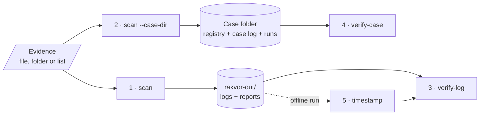
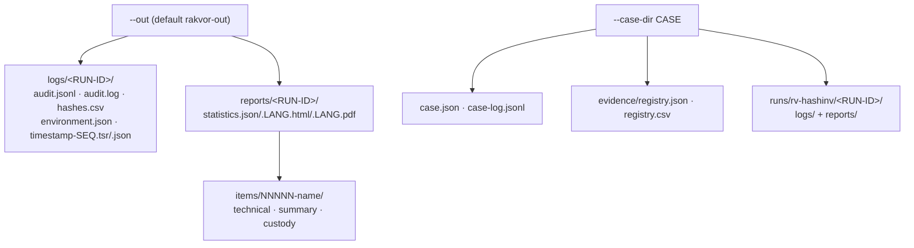

# Quick guide

<!-- forge:domain -->
RV HashInv is the intake tool of the Rakvor suite. It reads each piece of evidence you give it (one file, a
folder or a list of files) without changing it. It hashes each file with one or two algorithms, detects the real
file type from the first bytes, and flags anomalies: empty files, extensions that do not match the content,
programs under another name, and duplicates. It writes reports for the examiner and for the client, and records
every action in a hash-chained audit log. Its findings are **signals, not verdicts**: each one says what it shows
and what it does not prove. A file without findings is not proven authentic, and a finding does not show who
changed a file, when, or why. This page covers the five common tasks. The full guide is [usage.md](usage.md), and
every option is in [usage-cli.md](usage-cli.md).
<!-- /forge:domain -->



## Two ways to use it

| Mode | Program | When to use it |
| --- | --- | --- |
| Desktop app (GUI) | `rv-hashinv-gui.exe` (Start menu: *RV HashInv*) | Windows 10/11. You pick the evidence and the options in one window, then press **Start review**. |
| Command line (CLI) | `rv-hashinv.exe` | Scripts, batches, and the verification commands (`verify-log`, `verify-case`, `timestamp`). |

Both use the same engine. With the same evidence and options they give the same hashes and findings, and both
write the same files.

## Desktop app: what each button does

Nothing is written to disk until you press **Start review**. Each change you make before that is kept in memory,
then written to the run's audit log as a `ui_*` entry when the run starts.

| Button or box | What it does | What it writes |
| --- | --- | --- |
| **Add files…** | Opens the Windows file picker and adds the chosen files to the evidence list. | `ui_input_added` (one per file) |
| **Add folder…** | Adds a whole folder. | `ui_input_added` |
| **Add path** | Adds the path typed in the box next to it (pressing Enter does the same). | `ui_input_added` |
| Drag and drop | Files or folders dropped onto the window are added to the evidence list, as with **Add files…**. | `ui_input_added` |
| **x** (next to an entry) | Removes that entry from the evidence list. | `ui_input_removed` |
| **Include subfolders** | On by default: the folders are read with their subfolders. | `ui_recursive_changed` |
| **Browse…** next to **Case folder** | Chooses the shared case folder. The output folder then becomes `<case>/runs/rv-hashinv/<RUN-ID>` and you can no longer edit it. | `ui_case_dir_changed` |
| **Browse…** next to **Output folder** | Chooses where `logs/` and `reports/` are written (default `rakvor-out`). | Nothing until the run: the folder used is recorded in `environment.json` |
| **Trusted timestamp** (tick box and address) | On by default. Asks the RFC 3161 authority at that address to timestamp the audit log. | `ui_timestamp_changed` |
| **Browse…** next to **Signing certificate (.p12/.pfx)** | Chooses your certificate. Each PDF report is then signed with it. Type the **Certificate password** in the field below it. The password is kept in memory only and is never logged. | `ui_signing_certificate_changed` (the path only) |
| **Start review** | Starts the run with the settings shown. | `ui_start_clicked`, then the whole run (see [Where the outputs go](#where-the-outputs-go)) |
| **Cancel** | Stops after the file being read and writes partial reports. | `item_cancelled`, `run_cancelled` |
| **Open report** | Opens the statistics report (`statistics.<LANG>.html`) of the finished run. | Nothing |
| **Open log folder** | Opens the run's `logs/<RUN-ID>` folder. | Nothing |
| **Examiner** and **Case ID** (text fields) | The examiner's name (default: your Windows user) and an optional case reference. | Nothing until the run: the examiner is written in every audit entry and report, the case ID on the reports |
| **Evidence IDs** (result panel) | After a run in a case folder, lists each item's evidence id (E0001…) and its status. Read-only. | Nothing |
| **Warnings** (result panel) | Lists the errors met during the run. Read-only. | Nothing here: the run logs each error as `item_error` |

The timestamp is eIDAS-qualified only if the TSA address is that of a qualified trust service provider (QTSP) on an EU
trusted list; the default address (DigiCert) is not one.

The selectors (hash algorithms, report language, interface language, custody form) are recorded too:
`ui_hash_selection_changed`, `ui_language_changed`, `ui_interface_language_changed` and `ui_jurisdiction_changed`.

## Task 1: Scan a file or a folder

1. Check the build once on this PC: `rv-hashinv self-test` must print `PASS` for every algorithm (exit code 0).
2. Run the scan on a verified copy of the evidence, never on the original media. Leave out `--no-timestamp` when the
   PC can reach the TSA: the run then also obtains the timestamp (`timestamp: ok …`).

   ```powershell
   rv-hashinv scan -i D:\evidence -r --hash sha256,md5 --lang es --case CASE-2026-014 --actor "Ana Ruiz" --no-timestamp
   ```

3. Read the summary. On the sample evidence, offline (`--no-timestamp`), the command above prints:

   ```text
   DONE  run 20261125T201247Z-464fbc
     items: 3  bytes: 234  errors: 0  elapsed: 0.1 s
     findings: high 0, medium 1, low 0, info 2
     timestamp: off
     report: rakvor-out\reports\20261125T201247Z-464fbc\statistics.es.html
     logs:   rakvor-out\logs\20261125T201247Z-464fbc
   ```

4. Open the `report:` file. Then, for each item, open `technical.<LANG>.html` (for the examiner) or
   `summary.<LANG>.html` (for the client).

**What it writes:** `rakvor-out/logs/<RUN-ID>/` (audit log, `hashes.csv`, `environment.json`) and
`rakvor-out/reports/<RUN-ID>/` (statistics report, and per item a technical review, a summary and a custody form).

**How to read the result:** `DONE` with exit code 0 means no high-severity finding. `DONE (high-severity findings)`
with exit code 3 is a normal outcome for evidence, not an error: open the items whose status is `problem`. Each
finding states what it shows and what it does not prove. `timestamp: pending` means that the authority could not be
reached (see Task 5).

<!-- forge:domain -->
Scan options:

| Option | What it sets |
| --- | --- |
| `--input` (`-i`) | A file or folder to review. Repeat it for several. |
| `--input-list` (`-L`) | A text file with one path per line. |
| `--recursive` (`-r`) | Also read subfolders. |
| `--hash` (`-H`) | One or two of md5, sha1, sha256, sha512, sha3-256, blake3 (default sha256). |
| `--out` (`-o`) | Output folder (default `rakvor-out`). |
| `--lang` (`-l`) | Report language: en, es, fr or all. |
| `--actor` (`-a`) | Examiner name in the audit log and the reports. |
| `--case` (`-c`) | Case identifier printed on the reports. |
| `--progress` (`-p`) | bar, jsonl (one JSON event per line) or none. |
| `--jurisdiction` (`-j`) | Custody form: co (Colombia) or fr (France). |
| `--tsa-url` | RFC 3161 authority (default `http://timestamp.digicert.com`). |
| `--no-timestamp` | No timestamp request (offline labs). |
| `--sign-cert` | Your `.p12`/`.pfx` certificate: each PDF report is signed with it. |
| `--sign-pass-env` | The environment variable that holds its password (default `RV_SIGN_PASSWORD`). |
| `--case-dir` | The shared case folder (Task 2). |
| `--evidence` (`-E`) | Registered evidence ids to examine again (Task 2). |
<!-- /forge:domain -->

## Task 2: Scan into a case folder

<!-- forge:domain -->
1. Choose one folder for the case, on the case volume, for example `D:\cases\CASE-2026-014`.
2. Run the intake. The first run creates the case, so give `--case` and `--jurisdiction`:

   ```powershell
   rv-hashinv scan --case-dir D:\cases\CASE-2026-014 --case CASE-2026-014 --jurisdiction co -i E:\export -r
   ```

3. Read the last line of the summary:

   ```text
     case:   CASE-2026-014 (intake) registered 3 (new 3), verified 0, mismatched 0, not in registry 0
   ```

4. Later, to examine some registered items again, give their ids:
   `rv-hashinv scan --case-dir D:\cases\CASE-2026-014 --evidence E0001,E0002`.

**What it writes:** `case.json` (only once, at creation), `case-log.jsonl`, `evidence/registry.json` and `.csv`
(ids `E0001`, `E0002`, …), and the run under `runs/rv-hashinv/<RUN-ID>/logs` and `/reports`.

**How to read the result:** `new` counts the files registered for the first time. A file at a registered path whose
content changed gets a new id and the finding `REGISTRY_PATH_CONTENT_CHANGED`. Exit code 3 before anything is read
means that the case folder failed verification: nothing was written to it (run Task 4). Exit code 2 means a usage
error, for example a folder that belongs to another case.
<!-- /forge:domain -->

## Task 3: Verify a run's audit log

1. Point `verify-log` at the run's log folder (or at the `audit.jsonl` in it):

   ```powershell
   rv-hashinv verify-log rakvor-out\logs\20261125T201247Z-464fbc
   ```

2. Read the output:

   ```text
   OK  19 entries, chain intact: rakvor-out\logs\20261125T201247Z-464fbc\audit.jsonl
       truncation not detectable without a timestamp or case record
       outputs: 38 verified of 38 recorded (md5, sha256)
   ```

3. If the run has a timestamp, add `--tsa-ca <TSA roots.pem>` to also check the TSA certificate chain against the
   TSA's own root certificates.

**What it writes:** nothing. It only reads.

**How to read the result:** `OK` (exit code 0) means that no entry was edited, deleted or re-ordered, that each
timestamp token matches, and that each report, `hashes.csv` and `environment.json` still has the digest the log
recorded. `BROKEN` (exit code 3) lists one problem per line. The `truncation` line says what proves the log is
complete; with neither a timestamp nor a case record, removed final entries cannot be detected. Revocation of the
TSA certificate is never checked.

## Task 4: Verify a whole case

1. Run `verify-case` on the folder that holds `case.json`:

   ```powershell
   rv-hashinv verify-case D:\cases\CASE-2026-014 --rehash
   ```

2. Read the output:

   ```text
   OK  case CASE-2026-014: 4 case-log entries, 3 registered items, 1 runs verified: D:\cases\CASE-2026-014
       outputs: 38 verified of 38 recorded by the runs' audit logs
       re-hashed 3 of 3 registered items: 3 match the registry
   ```

**What it writes:** nothing. It only reads.

**How to read the result:** `OK` (exit code 0) means that the case log, the registry, every run's audit log and
the runs' recorded outputs are intact. Warnings (for example a run still in progress) are printed but do not fail
the check. `--rehash` reads each registered file again; a file that is not reachable from this PC is a warning. A file
that differs from the registry is a problem. `BROKEN` (exit code 3) lists each failed check. Exit code 1 means that
the folder is not a case folder (no `case.json`).

## Task 5: Add the timestamp after offline work

1. Offline, run the scan as usual, or with `--no-timestamp` (or `RV_NO_TIMESTAMP=1`) so that no request is sent.
   Without `--no-timestamp`, the summary shows `timestamp: pending`.
2. Once the network is back, timestamp the run's log folder:

   ```powershell
   rv-hashinv timestamp rakvor-out\logs\20261125T181941Z-86dd6e
   ```

3. Read the result: `OK  timestamp 2026-11-25T18:20:10Z by <TSA> covers entry #20`. Use `--tsa-url` to choose
   another authority, and `--actor` to name the examiner in the new audit entry.
4. Run Task 3 on the same folder. It now shows the timestamp line and `TSA signature valid`.

**What it writes:** `timestamp-<SEQ>.tsr` (the RFC 3161 token) and `timestamp-<SEQ>.json` in the log folder, and
the `timestamp_obtained` entry in `audit.jsonl`.

**How to read the result:** exit code 0 means that the timestamp was obtained and logged. Exit code 1 means that the
authority could not be reached; nothing changed, so try again later. Exit code 3 means that the log is missing or
broken; no timestamp is added to a broken log. The timestamp proves when the log existed, not that the evidence is
authentic.

## Other commands

| Command | What it does |
| --- | --- |
| `rv-hashinv self-test` | Checks every hash algorithm against published test values. |
| `rv-hashinv update-check` | Tells you whether a newer release is published. It only notifies: nothing is downloaded. `RV_NO_UPDATE_CHECK=1` turns it off. |
| `rv-hashinv describe --json` | Prints the tool's description for RV Hub. It reads and writes nothing. |

## Exit codes

| Code | Meaning | Returned by |
| --- | --- | --- |
| 0 | Completed; no high-severity finding (verification commands: everything checked is intact). | every command |
| 1 | Runtime error: input not found, output not writable, case log locked, TSA unreachable (`timestamp` only; `scan` shows `timestamp: pending` and goes on), not a case folder, a failed self-test, or an update check that could not be made. | `scan`, `verify-log`, `verify-case`, `timestamp`, `self-test`, `update-check` |
| 2 | Usage error: unknown option, bad value, more than two algorithms, case folder of another case. | every command (unknown option); `scan` |
| 3 | At least one high-severity finding, a broken or truncated log, a failed case check, or (for `update-check`) a newer release. | `scan`, `verify-log`, `verify-case`, `timestamp`, `update-check` |
| 130 | Cancelled with Ctrl+C: partial reports are written and the cancellation is in the audit log. | `scan` |

## Where the outputs go



Without `--case-dir`, each run creates `logs/<RUN-ID>/` and `reports/<RUN-ID>/` under `--out` (default
`.\rakvor-out`, relative to the current folder). With `--case-dir`, they go to `<CASE>/runs/rv-hashinv/<RUN-ID>/`.
Keep the log folder with the reports: it is the proof of what was done.
