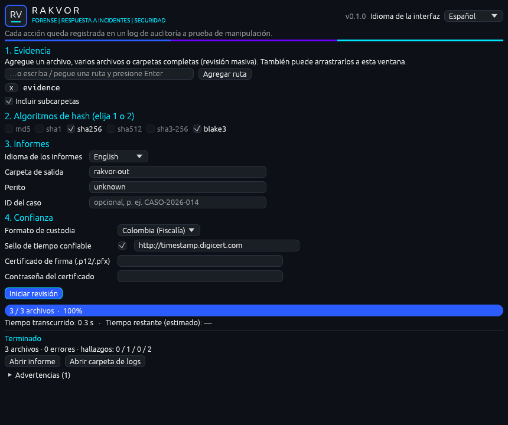
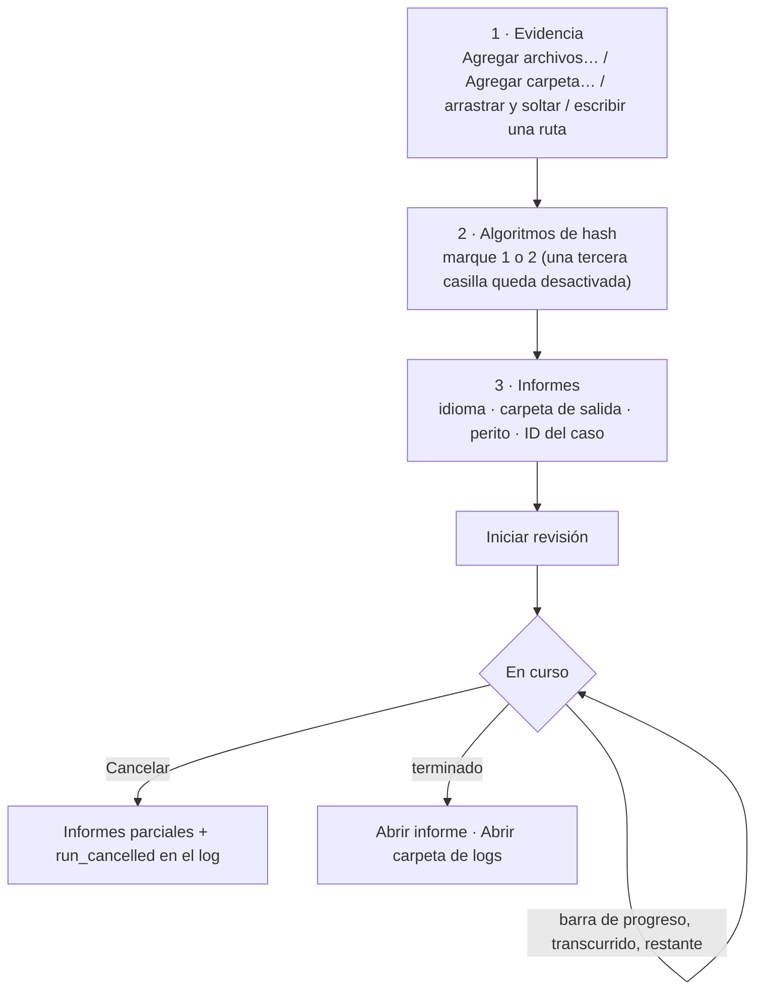

> La versión de referencia es la inglesa ([usage-gui.md](usage-gui.md)); esta traducción la sigue.

# Uso de la aplicación de escritorio (Windows 10/11)

Inicie **RV HashInv** desde el menú Inicio (instalador) o haga doble clic en `rv-hashinv-gui.exe` (zip portable).
No hace falta instalar ningún otro programa; la aplicación también funciona en máquinas virtuales sin controlador
gráfico (renderizado por software).

## Flujo de trabajo

## La ventana

| Zona | Qué hace |
| --- | --- |
| **1. Evidencia** | *Agregar archivos…* y *Agregar carpeta…* abren los selectores de Windows. También puede arrastrar archivos o carpetas a la ventana (o al icono de `rv-hashinv-gui.exe` antes de que arranque), o pegar una ruta y pulsar Enter. *Incluir subcarpetas* está activada por defecto. Quite una entrada con **x**. |
| **2. Algoritmos de hash** | Marque uno o dos. Con dos marcados, los demás se desactivan; no se puede desmarcar el último. |
| **3. Informes** | Idioma (English, Español, Français o los tres), carpeta de salida, nombre del perito (por defecto su usuario de Windows), ID del caso opcional. |
| **4. Confianza** | *Sello de tiempo confiable* (activado por defecto; la dirección de la TSA se puede editar), *Certificate…* para elegir su `.p12`/`.pfx` y su contraseña (solo en memoria, nunca se registra) para firmar cada PDF, y *Jurisdicción* (Colombia / Francia) para el formato de custodia. |
| **Idioma de la interfaz** | Selector arriba a la derecha: English, Español, Français. Cambia todas las etiquetas de inmediato; es independiente del idioma de los informes. |
| **Iniciar revisión / Cancelar** | Iniciar se habilita en cuanto se agrega evidencia. Durante una ejecución los ajustes quedan bloqueados y el botón pasa a ser *Cancelar*. |
| **Progreso** | Barra por bytes procesados, `archivos hechos / total`, tiempo transcurrido (siempre en movimiento) y tiempo restante estimado. Debajo se muestra el archivo que se está leyendo. |
| **Resultado** | Conteos por severidad, **Abrir informe** (página de estadísticas en su idioma) y **Abrir carpeta de logs**. |

## Carpeta del caso

Complete **Carpeta del caso** en la sección 1 para trabajar dentro de una carpeta compartida del caso (ver
[case-folder.md](case-folder.md), en inglés). Para una carpeta nueva, complete también **ID del caso** (y la
jurisdicción del formato de custodia): se escriben una sola vez en `case.json`. Mientras haya una carpeta del caso,
la **Carpeta de salida** muestra `<case>/runs/rv-hashinv/<RUN-ID>` y no se puede editar, y puede iniciar sin agregar
evidencia (se examina cada elemento registrado). Tras la ejecución, el panel de resultado lista el **ID de evidencia**
de cada elemento (E0001…) y su estado (registrado, verificado, no coincide, no está en el registro). El cambio se
audita como `ui_case_dir_changed`.

RV Hub abre la aplicación con la carpeta del caso ya completada: `rv-hashinv-gui.exe --case-dir <CASE> [FILES...]` (o
`--case-dir=<CASE>`). El log de auditoría empieza entonces con `ui_case_dir_from_launcher` (la ruta y `at_utc`); un
`--case-dir` sin carpeta se ignora, se indica en la ventana y se registra como `ui_launch_argument_ignored`.

## Lo que registra la GUI

Sus elecciones forman parte del registro de la evidencia. Antes de que empiece la ejecución, la GUI las escribe en el
log de auditoría:

| Acción | Registrada como |
| --- | --- |
| Agregar / quitar evidencia | `ui_input_added`, `ui_input_removed` |
| Cambiar la selección de hash | `ui_hash_selection_changed` |
| Cambiar idioma / subcarpetas | `ui_language_changed`, `ui_recursive_changed` |
| Abierta por RV Hub con `--case-dir` | `ui_case_dir_from_launcher`, `ui_case_dir_changed` (o `ui_launch_argument_ignored`) |
| Pulsar Iniciar | `ui_start_clicked` (ajustes finales) |
| Pulsar Cancelar | `item_cancelled`, `run_cancelled` |

Los errores durante la ejecución aparecen en **Advertencias** y en el log como `item_error`.
Los mensajes de validación mostrados *antes* de una ejecución (p. ej. "Add at least one file or folder") no se
registran, porque todavía no existe ninguna ejecución y, por tanto, ningún log.

## Mismos resultados que la línea de comandos

La GUI llama al mismo motor que `rv-hashinv scan`. Una ejecución en la GUI con la misma evidencia, los mismos
algoritmos y el mismo idioma da hashes y hallazgos idénticos; `environment.json` registra `"frontend": "gui"` y los
ajustes usados.
