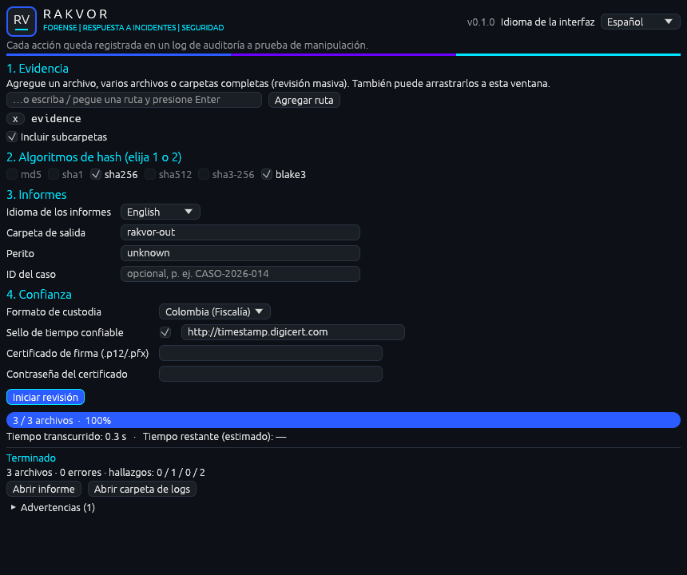
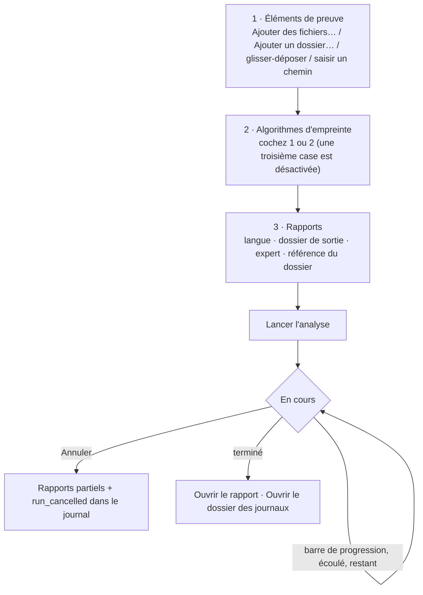

> La version de référence est la version anglaise ([usage-gui.md](usage-gui.md)) ; cette traduction la suit.

# Utiliser l'application de bureau (Windows 10/11)

Lancez **RV HashInv** depuis le menu Démarrer (programme d'installation) ou double-cliquez sur `rv-hashinv-gui.exe`
(zip portable). Aucun autre logiciel n'est nécessaire ; l'application fonctionne aussi sur des machines virtuelles
sans pilote graphique (rendu logiciel).

## Déroulement

## La fenêtre

| Zone | Ce qu'elle fait |
| --- | --- |
| **1. Éléments de preuve** | *Ajouter des fichiers…* et *Ajouter un dossier…* ouvrent les sélecteurs de Windows. Vous pouvez aussi glisser des fichiers ou des dossiers sur la fenêtre (ou sur l'icône de `rv-hashinv-gui.exe` avant son lancement), ou coller un chemin et appuyer sur Entrée. *Inclure les sous-dossiers* est coché par défaut. Retirez une entrée avec **x**. |
| **2. Algorithmes d'empreinte** | Cochez-en un ou deux. Quand deux sont cochés, les autres sont désactivés ; on ne peut pas décocher le dernier. |
| **3. Rapports** | Langue (English, Español, Français, ou les trois), dossier de sortie, nom de l'expert (par défaut votre utilisateur Windows), référence du dossier facultative. |
| **4. Confiance** | *Horodatage* (activé par défaut ; adresse de la TSA modifiable), *Certificate…* pour choisir votre `.p12`/`.pfx` et son mot de passe (gardé en mémoire seulement, jamais journalisé) afin de signer chaque PDF, et *Juridiction* (Colombie / France) pour la fiche de traçabilité. |
| **Langue de l'interface** | Sélecteur en haut à droite : English, Español, Français. Change immédiatement tous les libellés ; indépendant de la langue des rapports. |
| **Lancer l'analyse / Annuler** | Lancer est actif dès qu'un élément est ajouté. Pendant une exécution, les réglages sont verrouillés et le bouton devient *Annuler*. |
| **Progression** | Barre selon les octets traités, `fichiers traités / total`, temps écoulé (toujours en mouvement) et temps restant estimé. Le fichier en cours de lecture s'affiche en dessous. |
| **Résultat** | Nombre par gravité, **Ouvrir le rapport** (page des statistiques dans votre langue) et **Ouvrir le dossier des journaux**. |

## Dossier de l'affaire

Renseignez **Dossier de l'affaire** dans la section 1 pour travailler dans un dossier partagé de l'affaire (voir
[case-folder.md](case-folder.md), en anglais). Pour un nouveau dossier, renseignez aussi la **Référence du dossier**
(et la juridiction de la fiche de traçabilité) : elles sont écrites une seule fois dans `case.json`. Tant qu'un dossier
de l'affaire est défini, le **Dossier de sortie** affiche `<case>/runs/rv-hashinv/<RUN-ID>` et n'est pas modifiable,
et vous pouvez lancer sans ajouter d'élément (chaque élément enregistré est examiné). Après l'exécution, le panneau de
résultat liste l'**ID d'élément** de chaque élément (E0001…) et son statut (enregistré, vérifié, divergent, absent du
registre). La modification est auditée sous `ui_case_dir_changed`.

RV Hub ouvre l'application avec le dossier de l'affaire déjà renseigné : `rv-hashinv-gui.exe --case-dir <CASE> [FILES...]`
(ou `--case-dir=<CASE>`). Le journal d'audit commence alors par `ui_case_dir_from_launcher` (le chemin et `at_utc`) ;
un `--case-dir` sans dossier est ignoré, signalé dans la fenêtre et journalisé sous `ui_launch_argument_ignored`.

## Ce que la GUI consigne

Vos choix font partie de la trace des éléments de preuve. Avant le début de l'exécution, la GUI les inscrit dans le
journal d'audit :

| Action | Consignée sous |
| --- | --- |
| Ajouter / retirer un élément | `ui_input_added`, `ui_input_removed` |
| Modifier la sélection d'empreintes | `ui_hash_selection_changed` |
| Modifier la langue / les sous-dossiers | `ui_language_changed`, `ui_recursive_changed` |
| Ouverte par RV Hub avec `--case-dir` | `ui_case_dir_from_launcher`, `ui_case_dir_changed` (ou `ui_launch_argument_ignored`) |
| Clic sur Lancer | `ui_start_clicked` (réglages finaux) |
| Clic sur Annuler | `item_cancelled`, `run_cancelled` |

Les erreurs pendant l'exécution apparaissent sous **Avertissements** et dans le journal sous `item_error`.
Les messages de validation affichés *avant* une exécution (p. ex. « Add at least one file or folder ») ne sont pas
journalisés, car aucune exécution — et donc aucun journal — n'existe encore.

## Mêmes résultats que la ligne de commande

La GUI appelle le même moteur que `rv-hashinv scan`. Une exécution dans la GUI avec les mêmes éléments, les mêmes
algorithmes et la même langue donne des empreintes et des constatations identiques ; `environment.json` consigne
`"frontend": "gui"` et les réglages utilisés.
