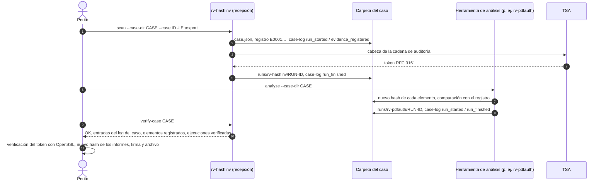
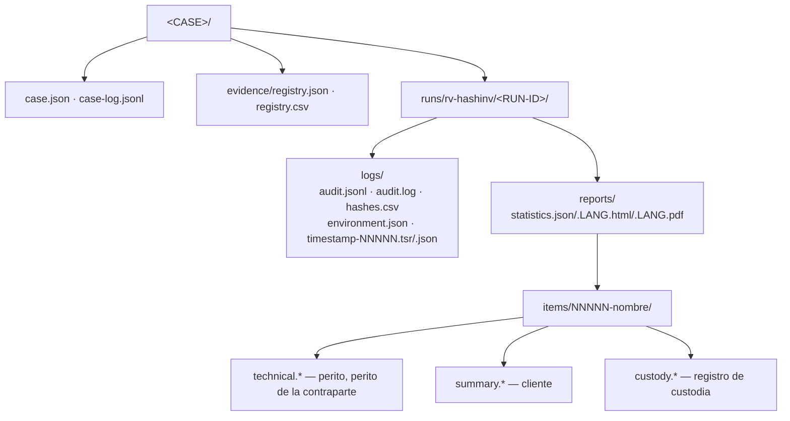

> La versión de referencia es la inglesa ([usage.md](usage.md)); esta traducción la sigue.

# Guía de uso: de la recepción de la evidencia a un caso verificado

Esta es la guía completa para el perito. Recorre un caso, explica cada salida, indica cómo leer cada hallazgo y cómo
probar después que nada cambió. Las listas de opciones no se repiten aquí:

- las cinco tareas más comunes en resumen: [quick-guide.es.md](quick-guide.es.md);
- cada comando, opción, valor por defecto, ejemplo y código de salida: [usage-cli.md](usage-cli.md) (generado desde
  `--help`, en inglés);
- la aplicación de escritorio, ventana por ventana: [usage-gui.es.md](usage-gui.es.md);
- el contrato de la carpeta del caso: [case-folder.md](case-folder.md) (en inglés);
- por qué funciona cada verificación: [theory.md](theory.md); peso legal: [admissibility.md](admissibility.md) (en
  inglés);
- instalar y verificar la herramienta: [installation.es.md](installation.es.md).



## 1. Antes de empezar

| Verificación | Por qué | Cómo |
| --- | --- | --- |
| Trabaje sobre una **copia verificada** (imagen forense, exportación con bloqueador de escritura), nunca sobre el soporte original | La herramienta es de solo lectura por software, no es un bloqueador de escritura | Herramienta de imagen + bloqueador de escritura; anote modelo y número de serie |
| La herramienta instalada es la versión auténtica | Pregunta del tribunal: "¿cómo sabe qué programa ejecutó?" | [installation.es.md](installation.es.md) pasos 2–4 y 6 |
| Política de hash | MD5/SHA-1 solos no son resistentes a colisiones | Incluya siempre `sha256` (o `sha512`): `--hash sha256,md5` cuando un registro anterior usa MD5 |
| Reloj | Las horas de auditoría vienen del reloj del equipo | Verifique la sincronización horaria de Windows antes de la ejecución |
| Jurisdicción | Selecciona el formato de custodia | `--jurisdiction co` (por defecto) o `fr`; en una carpeta del caso se fija al crearla |
| Sello de tiempo | TSA en línea por defecto | `--no-timestamp` sin red y luego `rv-hashinv timestamp`; `--tsa-url` para una TSA cualificada / ECD |
| Certificado del perito | Firma cada informe PDF | `--sign-cert examiner.p12` ([firma](#7-firmar-los-informes-con-el-certificado-del-perito)) |
| Un caso, una carpeta | Todas las herramientas del caso se enlazan al mismo registro y al mismo log del caso | Cree la carpeta del caso en el volumen del caso, p. ej. `D:\cases\CASE-2026-014` |

## 2. Recorrido de un caso

El caso de ejemplo: `CASE-2026-014`, jurisdicción colombiana, perita Ana Ruiz, una exportación del cliente en
`E:\export` (aquí: los tres archivos de ejemplo). Las salidas de los comandos que siguen vienen de una ejecución real
del ejemplo frente a la TSA local de pruebas (`tests/fake_tsa.py`); las rutas están acortadas.

<!-- forge:domain -->
### 2.1 Recepción: registrar la evidencia

```powershell
rv-hashinv scan --case-dir D:\cases\CASE-2026-014 --case CASE-2026-014 --jurisdiction co `
    -i E:\export -r --hash sha256,md5 --actor "Ana Ruiz" --sign-cert C:\certs\ana-ruiz.p12
```

```text
DONE  run 20261021T154339Z-6e298b
  items: 3  bytes: 234  errors: 0  elapsed: 1.2 s
  findings: high 0, medium 1, low 0, info 2
  timestamp: ok 2026-10-21T15:43:40Z
  report: D:\cases\CASE-2026-014\runs\rv-hashinv\20261021T154339Z-6e298b\reports\statistics.en.html
  logs:   D:\cases\CASE-2026-014\runs\rv-hashinv\20261021T154339Z-6e298b\logs
  case:   CASE-2026-014 (intake) registered 3 (new 3), verified 0, mismatched 0, not in registry 0
```

Qué pasó, en orden: la carpeta del caso no existía, así que `case.json` se escribió una sola vez (`--case` y
`--jurisdiction` solo hacen falta ahora) y `case_created` abrió el log del caso; se agregó `run_started` al log del
caso; cada archivo se procesó una vez con SHA-256 y MD5 y se tipificó por sus primeros bytes; los tres archivos se
registraron como `E0001` (`acta-copia.txt`), `E0002` (`acta.txt`) y `E0003` (`foto-vacaciones.jpg`), ordenados por
ruta, en `evidence\registry.json` / `.csv`, y `evidence_registered` registró el nuevo SHA-256 del registro en el log
del caso; los informes y el formato de custodia de cada elemento llevan ahora su ID de evidencia; se obtuvo el
sello de tiempo de la cabeza de la cadena de auditoría; `run_finished` en el log del caso registró la cabeza final de auditoría de
la ejecución.

Repetir la misma recepción sobre archivos sin cambios conserva los ID (`registered 3 (new 0)`). Un archivo modificado
en una ruta registrada recibe un ID nuevo y `REGISTRY_PATH_CONTENT_CHANGED`. Use `-i` varias veces, `-r` para las
subcarpetas, o `--input-list files.txt` (una ruta por línea, comentarios con `#`, rutas relativas a la carpeta de la
lista).

### 2.2 Análisis: las herramientas posteriores vuelven a verificar cada elemento

Toda herramienta de análisis de Rakvor (cualquier herramienta creada desde esta plantilla con `CASE_ROLE` igual a
`analysis`) acepta el mismo `--case-dir`. Sin `-i` examina cada elemento registrado; `--evidence E0001,E0003`
selecciona algunos.

```powershell
rv-pdfauth analyze --case-dir D:\cases\CASE-2026-014 --actor "Ana Ruiz" --sign-cert C:\certs\ana-ruiz.p12
```

Antes de analizar cada archivo, la herramienta vuelve a calcular su hash (agregando SHA-256 si su selección no
comparte ningún algoritmo con el registro, lo que se registra como `case_algorithm_added`) y lo compara con el
registro: por ID de `--evidence`, si no por ruta, si no por contenido. Su resumen termina con una línea como
`case: CASE-2026-014 (analysis) registered 0 (new 0), verified 3, mismatched 0, not in registry 0`. Un archivo que ya
no coincide genera `EVIDENCE_HASH_MISMATCH_WITH_CASE` (alta, código de salida 3) y **se analiza de todos modos**, para
que el perito decida; un archivo nunca registrado genera `EVIDENCE_NOT_IN_CASE_REGISTRY` (media).

> **rv-pdfauth en su commit actual todavía no implementa `--case-dir`** (su página de admisibilidad lo lista como la
> brecha G24). Mientras tanto, ejecútelo con `--out D:\cases\CASE-2026-014\runs\rv-pdfauth` y compare su `hashes.csv`
> con `evidence\registry.csv` por SHA-256, como se describe en la guía de uso de rv-pdfauth. Conserve esa salida en el
> expediente del caso.
<!-- /forge:domain -->

### 2.3 Verificar el caso completo

```powershell
rv-hashinv verify-case D:\cases\CASE-2026-014
```

```text
OK  case CASE-2026-014: 4 case-log entries, 3 registered items, 1 runs verified: D:\cases\CASE-2026-014
```

Toda herramienta Rakvor tiene `verify-case` y todas coinciden (un caso escrito por la versión Rust se verifica con la
versión Python y al revés). Verifica la cadena del log del caso, `case.json`, el hash del registro, la cadena de
auditoría y los tokens de sello de tiempo de cada ejecución, y los enlaces cruzados entre el log del caso y cada
ejecución ([theory.md B7](theory.md#b7-the-case-folder)). Salida 0 = intacto (se imprimen las advertencias, como una
ejecución todavía en curso), 3 = roto, 1 = no es una carpeta de caso. Por defecto no vuelve a calcular el hash de la
evidencia; agregue `--rehash` para leer cada elemento registrado que siga accesible en su ruta registrada y comparar
sus hashes con el registro (una ruta registrada varias veces se compara con su último registro):

```text
rv-hashinv verify-case D:\cases\CASE-2026-014 --rehash
OK  case CASE-2026-014: 4 case-log entries, 3 registered items, 1 runs verified: D:\cases\CASE-2026-014
    re-hashed 3 of 3 registered items: 3 match the registry
```

Un archivo que difiere aparece como `E0002 <path>: sha256 differs from the registry (registered …, now …)` y el código
de salida es 3; un archivo no accesible desde este equipo es una advertencia, no un fallo.

### 2.4 Lo mismo desde la aplicación de escritorio

Inicie **RV HashInv**, complete **Carpeta del caso** en la sección 1 (y **ID del caso** más la jurisdicción del
formato de custodia para un caso nuevo), agregue la evidencia (archivos, carpetas, arrastrar y soltar), o ninguna para
volver a examinar cada elemento registrado, marque uno o dos algoritmos de hash, defina el idioma de los informes y el
perito en *3. Informes*, el sello de tiempo y el certificado en *4. Confianza*, y luego **Iniciar revisión**. La
carpeta de salida se deriva de la carpeta del caso y queda bloqueada; el panel de resultado lista cada ID de evidencia
y su estado. Cada ajuste que cambie antes de empezar se escribe en el log de auditoría de la ejecución (acciones
`ui_*`). El motor, las salidas y los hallazgos son los mismos que en la CLI. Detalles:
[usage-gui.es.md](usage-gui.es.md).

### Inicio desde RV Hub: `--case-dir` y `describe --json`

RV Hub (el lanzador de Rakvor) encuentra las herramientas instaladas, las abre sobre una carpeta del caso y sugiere
cuál conviene para un archivo. Se apoya en dos puntos de entrada de RV HashInv:

- **`rv-hashinv-gui.exe --case-dir <CASE> [FILES...]`** inicia la aplicación de escritorio con **Carpeta del caso** ya
  completada (`--case-dir=<CASE>` también funciona). Los demás argumentos se cargan como evidencia, como cuando se
  sueltan archivos sobre el icono. El ajuste previo se escribe en el log de auditoría de la ejecución como
  `ui_case_dir_from_launcher` (ruta y `at_utc`) seguido de `ui_case_dir_changed`. Un `--case-dir` sin carpeta se
  ignora: la ventana lo indica y el log de auditoría registra `ui_launch_argument_ignored`.
- **`rv-hashinv describe --json`** imprime un objeto JSON (claves ordenadas) que lee RV Hub; está oculto en
  `rv-hashinv --help` pero aparece en [usage-cli.md](usage-cli.md). No lee ni escribe nada. Esquema:
  [`schemas/describe.schema.json`](../schemas/describe.schema.json) (`rakvor.describe/1`, idéntico en toda
  herramienta Rakvor).

| Campo | Significado |
| --- | --- |
| `schema` | `rakvor.describe/1` |
| `tool`, `title`, `version` | `rv-hashinv`, `RV HashInv`, la versión del producto (`version.txt`) |
| `role` | `intake` (registra la evidencia en la carpeta del caso) |
| `main_verb` | `scan`: el comando que hace el trabajo principal |
| `accepts` | `extensions` (en minúsculas, sin punto) y `signatures` de contenido (`format` + `match`: bytes hexadecimales en un desplazamiento); `"*"` = cualquier archivo |
| `case_formats`, `log_formats` | `rakvor.case/1`; `rakvor.audit/1` = `logs/audit.jsonl`, `rakvor.review/1` = `logs/review.jsonl` |
| `cli_exe`, `gui_exe` | `rv-hashinv.exe`, `rv-hashinv-gui.exe` |
| `exit_codes` | El significado de 0, 1, 2, 3 y 130 (tabla de la sección 9) |

```powershell
rv-hashinv describe --json
```

## 3. Leer las salidas



Sin `--case-dir`, `logs\<RUN-ID>\` y `reports\<RUN-ID>\` se crean dentro de `--out` (por defecto `.\rakvor-out`).

| Salida | Para | Para qué sirve |
| --- | --- | --- |
| `statistics.*` | Perito, abogado | Visión general de la ejecución: quién, cuándo, interfaz, algoritmos, totales y velocidad, hallazgos por severidad y código, elementos por tipo detectado, grupos de duplicados (rutas), la sección de la carpeta del caso (registrados / agregados / verificados / no coinciden / no registrados), estado del sello de tiempo, firmante, cabeza de la cadena de auditoría y número de entradas en el momento en que se escribió |
| `technical.*` | Perito, perito de la contraparte | Un archivo: ruta, tamaño, fecha de modificación, extensión, tipo detectado, estado, ID de evidencia y "Registrado en la recepción (UTC)" (carpeta del caso), todos los hashes, hallazgos con *lo que muestra / lo que no demuestra*, método, entradas de auditoría `#primera–#última`, limitaciones |
| `summary.*` | Cliente | Estado en lenguaje sencillo, la huella principal, los hallazgos en una frase cada uno, el siguiente paso |
| `custody.*` | Registro de custodia | Formato de la jurisdicción (en español para `co`, en francés para `fr`) + copia en inglés, prellenado desde la ejecución, con 6 filas de traspaso en blanco para firmar. Es un registro interno, que se usa **junto con** el formato oficial ([admissibility.md](admissibility.md#consolidated-gap-list) G9) |
| `audit.jsonl` / `audit.log` | Verificación | Cada acción, encadenada por hashes / lo mismo, legible (no es la fuente autorizada) |
| `hashes.csv` | Verificación | Registro de hashes: `index,path,size,<algo1>[,<algo2>],status,error` |
| `environment.json` | Reproducibilidad | Herramienta, compilador, versión de cada dependencia, SO, equipo, usuario, línea de comandos (o ajustes de la GUI) |
| `timestamp-NNNNN.tsr` / `.json` | Verificación | Respuesta RFC 3161 para la entrada de auditoría NNNNN, y su resumen |
| `case.json`, `case-log.jsonl` | Verificación | Identidad del caso (escrita una vez); cada ejecución de herramienta sobre el caso, cambios del registro, cabezas finales de auditoría |
| `evidence\registry.json` / `.csv` | Todos | La lista de evidencia del caso: ID, ruta en la recepción, tamaño, hashes, qué ejecución la registró y cuándo |

**Estado y siguiente paso por elemento:** `problem` (un hallazgo alto: no se apoye en el archivo hasta que se
explique), `attention` (medio o bajo: revíselo con el perito), `ok` (solo informativo). **El código de salida 3**
significa "terminado, al menos un hallazgo de severidad alta": un resultado normal para evidencia, no un error.

## 4. Interpretar cada hallazgo

Severidad entre paréntesis. "Verificar después" es lo que el perito debe hacer antes de apoyarse en el hallazgo; "No
concluir" es la extralimitación que hay que evitar en un informe. El texto exacto impreso en los informes está en
`i18n/es.json` (y en `en.json`, `fr.json`).

<!-- forge:domain -->
| Código | Verificar después | No concluir |
| --- | --- | --- |
| `EXTENSION_MISMATCH` (media) | El tipo detectado; abra el archivo con una herramienta para ese tipo; pregunte cómo se llamaba el archivo en el origen | Intención de ocultar algo: las exportaciones, descargas y aplicaciones de mensajería renombran archivos |
| `EXECUTABLE_CONTENT` (alta) | Confirme con un analizador PE/ELF (una coincidencia `MZ` de 2 bytes puede ser un falso positivo); trátelo como hostil; analícelo en un entorno aislado | Que el programa sea malicioso, o que alguien lo haya ejecutado |
| `EMPTY_FILE` (informativa) | Si el origen conserva el archivo con contenido; el tamaño en la adquisición | Que se haya vaciado a propósito |
| `DUPLICATE` (informativa) | El grupo en `statistics.*` (rutas) y `hashes.csv`; verifique que el algoritmo principal sea SHA-256 | Quién copió el archivo, cuándo, o cuál copia es la original |
| `UNREADABLE` (alta) | El error del SO (permisos, bloqueos, longitud de la ruta); vuelva a adquirir y a ejecutar; los elementos ilegibles **no** se registran | Que el archivo esté dañado o haya sido ocultado |
| `REGISTRY_PATH_CONTENT_CHANGED` (media) | Ambos ID de evidencia en `registry.csv`; qué ejecución registró cada uno; cómo cambió el origen entre recepciones | Cuál versión es la original, o por qué cambió |
<!-- /forge:domain -->

| Código (carpeta del caso, herramientas de análisis) | Verificar después | No concluir |
| --- | --- | --- |
| `EVIDENCE_HASH_MISMATCH_WITH_CASE` (alta) | Hash esperado y real en el hallazgo; vuelva a calcular a mano el hash del archivo y de la copia de la recepción; revise el almacenamiento, las transferencias y quién tuvo acceso desde la recepción (log del caso) | Quién lo cambió, cuándo, o que haya sido deliberado |
| `EVIDENCE_NOT_IN_CASE_REGISTRY` (media) | Si el archivo debía pasar por la recepción; regístrelo (ejecución de recepción) si es evidencia nueva | Que el archivo esté alterado o sea irrelevante |

## 5. Trabajar sin carpeta del caso

El mismo comando funciona de forma independiente para un inventario rápido (sin registro ni log del caso):

```powershell
rv-hashinv scan -i D:\evidence -r --hash sha256,md5 --lang all --case CASE-2026-014 --out D:\work\inventory
rv-hashinv scan --input-list files.txt --progress jsonl > events.jsonl      # one JSON event per line on stdout
```

`--progress jsonl` imprime cada evento (`run_started`, `item_started`, `item_hashed`, `progress` con tiempo
transcurrido y ETA, `item_finished`, `evidence_linked`, `error`, `cancelled`, `timestamp`, `report_written`,
`run_finished`) para scripts; una salida estándar cerrada nunca interrumpe la ejecución. **Ctrl+C** se detiene tras el
bloque actual de 1 MiB: se escriben informes parciales, se registra `run_cancelled`, código de salida 130.

## 6. Sellos de tiempo

Por defecto, cada ejecución pide a la TSA (`http://timestamp.digicert.com`, se cambia con `--tsa-url`) que firme la
cabeza de la cadena de auditoría justo antes de escribir el informe estadístico. El token cubre cada hash de
evidencia, hallazgo y hash de informe de elemento registrado antes de él, no el informe estadístico ni `run_finished`
escritos después ([theory.md B8](theory.md#b8-rfc-3161-trusted-timestamp)).

| Situación | Qué ocurre | Qué hacer |
| --- | --- | --- |
| TSA accesible | `timestamp_obtained`; archivos `timestamp-NNNNN.tsr` y `.json` en la carpeta de logs; el informe estadístico muestra la hora | Verifique con OpenSSL (abajo) |
| Sin red | `timestamp_pending`; la ejecución termina; advertencia en el informe estadístico y en la consola | Más tarde, con red: `rv-hashinv timestamp <carpeta de logs>` |
| `--no-timestamp` / `RV_NO_TIMESTAMP=1` / casilla desmarcada en la GUI | No hay solicitud | Use `rv-hashinv timestamp` más tarde si hace falta |
| Cadena rota | `rv-hashinv timestamp` se niega (salida 3): no se agrega sello de tiempo a un log roto | Investigue; no repare |

`verify-log` verifica el hash del token, que cubra la cabeza registrada y la firma CMS de la TSA
(`TSA signature valid (signer: …)`). La cadena del certificado de la TSA solo se valida con `--tsa-ca`:

```bash
rv-hashinv verify-log <log folder> --tsa-ca <TSA roots.pem>
# → … TSA signature valid (signer: …); chain validated to … (revocation not checked)
# without --tsa-ca: … chain not checked (pass --tsa-ca <CA bundle> to validate it)
```

Un archivo de CA ilegible da salida 1; un fallo de firma o de cadena da salida 3; un token registrado en el log cuyo
`.tsr` o `.json` falta también da salida 3. La revocación nunca se verifica (brecha G18). Como verificación
independiente de **firma y cadena**, use OpenSSL (Git for Windows incluye `openssl.exe`); tampoco verifica la
revocación (no se le da ninguna CRL y OpenSSL no consulta OCSP):

```bash
cd <log folder>
N=00022                                                   # from the file name timestamp-00022.tsr
H=$(python -c "import json;print(json.load(open('timestamp-$N.json'))['head'])")
openssl ts -reply -in timestamp-$N.tsr -text              # genTime, policy OID, TSA name, serial, nonce, accuracy
openssl ts -reply -in timestamp-$N.tsr -token_out -out token.der
openssl pkcs7 -inform DER -in token.der -print_certs > tsa-certs.pem   # certificates sent by the TSA
openssl ts -verify -digest "$H" -in timestamp-$N.tsr -CAfile <TSA root.pem> -untrusted tsa-certs.pem
# → "Verification: OK"  (signature and chain only, not revocation)
```

Establezca por separado el estado de revocación del certificado de la TSA, a partir de evidencia CRL/OCSP que cubra
genTime (una CRL emitida después de genTime por la CA de la TSA, o una respuesta OCSP archivada en el momento del
sellado), p. ej.
`openssl verify -crl_check -CRLfile tsa-ca.crl -CAfile <TSA root.pem> -untrusted tsa-certs.pem -attime <genTime-epoch> tsa.pem`,
o `rv-certcheck analyze --crl … --ocsp …`. Obtenga el certificado raíz de la TSA en el repositorio de la propia TSA, no
del token. Guarde la salida en el expediente del caso: es la evidencia de que la hora es auténtica.

> **Fechas de la CRL y `-attime`.** OpenSSL aplica `-attime` también a la CRL, así que `openssl verify -crl_check -attime <genTime-epoch>` solo funciona con una CRL cuyo intervalo `thisUpdate`–`nextUpdate` contenga genTime; una CRL emitida después de genTime falla con "CRL is not yet valid". Para usar como evidencia una CRL posterior, verifique su firma (`openssl crl -in tsa-ca.crl -CAfile <TSA root.pem> -noout -verify`) y luego busque en ella el número de serie del certificado de la TSA (`openssl crl -in tsa-ca.crl -noout -text`): si no aparece, o aparece con una fecha de revocación posterior a genTime, no estaba revocado en genTime. Una CA puede quitar de sus CRL los certificados vencidos, así que para un certificado de TSA ya vencido un número de serie ausente no es concluyente: use una CRL anterior a su vencimiento, o una respuesta OCSP archivada en el momento del sellado.

## 7. Firmar los informes con el certificado del perito

`--sign-cert <file.p12|.pfx>` firma **cada informe PDF** (estadísticas, técnico, resumen, custodia) con su propio
certificado (solo claves RSA). La contraseña se lee de la variable de entorno indicada por `--sign-pass-env` (por
defecto `RV_SIGN_PASSWORD`) o se pide en la terminal (no se muestra nada mientras escribe). Nunca se registra; el log
registra `signing_certificate_loaded` con el sujeto y el SHA-256 del certificado, y cada informe imprime ambos
(`Signed by <subject> (certificate SHA-256 <fingerprint>)`). Una contraseña incorrecta detiene la ejecución
(`run_failed`, salida 1) antes de leer cualquier evidencia. En la GUI: *4. Confianza → Certificado de firma* y
*Contraseña del certificado* (solo en memoria).

```powershell
$s = Read-Host "Certificate password" -AsSecureString
$env:RV_SIGN_PASSWORD = [Runtime.InteropServices.Marshal]::PtrToStringBSTR(
    [Runtime.InteropServices.Marshal]::SecureStringToBSTR($s))
rv-hashinv scan --case-dir D:\cases\CASE-2026-014 -i E:\export -r --sign-cert C:\certs\ana-ruiz.p12
Remove-Item Env:RV_SIGN_PASSWORD
(Get-PfxCertificate C:\certs\ana-ruiz.p12).GetCertHashString("SHA256")   # publish this fingerprint
```

Verifique un informe firmado con Adobe Acrobat/Reader (panel de firmas) o con pyHanko:
`pyhanko sign validate --pretty-print --trust <your CA or certificate .pem> technical.en.pdf` (resultado esperado:
intacto, cobertura del archivo completo). Los informes HTML y JSON no se firman; sus hashes están en la cadena de
auditoría sellada en el tiempo. El peso legal de esta firma depende del certificado
([admissibility.md](admissibility.md) G3).

## 8. Verificar una ejecución

Cualquiera (usted, un colega, el perito de la contraparte) puede verificar una ejecución con su carpeta de logs, su
carpeta de informes y la copia de la evidencia:

```powershell
rv-hashinv verify-log D:\cases\CASE-2026-014\runs\rv-hashinv\20261021T154339Z-6e298b\logs
# OK  25 entries, chain intact: …\audit.jsonl
#     timestamp 2026-10-21T15:43:40Z by http://127.0.0.1:33481/tsr covers entry #22
#     truncation: the final entry #25 is anchored by the case log (run_finished)
#     outputs: 38 verified of 38 recorded (md5, sha256)
#     not re-hashed: logs/timestamp-00022.tsr (RFC 3161 token: checked by the timestamp verification)
```

La línea `truncation:` dice qué respalda la longitud del log. Una ejecución independiente con sello de tiempo imprime
`truncation: entries up to #22 are anchored by the RFC 3161 timestamp (timestamp-00022.json); 3 entries after it
(timestamp_obtained, statistics_report_written, run_finished) cannot be proven complete`; una ejecución independiente
sin sello de tiempo imprime `truncation not detectable without a timestamp or case record`. Un log más corto que lo
que indican su sello de tiempo o el registro del caso es `BROKEN` (`truncated: …`, salida 3).

La línea `outputs:` es el nuevo cálculo del hash de cada archivo que, según el log, escribió la ejecución (los informes
de cada elemento, los informes estadísticos, `hashes.csv`, `environment.json`), con cada algoritmo que registró el
log; para cada archivo vale la última entrada. Un archivo editado, borrado o reemplazado después de la ejecución deja
la ejecución en `BROKEN` (salida 3) y se nombra:

```text
BROKEN  …udit.jsonl
  - output reports/statistics.json: sha256 differs from audit entry #37 (recorded e8ed…, now 73cb…): edited or replaced after the run
  - output reports/items/00002-photo.jpg/technical.en.pdf: missing (recorded by audit entry #31): deleted or moved after the run
    outputs: 36 verified of 38 recorded (sha256), 1 missing, 1 changed
```

Una ruta registrada que es absoluta, contiene `..` o se resuelve fuera de la carpeta de la ejecución mediante un
enlace simbólico o una unión se rechaza y nunca se lee. El token de sello de tiempo aparece como `not re-hashed`
porque la verificación del sello de tiempo de arriba ya lo comprueba. Los archivos que la ejecución no registró
(cualquier cosa agregada después a la carpeta) no se verifican.

| Paso | Comando | Prueba |
| --- | --- | --- |
| 1 | `rv-hashinv verify-log <log>` (salida 0 intacto, 3 roto o truncado) | Ninguna entrada editada, borrada ni reordenada; el token de sello de tiempo coincide con la cabeza que cubre; el log todavía llega hasta la entrada que cubre su sello de tiempo y, en una carpeta del caso, hasta la entrada final registrada en el log del caso (la línea `truncation:` nombra el ancla) |
| 2 | `python tests/verify_chain.py <log>` (árbol de fuentes) | Lo mismo, con una implementación independiente; además vuelve a calcular el hash de la evidencia listada en `hashes.csv` y de cada salida registrada en el log de auditoría |
| 3 | OpenSSL ([Sellos de tiempo](#6-sellos-de-tiempo)) | La TSA realmente firmó esa cabeza en ese momento |
| 4 | Paso 1 (línea `outputs:`); el script de abajo para una verificación independiente | Cada archivo de informe, `environment.json` y `hashes.csv` conserva el hash registrado en el log |
| 5 | `rv-hashinv verify-case <CASE> --rehash` | La ejecución es la que anunció el log del caso, completa hasta su entrada final registrada, con cada salida registrada sin cambios; la evidencia accesible sigue coincidiendo con el registro |
| 6 | `python tests/validate_reports.py <CASE or report folder>` | Cada informe JSON, `case.json` y `registry.json` cumplen sus esquemas |

El paso 4 está integrado en `verify-log` y `verify-case`. Para comprobarlo con código que se lee en una pantalla (una
implementación independiente, p. ej. para el perito de la contraparte), vuelva a calcular el hash de cada archivo que
registró la ejecución:

```bash
python - "<log folder>" "<report folder>" <<'EOF'
import hashlib, json, pathlib, sys
log, rep = pathlib.Path(sys.argv[1]), pathlib.Path(sys.argv[2])
def digest(p, algo):
    h = hashlib.new({"sha3-256": "sha3_256"}.get(algo, algo)); h.update(p.read_bytes()); return h.hexdigest()
checked = bad = 0
for line in (log / "audit.jsonl").open(encoding="utf-8"):
    e = json.loads(line); a, d = e["action"], e["details"]
    if a == "item_reports_written":
        files = {rep / d["folder"] / k: v for k, v in d["files"].items()}
    elif a == "statistics_report_written":
        files = {rep / k: v for k, v in d["files"].items()}
    elif a in ("environment_recorded", "hash_register_written"):
        files = {log / e["item"]: d}
    else:
        continue
    for p, digests in files.items():
        algo = next(x for x in ("sha256", "sha512", "sha3-256", "sha1", "md5") if x in digests)
        checked += 1
        got = digest(p, algo) if p.is_file() else "missing"
        if got != digests[algo]:
            bad += 1; print("MISMATCH", p, algo, got)
print(f"{checked} files checked, {bad} mismatches"); sys.exit(3 if bad else 0)
EOF
```

Con la ejecución de ejemplo (3 elementos, un idioma) se verifican 38 archivos; agregar un byte a `statistics.json` da
`MISMATCH … statistics.json` y el código de salida 3. Un solo archivo en PowerShell:
`(Get-FileHash <file> -Algorithm SHA256).Hash.ToLower()` y busque el valor en `audit.jsonl`.

## 9. Solución de problemas

### Códigos de salida

| Comando | 0 | 1 | 2 | 3 | 130 |
| --- | --- | --- | --- | --- | --- |
| `scan` | terminado, ningún hallazgo alto | error de ejecución (entrada no encontrada, salida no escribible, contraseña del certificado incorrecta, log del caso bloqueado) | error de uso (opción o algoritmo desconocido, tres algoritmos, idioma desconocido; con `--case-dir`: carpeta de otro caso, falta `--case` al crearla, ID de evidencia desconocido) | terminado, ≥ 1 hallazgo alto; o la carpeta del caso no pasa la verificación (no se escribe nada) | cancelado (Ctrl+C), se escriben informes parciales |
| `verify-log` | intacto | log ilegible | — | cadena rota, token que no coincide, o truncado (más corto que su sello de tiempo o el registro del caso) | — |
| `verify-case` | caso intacto (se imprimen advertencias) | no es una carpeta de caso (no hay `case.json`) | — | al menos una verificación falló (con `--rehash`: un archivo de evidencia difiere del registro) | — |
| `timestamp` | obtenido y registrado | TSA inaccesible (no cambió nada) | — | log ausente, roto o ilegible (no se agrega nada) | — |
| `self-test` | todo pasa | un fallo: no use este programa | — | — | — |
| `describe` | descripción impresa | — | error de uso (opción desconocida) | — | — |

### Mensajes

<!-- forge:domain -->
| Mensaje | Solución |
| --- | --- |
| `at most 2 hash algorithms can run at the same time (got 3)` | Elija uno o dos algoritmos |
| `unknown hash algorithm '…': use md5, sha1, sha256, sha512, sha3-256 or blake3` | Ortografía: `sha3-256` (también `sha3`, `sha3_256`) |
| `… is neither a file nor a folder (symbolic links are not followed)` | Indique el destino del enlace, o cópielo |
<!-- /forge:domain -->

| Mensaje | Solución |
| --- | --- |
| `… is not a case folder yet: give --case ID (and --jurisdiction) to create it` | Primera ejecución en una carpeta del caso nueva: agregue `--case` |
| `the case folder … belongs to case X, not Y` | Carpeta equivocada o `--case` equivocado; omita `--case` después de la creación |
| `evidence id(s) not in the case registry: E0042` | Revise `evidence\registry.csv`; los ID son `E` + número (`e7` = `E0007`) |
| `--evidence needs an existing case folder with a registry` | Haga primero la recepción |
| `refusing to extend a broken case (…)` / `the case folder … fails verification` | Ejecute `verify-case`; investigue qué cambió; **no repare** a mano un log del caso: abra una carpeta del caso nueva y documente por qué |
| `the case log is locked by <tool> run <id> (since …)` | Otra herramienta está escribiendo; espere y vuelva a ejecutar |
| `stale case lock … held by … for more than 10 minutes` | Asegúrese de que ninguna herramienta Rakvor esté trabajando en el caso, luego borre `case-log.lock` a mano (nunca es automático) y anótelo en el expediente del caso |
| `cannot load signing certificate …: wrong password or unsupported file` | Revise `RV_SIGN_PASSWORD`; el archivo debe ser un `.p12`/`.pfx` con clave privada |
| `only RSA signing certificates are supported` | Use un certificado RSA (ECDSA no se admite para firmar informes) |
| `warning: timestamp pending (…)` | Ver [Sellos de tiempo](#6-sellos-de-tiempo) |
| `refusing to append to a broken audit log` (`timestamp`) | El log fue editado; investigue con `verify-log`; no repare |
| `no audit log at …: nothing to timestamp` (`timestamp`) | Indique la carpeta `logs\<RUN-ID>` de la ejecución (o su `audit.jsonl`) |
| `truncated: …` (`verify-log`) | Se quitaron entradas del final del log después de hacerse el sello de tiempo o el registro del caso; investigue, no repare |
