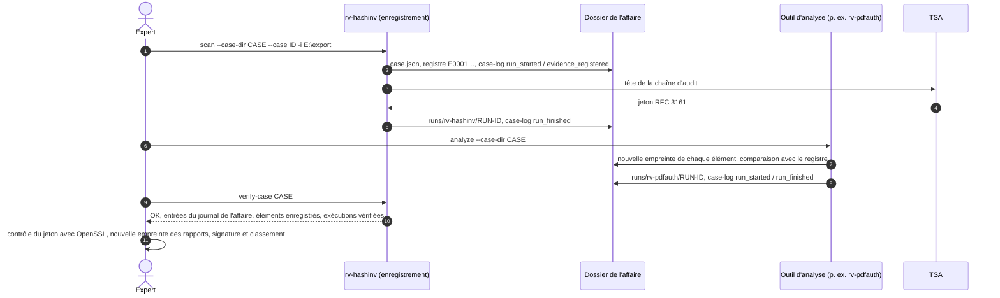
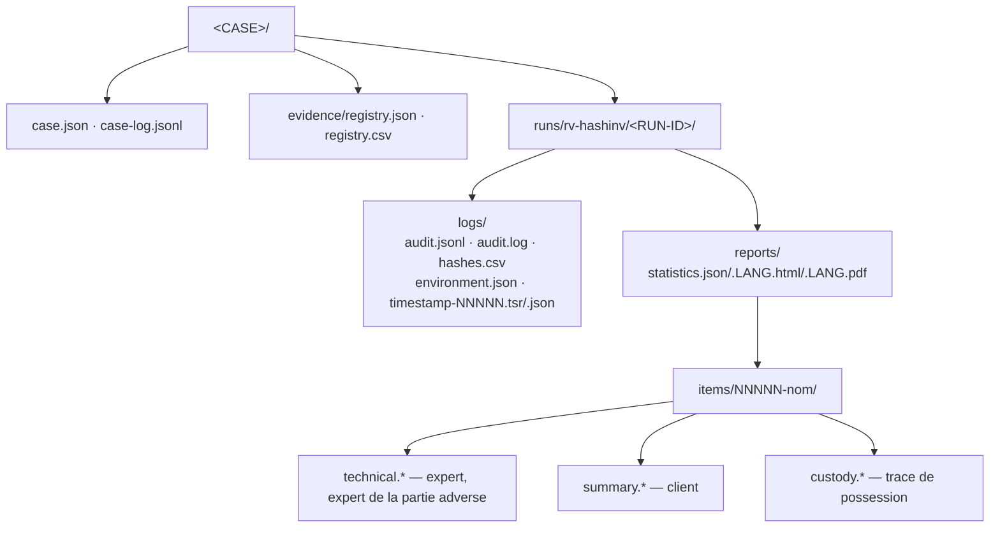

> La version de référence est la version anglaise ([usage.md](usage.md)) ; cette traduction la suit.

# Guide d'utilisation : de l'enregistrement à une affaire vérifiée

Voici le guide complet pour l'expert. Il suit une affaire de bout en bout, explique chaque sortie, indique comment
lire chaque constatation et comment prouver ensuite que rien n'a changé. Les listes d'options ne sont pas reprises
ici :

- les cinq tâches les plus courantes en bref : [quick-guide.fr.md](quick-guide.fr.md) ;
- chaque commande, option, valeur par défaut, exemple et code de sortie : [usage-cli.md](usage-cli.md) (généré à
  partir de `--help`, en anglais) ;
- l'application de bureau, fenêtre par fenêtre : [usage-gui.fr.md](usage-gui.fr.md) ;
- le contrat du dossier de l'affaire : [case-folder.md](case-folder.md) (en anglais) ;
- pourquoi chaque contrôle fonctionne : [theory.md](theory.md) ; portée juridique : [admissibility.md](admissibility.md)
  (en anglais) ;
- installer et vérifier l'outil : [installation.fr.md](installation.fr.md).



## 1. Avant de commencer

| Contrôle | Pourquoi | Comment |
| --- | --- | --- |
| Travaillez sur une **copie vérifiée** (image forensique, export avec bloqueur d'écriture), jamais sur le support d'origine | L'outil est en lecture seule de façon logicielle, ce n'est pas un bloqueur d'écriture | Outil d'imagerie + bloqueur d'écriture ; notez le modèle et le numéro de série |
| L'outil installé est la version authentique | Question du tribunal : « comment savez-vous quel programme vous avez exécuté ? » | [installation.fr.md](installation.fr.md) étapes 2–4 et 6 |
| Politique d'empreinte | MD5/SHA-1 seuls ne résistent pas aux collisions | Incluez toujours `sha256` (ou `sha512`) : `--hash sha256,md5` quand un ancien enregistrement utilise MD5 |
| Horloge | Les heures d'audit viennent de l'horloge du poste | Vérifiez la synchronisation de l'heure Windows avant l'exécution |
| Juridiction | Choisit la fiche de possession | `--jurisdiction co` (par défaut) ou `fr` ; dans un dossier d'affaire, elle est fixée à la création |
| Horodatage | TSA en ligne par défaut | `--no-timestamp` hors ligne, puis `rv-hashinv timestamp` ; `--tsa-url` pour une TSA qualifiée / ECD |
| Certificat de l'expert | Signe chaque rapport PDF | `--sign-cert examiner.p12` ([signature](#7-signer-les-rapports-avec-le-certificat-de-lexpert)) |
| Une affaire, un dossier | Tous les outils de l'affaire se relient au même registre et au même journal de l'affaire | Créez le dossier de l'affaire sur le volume de l'affaire, p. ex. `D:\cases\CASE-2026-014` |

## 2. Parcours d'une affaire

L'affaire d'exemple : `CASE-2026-014`, juridiction colombienne, experte Ana Ruiz, un export du client sur `E:\export`
(ici : les trois fichiers d'exemple). Les sorties de commandes ci-dessous proviennent d'une exécution réelle de
l'exemple face à la TSA locale de test (`tests/fake_tsa.py`) ; les chemins sont raccourcis.

<!-- forge:domain -->
### 2.1 Enregistrement : inscrire les éléments de preuve

```powershell
rv-hashinv scan --case-dir D:\cases\CASE-2026-014 --case CASE-2026-014 --jurisdiction co `
    -i E:\export -r --hash sha256,md5 --actor "Ana Ruiz" --sign-cert C:\certs\ana-ruiz.p12
```

```text
DONE  run 20261021T154339Z-6e298b
  items: 3  bytes: 234  errors: 0  elapsed: 1.2 s
  findings: high 0, medium 1, low 0, info 2
  timestamp: ok 2026-10-21T15:43:40Z
  report: D:\cases\CASE-2026-014\runs\rv-hashinv\20261021T154339Z-6e298b\reports\statistics.en.html
  logs:   D:\cases\CASE-2026-014\runs\rv-hashinv\20261021T154339Z-6e298b\logs
  case:   CASE-2026-014 (intake) registered 3 (new 3), verified 0, mismatched 0, not in registry 0
```

Ce qui s'est passé, dans l'ordre : le dossier de l'affaire n'existait pas, donc `case.json` a été écrit une seule
fois (`--case` et `--jurisdiction` ne sont nécessaires qu'à ce moment) et `case_created` a ouvert le journal de
l'affaire ; `run_started` a été ajouté au journal de l'affaire ; chaque fichier a été haché une fois avec SHA-256 et
MD5 et typé d'après ses premiers octets ; les trois fichiers ont été enregistrés sous `E0001` (`acta-copia.txt`),
`E0002` (`acta.txt`) et `E0003` (`foto-vacaciones.jpg`), triés par chemin, dans `evidence\registry.json` / `.csv`, et
`evidence_registered` a consigné le nouveau SHA-256 du registre dans le journal de l'affaire ; les rapports et la
fiche de possession de chaque élément portent désormais son ID ; la tête de la chaîne d'audit a été horodatée ;
`run_finished` dans le journal de l'affaire a consigné la tête d'audit finale de l'exécution.

Relancer le même enregistrement sur des fichiers inchangés conserve les ID (`registered 3 (new 0)`). Un fichier
modifié à un chemin enregistré reçoit un nouvel ID et `REGISTRY_PATH_CONTENT_CHANGED`. Utilisez `-i` plusieurs fois,
`-r` pour les sous-dossiers, ou `--input-list files.txt` (un chemin par ligne, commentaires avec `#`, chemins relatifs
au dossier de la liste).

### 2.2 Analyse : les outils suivants revérifient chaque élément

Chaque outil d'analyse Rakvor (tout outil créé à partir de ce modèle avec `CASE_ROLE` égal à `analysis`) accepte le
même `--case-dir`. Sans `-i`, il examine chaque élément enregistré ; `--evidence E0001,E0003` en sélectionne certains.

```powershell
rv-pdfauth analyze --case-dir D:\cases\CASE-2026-014 --actor "Ana Ruiz" --sign-cert C:\certs\ana-ruiz.p12
```

Avant d'analyser chaque fichier, l'outil recalcule son empreinte (en ajoutant SHA-256 si votre sélection n'a aucun
algorithme en commun avec le registre, ce qui est consigné sous `case_algorithm_added`) et la compare au registre :
par ID `--evidence`, sinon par chemin, sinon par contenu. Son résumé se termine par une ligne comme
`case: CASE-2026-014 (analysis) registered 0 (new 0), verified 3, mismatched 0, not in registry 0`. Un fichier qui ne
correspond plus déclenche `EVIDENCE_HASH_MISMATCH_WITH_CASE` (élevée, code de sortie 3) et **est tout de même
analysé**, pour que l'expert décide ; un fichier jamais enregistré déclenche `EVIDENCE_NOT_IN_CASE_REGISTRY`
(moyenne).

> **rv-pdfauth, à son commit actuel, n'implémente pas encore `--case-dir`** (sa page d'admissibilité le liste comme
> lacune G24). D'ici là, lancez-le avec `--out D:\cases\CASE-2026-014\runs\rv-pdfauth` et comparez son `hashes.csv`
> avec `evidence\registry.csv` par SHA-256, comme le décrit le guide d'utilisation de rv-pdfauth. Conservez cette
> sortie au dossier.
<!-- /forge:domain -->

### 2.3 Vérifier l'affaire entière

```powershell
rv-hashinv verify-case D:\cases\CASE-2026-014
```

```text
OK  case CASE-2026-014: 4 case-log entries, 3 registered items, 1 runs verified: D:\cases\CASE-2026-014
```

Chaque outil Rakvor dispose de `verify-case` et ils concordent (une affaire écrite par la version Rust se vérifie avec
la version Python et inversement). La commande vérifie la chaîne du journal de l'affaire, `case.json`, l'empreinte du
registre, la chaîne d'audit et les jetons d'horodatage de chaque exécution, ainsi que les liens croisés entre le
journal de l'affaire et chaque exécution ([theory.md B7](theory.md#b7-the-case-folder)). Sortie 0 = intact (les
avertissements, comme une exécution encore en cours, sont affichés), 3 = rompu, 1 = pas un dossier d'affaire. Par
défaut elle ne recalcule pas l'empreinte des éléments ; ajoutez `--rehash` pour relire chaque élément enregistré
encore accessible à son chemin enregistré et comparer ses empreintes au registre (un chemin enregistré plusieurs fois
est comparé à son dernier enregistrement) :

```text
rv-hashinv verify-case D:\cases\CASE-2026-014 --rehash
OK  case CASE-2026-014: 4 case-log entries, 3 registered items, 1 runs verified: D:\cases\CASE-2026-014
    re-hashed 3 of 3 registered items: 3 match the registry
```

Un fichier qui diffère est listé sous la forme `E0002 <path>: sha256 differs from the registry (registered …, now …)`
et le code de sortie est 3 ; un fichier inaccessible depuis ce poste est un avertissement, pas un échec.

### 2.4 La même chose depuis l'application de bureau

Lancez **RV HashInv**, renseignez **Dossier de l'affaire** dans la section 1 (ainsi que la **Référence du dossier** et
la juridiction de la fiche de possession pour une nouvelle affaire), ajoutez les éléments (fichiers, dossiers,
glisser-déposer), ou aucun pour réexaminer chaque élément enregistré, cochez un ou deux algorithmes d'empreinte,
réglez la langue des rapports et l'expert dans *3. Rapports*, l'horodatage et le certificat dans *4. Confiance*, puis
**Lancer l'analyse**. Le dossier de sortie est déduit du dossier de l'affaire et verrouillé ; le panneau de résultat
liste chaque ID d'élément et son statut. Chaque réglage modifié avant le lancement est inscrit dans le journal d'audit
de l'exécution (actions `ui_*`). Le moteur, les sorties et les constatations sont les mêmes qu'avec la CLI. Détails :
[usage-gui.fr.md](usage-gui.fr.md).

### Démarrer depuis RV Hub : `--case-dir` et `describe --json`

RV Hub (le lanceur Rakvor) trouve les outils installés, les ouvre sur un dossier d'affaire et suggère celui qui
convient à un fichier. Il s'appuie sur deux points d'entrée de RV HashInv :

- **`rv-hashinv-gui.exe --case-dir <CASE> [FILES...]`** lance l'application de bureau avec le **Dossier de l'affaire**
  déjà renseigné (`--case-dir=<CASE>` fonctionne aussi). Les autres arguments sont préchargés comme éléments, comme
  lorsqu'on dépose des fichiers sur l'icône. Ce préréglage est inscrit dans le journal d'audit de l'exécution sous
  `ui_case_dir_from_launcher` (chemin et `at_utc`) suivi de `ui_case_dir_changed`. Un `--case-dir` sans dossier est
  ignoré : la fenêtre l'indique et le journal d'audit consigne `ui_launch_argument_ignored`.
- **`rv-hashinv describe --json`** affiche un objet JSON (clés triées) que lit RV Hub ; il est masqué dans
  `rv-hashinv --help` mais figure dans [usage-cli.md](usage-cli.md). Il ne lit ni n'écrit rien. Schéma :
  [`schemas/describe.schema.json`](../schemas/describe.schema.json) (`rakvor.describe/1`, identique dans chaque outil
  Rakvor).

| Champ | Signification |
| --- | --- |
| `schema` | `rakvor.describe/1` |
| `tool`, `title`, `version` | `rv-hashinv`, `RV HashInv`, la version du produit (`version.txt`) |
| `role` | `intake` (enregistre les éléments dans le dossier de l'affaire) |
| `main_verb` | `scan` : la commande qui fait le travail principal |
| `accepts` | `extensions` (en minuscules, sans point) et `signatures` de contenu (`format` + `match` : octets hexadécimaux à un décalage) ; `"*"` = tout fichier |
| `case_formats`, `log_formats` | `rakvor.case/1` ; `rakvor.audit/1` = `logs/audit.jsonl`, `rakvor.review/1` = `logs/review.jsonl` |
| `cli_exe`, `gui_exe` | `rv-hashinv.exe`, `rv-hashinv-gui.exe` |
| `exit_codes` | La signification de 0, 1, 2, 3 et 130 (tableau de la section 9) |

```powershell
rv-hashinv describe --json
```

## 3. Lire les sorties



Sans `--case-dir`, `logs\<RUN-ID>\` et `reports\<RUN-ID>\` sont créés dans `--out` (par défaut `.\rakvor-out`).

| Sortie | Pour | À quoi elle sert |
| --- | --- | --- |
| `statistics.*` | Expert, avocat | Vue d'ensemble de l'exécution : qui, quand, interface, algorithmes, totaux et débit, constatations par gravité et par code, éléments par type détecté, groupes de doublons (chemins), la section du dossier de l'affaire (enregistrés / ajoutés / vérifiés / divergents / non enregistrés), statut de l'horodatage, signataire, tête de la chaîne d'audit et nombre d'entrées au moment de l'écriture |
| `technical.*` | Expert, expert de la partie adverse | Un fichier : chemin, taille, date de modification, extension, type détecté, statut, ID d'élément et date d'enregistrement (dossier de l'affaire), toutes les empreintes, constatations avec *ce que cela montre / ce que cela ne prouve pas*, méthode, entrées d'audit `#première–#dernière`, limites |
| `summary.*` | Client | Statut en langage simple, l'empreinte principale, les constatations en une phrase chacune, la prochaine étape |
| `custody.*` | Trace de possession | Fiche de la juridiction (en espagnol pour `co`, en français pour `fr`) + copie en anglais, préremplie à partir de l'exécution, avec 6 lignes de transfert vierges à signer. C'est une trace interne, utilisée **en complément** du formulaire officiel ([admissibility.md](admissibility.md#consolidated-gap-list) G9) |
| `audit.jsonl` / `audit.log` | Vérification | Chaque action, chaînée par empreintes / la même chose, lisible (ne fait pas foi) |
| `hashes.csv` | Vérification | Registre des empreintes : `index,path,size,<algo1>[,<algo2>],status,error` |
| `environment.json` | Reproductibilité | Outil, compilateur, version de chaque dépendance, OS, poste, utilisateur, ligne de commande (ou réglages de la GUI) |
| `timestamp-NNNNN.tsr` / `.json` | Vérification | Réponse RFC 3161 pour l'entrée d'audit NNNNN, et son résumé |
| `case.json`, `case-log.jsonl` | Vérification | Identité de l'affaire (écrite une fois) ; chaque exécution d'outil sur l'affaire, modifications du registre, têtes d'audit finales |
| `evidence\registry.json` / `.csv` | Tous | La liste des éléments de l'affaire : ID, chemin à l'enregistrement, taille, empreintes, quelle exécution l'a enregistré et quand |

**Statut et prochaine étape par élément :** `problem` (une constatation élevée : ne vous appuyez pas sur le fichier
avant explication), `attention` (moyenne ou faible : à examiner avec l'expert), `ok` (information seulement). **Le
code de sortie 3** signifie « terminé, au moins une constatation de gravité élevée » : un résultat normal pour des
éléments de preuve, pas une erreur.

## 4. Interpréter chaque constatation

Gravité entre parenthèses. « À vérifier ensuite » est ce que l'expert doit faire avant de s'appuyer sur la
constatation ; « Ne pas conclure » est l'excès à éviter dans un rapport. Le texte exact imprimé dans les rapports se
trouve dans `i18n/fr.json` (ainsi que `en.json`, `es.json`).

<!-- forge:domain -->
| Code | À vérifier ensuite | Ne pas conclure |
| --- | --- | --- |
| `EXTENSION_MISMATCH` (moyenne) | Le type détecté ; ouvrez le fichier avec un outil adapté à ce type ; demandez comment le fichier était nommé à la source | Une intention de dissimuler : les exports, les téléchargements et les messageries renomment les fichiers |
| `EXECUTABLE_CONTENT` (élevée) | Confirmez avec un analyseur PE/ELF (une correspondance `MZ` de 2 octets peut être un faux positif) ; traitez-le comme hostile ; analysez-le dans un bac à sable | Que le programme soit malveillant, ou que quelqu'un l'ait exécuté |
| `EMPTY_FILE` (information) | Si la source détient le fichier avec son contenu ; la taille à l'acquisition | Qu'il ait été vidé volontairement |
| `DUPLICATE` (information) | Le groupe dans `statistics.*` (chemins) et `hashes.csv` ; vérifiez que l'algorithme principal est SHA-256 | Qui a copié le fichier, quand, ou quelle copie est l'originale |
| `UNREADABLE` (élevée) | L'erreur du système (droits, verrous, longueur du chemin) ; réacquérez et relancez ; les éléments illisibles ne sont **pas** enregistrés | Que le fichier soit endommagé ou ait été dissimulé |
| `REGISTRY_PATH_CONTENT_CHANGED` (moyenne) | Les deux ID dans `registry.csv` ; quelle exécution a enregistré chacun ; comment la source a changé entre les enregistrements | Quelle version est l'originale, ou pourquoi elle a changé |
<!-- /forge:domain -->

| Code (dossier de l'affaire, outils d'analyse) | À vérifier ensuite | Ne pas conclure |
| --- | --- | --- |
| `EVIDENCE_HASH_MISMATCH_WITH_CASE` (élevée) | Empreinte attendue et réelle dans la constatation ; recalculez à la main l'empreinte du fichier et de la copie enregistrée ; vérifiez le stockage, les transferts et qui y a eu accès depuis l'enregistrement (journal de l'affaire) | Qui l'a modifié, quand, ou que ce soit délibéré |
| `EVIDENCE_NOT_IN_CASE_REGISTRY` (moyenne) | Si le fichier aurait dû passer par l'enregistrement ; enregistrez-le (exécution d'enregistrement) s'il s'agit d'un nouvel élément | Que le fichier soit altéré ou sans intérêt |

## 5. Travailler sans dossier d'affaire

La même commande fonctionne seule pour un inventaire rapide (sans registre ni journal de l'affaire) :

```powershell
rv-hashinv scan -i D:\evidence -r --hash sha256,md5 --lang all --case CASE-2026-014 --out D:\work\inventory
rv-hashinv scan --input-list files.txt --progress jsonl > events.jsonl      # one JSON event per line on stdout
```

`--progress jsonl` affiche chaque événement (`run_started`, `item_started`, `item_hashed`, `progress` avec temps écoulé
et ETA, `item_finished`, `evidence_linked`, `error`, `cancelled`, `timestamp`, `report_written`, `run_finished`) pour
les scripts ; une sortie standard fermée n'interrompt jamais l'exécution. **Ctrl+C** arrête après le bloc de 1 Mio en
cours : des rapports partiels sont écrits, `run_cancelled` est consigné, code de sortie 130.

## 6. Horodatages

Par défaut, chaque exécution demande à la TSA (`http://timestamp.digicert.com`, modifiable avec `--tsa-url`) de signer
la tête de la chaîne d'audit juste avant l'écriture du rapport statistique. Le jeton couvre chaque empreinte
d'élément, constatation et empreinte de rapport d'élément consignée avant lui, mais pas le rapport statistique ni
`run_finished` écrits après ([theory.md B8](theory.md#b8-rfc-3161-trusted-timestamp)).

| Situation | Ce qui se passe | Que faire |
| --- | --- | --- |
| TSA joignable | `timestamp_obtained` ; fichiers `timestamp-NNNNN.tsr` et `.json` dans le dossier des journaux ; le rapport statistique affiche l'heure | Vérifiez avec OpenSSL (ci-dessous) |
| Hors ligne | `timestamp_pending` ; l'exécution se termine ; avertissement sur le rapport statistique et dans la console | Plus tard, en ligne : `rv-hashinv timestamp <dossier des journaux>` |
| `--no-timestamp` / `RV_NO_TIMESTAMP=1` / case décochée dans la GUI | Aucune demande | Utilisez `rv-hashinv timestamp` plus tard si besoin |
| Chaîne rompue | `rv-hashinv timestamp` refuse (sortie 3) : aucun horodatage n'est ajouté à un journal rompu | Enquêtez ; ne réparez pas |

`verify-log` vérifie l'empreinte du jeton, qu'il couvre la tête consignée et la signature CMS de la TSA
(`TSA signature valid (signer: …)`). La chaîne de certificats de la TSA n'est validée qu'avec `--tsa-ca` :

```bash
rv-hashinv verify-log <log folder> --tsa-ca <TSA roots.pem>
# → … TSA signature valid (signer: …); chain validated to … (revocation not checked)
# without --tsa-ca: … chain not checked (pass --tsa-ca <CA bundle> to validate it)
```

Un fichier d'AC illisible donne la sortie 1 ; un échec de signature ou de chaîne donne la sortie 3 ; un jeton consigné
dans le journal dont le `.tsr` ou le `.json` manque donne aussi la sortie 3. La révocation n'est jamais vérifiée
(lacune G18). Comme contrôle indépendant de **la signature et de la chaîne**, utilisez OpenSSL (Git for Windows fournit
`openssl.exe`) ; il ne vérifie pas non plus la révocation (aucune CRL ne lui est fournie et OpenSSL n'interroge pas
OCSP) :

```bash
cd <log folder>
N=00022                                                   # from the file name timestamp-00022.tsr
H=$(python -c "import json;print(json.load(open('timestamp-$N.json'))['head'])")
openssl ts -reply -in timestamp-$N.tsr -text              # genTime, policy OID, TSA name, serial, nonce, accuracy
openssl ts -reply -in timestamp-$N.tsr -token_out -out token.der
openssl pkcs7 -inform DER -in token.der -print_certs > tsa-certs.pem   # certificates sent by the TSA
openssl ts -verify -digest "$H" -in timestamp-$N.tsr -CAfile <TSA root.pem> -untrusted tsa-certs.pem
# → "Verification: OK"  (signature and chain only, not revocation)
```

Établissez séparément l'état de révocation du certificat de la TSA, à partir de preuves CRL/OCSP couvrant genTime
(une CRL émise après genTime par l'AC de la TSA, ou une réponse OCSP archivée au moment de l'horodatage), p. ex.
`openssl verify -crl_check -CRLfile tsa-ca.crl -CAfile <TSA root.pem> -untrusted tsa-certs.pem -attime <genTime-epoch> tsa.pem`,
ou `rv-certcheck analyze --crl … --ocsp …`. Obtenez le certificat racine de la TSA dans le dépôt de la TSA elle-même,
pas dans le jeton. Conservez la sortie au dossier : c'est la preuve que l'heure est authentique.

> **Dates de la CRL et `-attime`.** OpenSSL applique aussi `-attime` à la CRL, donc `openssl verify -crl_check -attime <genTime-epoch>` ne fonctionne qu'avec une CRL dont l'intervalle `thisUpdate`–`nextUpdate` contient genTime ; une CRL émise après genTime échoue avec « CRL is not yet valid ». Pour utiliser comme preuve une CRL plus récente, vérifiez sa signature (`openssl crl -in tsa-ca.crl -CAfile <TSA root.pem> -noout -verify`), puis cherchez-y le numéro de série du certificat de la TSA (`openssl crl -in tsa-ca.crl -noout -text`) : absent, ou listé avec une date de révocation postérieure à genTime, il n'était pas révoqué à genTime. Une AC peut retirer de ses CRL les certificats expirés : pour un certificat de TSA expiré depuis, un numéro de série absent n'est donc pas probant ; utilisez une CRL antérieure à son expiration, ou une réponse OCSP archivée au moment de l'horodatage.

## 7. Signer les rapports avec le certificat de l'expert

`--sign-cert <file.p12|.pfx>` signe **chaque rapport PDF** (statistiques, revue technique, synthèse, possession) avec
votre propre certificat (clés RSA uniquement). Le mot de passe est lu dans la variable d'environnement nommée par
`--sign-pass-env` (par défaut `RV_SIGN_PASSWORD`) ou demandé dans le terminal (rien ne s'affiche pendant la saisie). Il
n'est jamais journalisé ; le journal consigne `signing_certificate_loaded` avec le sujet et le SHA-256 du certificat,
et chaque rapport affiche les deux (`Signed by <subject> (certificate SHA-256 <fingerprint>)`). Un mot de passe erroné
arrête l'exécution (`run_failed`, sortie 1) avant toute lecture d'élément. Dans la GUI : *4. Confiance → Certificat de
signature* et *Mot de passe du certificat* (gardé en mémoire seulement).

```powershell
$s = Read-Host "Certificate password" -AsSecureString
$env:RV_SIGN_PASSWORD = [Runtime.InteropServices.Marshal]::PtrToStringBSTR(
    [Runtime.InteropServices.Marshal]::SecureStringToBSTR($s))
rv-hashinv scan --case-dir D:\cases\CASE-2026-014 -i E:\export -r --sign-cert C:\certs\ana-ruiz.p12
Remove-Item Env:RV_SIGN_PASSWORD
(Get-PfxCertificate C:\certs\ana-ruiz.p12).GetCertHashString("SHA256")   # publish this fingerprint
```

Vérifiez un rapport signé avec Adobe Acrobat/Reader (panneau Signatures) ou pyHanko :
`pyhanko sign validate --pretty-print --trust <your CA or certificate .pem> technical.en.pdf` (attendu : intact,
couverture du fichier entier). Les rapports HTML et JSON ne sont pas signés ; leurs empreintes figurent dans la chaîne
d'audit horodatée. La portée juridique de cette signature dépend du certificat ([admissibility.md](admissibility.md)
G3).

## 8. Vérifier une exécution

N'importe qui (vous, un collègue, l'expert de la partie adverse) peut vérifier une exécution avec son dossier des
journaux, son dossier des rapports et la copie des éléments :

```powershell
rv-hashinv verify-log D:\cases\CASE-2026-014\runs\rv-hashinv\20261021T154339Z-6e298b\logs
# OK  25 entries, chain intact: …\audit.jsonl
#     timestamp 2026-10-21T15:43:40Z by http://127.0.0.1:33481/tsr covers entry #22
#     truncation: the final entry #25 is anchored by the case log (run_finished)
#     outputs: 38 verified of 38 recorded (md5, sha256)
#     not re-hashed: logs/timestamp-00022.tsr (RFC 3161 token: checked by the timestamp verification)
```

La ligne `truncation:` indique ce qui garantit la longueur du journal. Une exécution seule avec horodatage affiche
`truncation: entries up to #22 are anchored by the RFC 3161 timestamp (timestamp-00022.json); 3 entries after it
(timestamp_obtained, statistics_report_written, run_finished) cannot be proven complete` ; une exécution seule sans
horodatage affiche `truncation not detectable without a timestamp or case record`. Un journal plus court que ne
l'indiquent son horodatage ou la trace de l'affaire est `BROKEN` (`truncated: …`, sortie 3).

La ligne `outputs:` est le nouveau calcul d'empreinte de chaque fichier que, selon le journal, l'exécution a écrit (les
rapports de chaque élément, les rapports statistiques, `hashes.csv`, `environment.json`), avec chaque algorithme
consigné ; pour un fichier, c'est la dernière entrée qui compte. Un fichier modifié, supprimé ou remplacé après
l'exécution rend l'exécution `BROKEN` (sortie 3) et il est nommé :

```text
BROKEN  …udit.jsonl
  - output reports/statistics.json: sha256 differs from audit entry #37 (recorded e8ed…, now 73cb…): edited or replaced after the run
  - output reports/items/00002-photo.jpg/technical.en.pdf: missing (recorded by audit entry #31): deleted or moved after the run
    outputs: 36 verified of 38 recorded (sha256), 1 missing, 1 changed
```

Un chemin consigné qui est absolu, contient `..` ou se résout hors du dossier de l'exécution par un lien symbolique ou
une jonction est rejeté et jamais lu. Le jeton d'horodatage est listé `not re-hashed` car le contrôle d'horodatage
ci-dessus le vérifie déjà. Les fichiers que l'exécution n'a pas consignés (tout ce qui a été ajouté ensuite au dossier)
ne sont pas vérifiés.

| Étape | Commande | Prouve |
| --- | --- | --- |
| 1 | `rv-hashinv verify-log <log>` (sortie 0 intact, 3 rompu ou tronqué) | Aucune entrée modifiée, supprimée ni réordonnée ; le jeton d'horodatage correspond à la tête qu'il couvre ; le journal atteint encore l'entrée que couvre son horodatage et, dans un dossier d'affaire, l'entrée finale consignée dans le journal de l'affaire (la ligne `truncation:` nomme l'ancre) |
| 2 | `python tests/verify_chain.py <log>` (arborescence des sources) | La même chose, avec une implémentation indépendante ; recalcule aussi l'empreinte des éléments listés dans `hashes.csv` et de chaque sortie consignée dans le journal d'audit |
| 3 | OpenSSL ([Horodatages](#6-horodatages)) | La TSA a réellement signé cette tête à ce moment |
| 4 | Étape 1 (ligne `outputs:`) ; le script ci-dessous pour un contrôle indépendant | Chaque fichier de rapport, `environment.json` et `hashes.csv` a toujours l'empreinte consignée dans le journal |
| 5 | `rv-hashinv verify-case <CASE> --rehash` | L'exécution est celle annoncée par le journal de l'affaire, complète jusqu'à son entrée finale consignée, avec chaque sortie consignée inchangée ; les éléments accessibles correspondent toujours au registre |
| 6 | `python tests/validate_reports.py <CASE or report folder>` | Chaque rapport JSON, `case.json` et `registry.json` sont conformes à leurs schémas |

L'étape 4 est intégrée à `verify-log` et `verify-case`. Pour la contrôler avec un code qui tient sur un écran (une
implémentation indépendante, p. ex. pour l'expert de la partie adverse), recalculez l'empreinte de chaque fichier
consigné par l'exécution :

```bash
python - "<log folder>" "<report folder>" <<'EOF'
import hashlib, json, pathlib, sys
log, rep = pathlib.Path(sys.argv[1]), pathlib.Path(sys.argv[2])
def digest(p, algo):
    h = hashlib.new({"sha3-256": "sha3_256"}.get(algo, algo)); h.update(p.read_bytes()); return h.hexdigest()
checked = bad = 0
for line in (log / "audit.jsonl").open(encoding="utf-8"):
    e = json.loads(line); a, d = e["action"], e["details"]
    if a == "item_reports_written":
        files = {rep / d["folder"] / k: v for k, v in d["files"].items()}
    elif a == "statistics_report_written":
        files = {rep / k: v for k, v in d["files"].items()}
    elif a in ("environment_recorded", "hash_register_written"):
        files = {log / e["item"]: d}
    else:
        continue
    for p, digests in files.items():
        algo = next(x for x in ("sha256", "sha512", "sha3-256", "sha1", "md5") if x in digests)
        checked += 1
        got = digest(p, algo) if p.is_file() else "missing"
        if got != digests[algo]:
            bad += 1; print("MISMATCH", p, algo, got)
print(f"{checked} files checked, {bad} mismatches"); sys.exit(3 if bad else 0)
EOF
```

Sur l'exécution d'exemple (3 éléments, une langue), 38 fichiers sont contrôlés ; ajouter un octet à `statistics.json`
donne `MISMATCH … statistics.json` et le code de sortie 3. Pour un seul fichier en PowerShell :
`(Get-FileHash <file> -Algorithm SHA256).Hash.ToLower()`, puis cherchez la valeur dans `audit.jsonl`.

## 9. Dépannage

### Codes de sortie

| Commande | 0 | 1 | 2 | 3 | 130 |
| --- | --- | --- | --- | --- | --- |
| `scan` | terminé, aucune constatation élevée | erreur d'exécution (entrée introuvable, sortie non inscriptible, mot de passe du certificat erroné, journal de l'affaire verrouillé) | erreur d'utilisation (option ou algorithme inconnu, trois algorithmes, langue inconnue ; avec `--case-dir` : dossier d'une autre affaire, `--case` absent à la création, ID d'élément inconnu) | terminé, ≥ 1 constatation élevée ; ou le dossier de l'affaire échoue à la vérification (rien n'est écrit) | annulé (Ctrl+C), rapports partiels écrits |
| `verify-log` | intact | journal illisible | — | chaîne rompue, jeton non concordant, ou tronqué (plus court que son horodatage ou la trace de l'affaire) | — |
| `verify-case` | affaire intacte (avertissements affichés) | pas un dossier d'affaire (pas de `case.json`) | — | au moins un contrôle a échoué (avec `--rehash` : un fichier diffère du registre) | — |
| `timestamp` | obtenu et consigné | TSA injoignable (rien n'a changé) | — | journal absent, rompu ou illisible (rien n'est ajouté) | — |
| `self-test` | tout réussit | un échec : n'utilisez pas ce programme | — | — | — |
| `describe` | description affichée | — | erreur d'utilisation (option inconnue) | — | — |

### Messages

<!-- forge:domain -->
| Message | Solution |
| --- | --- |
| `at most 2 hash algorithms can run at the same time (got 3)` | Choisissez un ou deux algorithmes |
| `unknown hash algorithm '…': use md5, sha1, sha256, sha512, sha3-256 or blake3` | Orthographe : `sha3-256` (aussi `sha3`, `sha3_256`) |
| `… is neither a file nor a folder (symbolic links are not followed)` | Indiquez la cible du lien, ou copiez-la |
<!-- /forge:domain -->

| Message | Solution |
| --- | --- |
| `… is not a case folder yet: give --case ID (and --jurisdiction) to create it` | Première exécution dans un nouveau dossier d'affaire : ajoutez `--case` |
| `the case folder … belongs to case X, not Y` | Mauvais dossier ou mauvais `--case` ; omettez `--case` après la création |
| `evidence id(s) not in the case registry: E0042` | Consultez `evidence\registry.csv` ; les ID sont `E` + numéro (`e7` = `E0007`) |
| `--evidence needs an existing case folder with a registry` | Faites d'abord l'enregistrement |
| `refusing to extend a broken case (…)` / `the case folder … fails verification` | Lancez `verify-case` ; cherchez ce qui a changé ; **ne réparez pas** un journal d'affaire à la main : ouvrez un nouveau dossier d'affaire et documentez pourquoi |
| `the case log is locked by <tool> run <id> (since …)` | Un autre outil écrit ; attendez et relancez |
| `stale case lock … held by … for more than 10 minutes` | Assurez-vous qu'aucun outil Rakvor ne travaille sur l'affaire, puis supprimez `case-log.lock` à la main (jamais automatiquement) et notez-le au dossier |
| `cannot load signing certificate …: wrong password or unsupported file` | Vérifiez `RV_SIGN_PASSWORD` ; le fichier doit être un `.p12`/`.pfx` avec une clé privée |
| `only RSA signing certificates are supported` | Utilisez un certificat RSA (ECDSA n'est pas pris en charge pour signer les rapports) |
| `warning: timestamp pending (…)` | Voir [Horodatages](#6-horodatages) |
| `refusing to append to a broken audit log` (`timestamp`) | Le journal a été modifié ; enquêtez avec `verify-log` ; ne réparez pas |
| `no audit log at …: nothing to timestamp` (`timestamp`) | Indiquez le dossier `logs\<RUN-ID>` de l'exécution (ou son `audit.jsonl`) |
| `truncated: …` (`verify-log`) | Des entrées ont été retirées de la fin du journal après l'horodatage ou la trace de l'affaire ; enquêtez, ne réparez pas |
