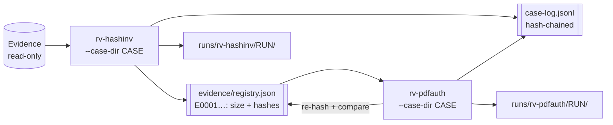

# Case folder: linking Rakvor tools into one toolkit

Every Rakvor tool can work alone (`--out DIR`). In a real engagement the tools share **one case folder**: the
intake tool (rv-hashinv) registers the evidence once; every later tool (rv-pdfauth, …) re-verifies each file
against that registry before analysing it and links its own audit chain to the case. A reviewer can then follow
one item from intake to the last report, across tools, and prove nothing changed in between.



Implemented in both reference profiles (Rust `src/core/src/case.rs`, Python `core/case.py`) with identical file
formats: a case written by one profile is verified and extended by the other (cross-language test, run when
`RV_CROSS_PROJECT` points to the other profile). Each project documents it in `docs/case-folder.md`.

## Role: one constant

| | Rust | Python | `.forge.json` |
| --- | --- | --- | --- |
| Intake (reference rv-hashinv) | `pub const CASE_ROLE: CaseRole = CaseRole::Intake;` in `src/core/src/lib.rs` | `CASE_ROLE = "intake"` in `core/__init__.py` | `"case_role": "intake"` |
| Analysis (scaffolded tools) | `CaseRole::Analysis` | `"analysis"` | `"case_role": "analysis"` |

Both behaviours live in the shared code; `RunConfig.case_role` defaults to the constant, so tests construct either
role explicitly. **The scaffold flips the constant and `case_role` together**; the validator checks they agree.
Front-end tests (CLI, GUI) are role-aware: for an analysis tool they seed the registry with an explicit intake run
through the core first, so inherited tests pass in both roles.

## Layout (`rakvor.case/1`)

```text
<CASE>/
  case.json                    {"schema":"rakvor.case/1","case_id","jurisdiction","created_utc",
                                "created_by":{"tool","version","run_id","actor"}}
  case-log.jsonl               hash-chained (same algorithm as audit.jsonl), append-only, one line per event
  case-log.lock                exclusive lock while a tool appends (created with create_new / O_EXCL, removed after)
  evidence/registry.json       {"schema":"rakvor.registry/1","items":[{"evidence_id":"E0001","path","size",
                               "hashes":{"sha256":…,"md5":…},"registered_by":{"tool","version","run_id","audit_seq"},
                               "registered_utc"}]}     (items sorted by id; all fields required)
  evidence/registry.csv        evidence_id,path,size,<algorithms present in any item, standard order>,run_id
  runs/<tool>/<RUN-ID>/logs/   the tool's normal logs/ (audit.jsonl, audit.log, hashes.csv, environment.json, timestamps)
  runs/<tool>/<RUN-ID>/reports/
```

Schemas: `schemas/case.schema.json`, `schemas/registry.schema.json` (+ `evidence_id` / `case` fields in the four
report schemas). JSON files are written pretty-printed with sorted keys (same bytes in both profiles).

- `case.json` is created once (by the first tool that gets `--case-dir` on a folder without it; `--case ID` is then
  required, `--jurisdiction` sets the custody form); it never changes afterwards and its SHA-256 is recorded in
  `case_created`. Tools refuse a `case.json` with another schema (exit 2). Afterwards `--case` may be left out; if
  given it must match (exit 2). The case's jurisdiction overrides `--jurisdiction` for custody forms.
- `path` in the registry is absolute and lexically normalised (no `.`/`..`). Ids are `E` + at least 4 digits,
  continuing from the highest id.
- The registry is written only by the **intake tool**. Registering the **same path with the same content** (every
  algorithm in common agrees) returns the existing id; the same path with different content gets a new id plus the
  finding `REGISTRY_PATH_CONTENT_CHANGED` (medium); identical content at another path is a separate item (new id;
  the `DUPLICATE` finding already links them).
- The registry file's SHA-256 is recorded in the case log at every registration (`evidence_registered`), so an
  edited registry is detected.

## Case log events

Entries have exactly the audit-entry shape (`seq, ts_utc, run_id, actor, action, details, prev_entry_hash,
entry_hash`), so `verify-log`'s algorithm verifies the chain.

| Event | Written by | Details |
| --- | --- | --- |
| `case_created` | first tool | case_id, jurisdiction, schema, `case_json_sha256`, `registry_sha256: null`, tool, version |
| `run_started` | every tool | tool, version, `run_dir` ("runs/<tool>/<RUN-ID>", relative, forward slashes), frontend, role, evidence_ids |
| `evidence_registered` | intake tool | tool, version, evidence_ids (all items of the run), added (new ids), registry_items, `registry_sha256` |
| `run_finished` | every tool, also after cancel/failure | tool, version, run_dir, status (`completed`/`cancelled`/`failed` + reason), `audit_head`, `audit_entries`, timestamp_status, totals {items, bytes, errors, high, medium, low, info} (null if failed), verification {registered, added, verified, mismatched, unregistered} |

Each tool's own `audit.jsonl` keeps `run_started` as entry #1 and records `case_linked` as entry #2
{case_id, case_dir, role, run_dir, case_created, `case_log_seq_at_start`, `case_log_head_at_start`, registry_sha256,
registry_items, jurisdiction, requested_jurisdiction}. `case_log_head_at_start` is the `entry_hash` of this run's
`run_started` entry in the case log. So the two chains reference each other: the case log holds the run's final
audit head, the run's audit holds the case-log entry that announced it. Other audit events: `case_algorithm_added`,
`evidence_registered` {index, evidence_id, new, case_log_seq, registry_sha256}, `evidence_verified_against_case`,
`evidence_not_in_case_registry`. Front-ends also receive an `evidence_linked` event {index, path, evidence_id,
status} per item (status: registered | already_registered | verified | mismatch | not_in_registry).

## Locking

Every append (and every registry write) happens under `case-log.lock`, created exclusively; it holds
{tool, version, run_id, pid, host, created_utc}. A tool waits up to 30 s for another tool's lock, then fails
(exit 1). A lock older than **10 minutes** is reported as stale with its owner and **never deleted automatically**.
Under the lock the tool first re-verifies the case log chain, `case.json` digest and registry digest (a broken case
is never extended), reloads the registry (intake), then writes. The lock is not held during the analysis itself.

## Behaviour of an analysis tool with `--case-dir`

1. Load and verify `case-log.jsonl` (chain intact), `case.json` and the registry digest recorded in it → else exit 3
   with a clear message and nothing written (no run folder, no case-log entry).
2. Inputs: every registered item by default, or `--evidence E0001,E0007` (needs `--case-dir`; unknown id → exit 2);
   plain `--input` paths are still allowed. Matching order per item: the `--evidence` id, else the same registered
   path, else the same content.
3. Hash algorithms: the run always includes at least one algorithm present in every registered item (SHA-256 if
   possible; added, or replacing the second choice since the 2-algorithm limit still holds, and logged as
   `case_algorithm_added` {requested, added, replaced, algorithms}). The intake tool applies the same rule so
   identity can always be compared.
4. Per item, after hashing: compare with the registry →
   `evidence_verified_against_case` {index, evidence_id, algorithm, match: true, matched_by}; mismatch → the same
   event with match: false, expected, actual and the finding `EVIDENCE_HASH_MISMATCH_WITH_CASE` (high) — the
   analysis still runs (the examiner decides); a file not in the registry → `evidence_not_in_case_registry` and
   `EVIDENCE_NOT_IN_CASE_REGISTRY` (medium).
5. Outputs go to `runs/<tool>/<RUN-ID>/` (logs/ and reports/ inside); reports show the evidence id next to each item
   (technical, summary, custody, statistics with a "Case folder" section); the custody form uses the case id, the
   evidence id and the intake date (`registered_utc`) from the registry.
6. At the end: `run_finished` appended to the case log under the lock, with the final audit head read back from
   disk (also after a cancel or a failure).

`verify-case <CASE>` (every tool has it): case log chain starting with `case_created`, `case.json` digest, registry
digest, each announced run's audit chain and timestamp tokens, `case_linked` → `run_started`, and that the audit head
recorded at `run_finished` is entry #`audit_entries` of the run's audit (only `timestamp_obtained` may follow it).
Exit 0 (warnings: run without `run_finished`, run folder not announced) / 3 broken / 1 not a case folder.

`verify-case <CASE> --rehash` (default off) also re-hashes every registered item still reachable at its registered
path, with the entry's own algorithms (≤ 2, standard order), and compares the digests with the registry. A path
registered several times is compared with its latest registration (earlier ids: warning "superseded"). A difference
is a problem → exit 3 (`E0002 <path>: sha256 differs from the registry (registered …, now …)`); an unreachable or
unreadable file is a warning. It prints `re-hashed C of R registered items: M match the registry`. Use it when the
evidence copies are on the reviewing workstation; otherwise an analysis run does the same comparison per item.

## Exit codes with `--case-dir`

| Code | Case-folder causes |
| --- | --- |
| 1 | lock held by another tool (after 30 s) or stale lock; file-system error |
| 2 | other schema, case id mismatch, `--case` missing when creating, unknown or malformed evidence id, `--evidence` without `--case-dir` |
| 3 | case folder fails verification (nothing written); or the run completed with a high finding (e.g. `EVIDENCE_HASH_MISMATCH_WITH_CASE`) |

## Validator (`scripts/validate_project.py`)

Static: `docs/case-folder.md`, case/registry schemas, the case findings worded in en/es/fr, `CASE_ROLE` constant
present and equal to `.forge.json` `case_role`. With `--run`: `--case-dir`/`--evidence` documented,
`verify-case` exists; a case run on a copy of the sample (intake: the tool registers it; analysis: the validator
pre-creates case.json, registry and case log itself, independently of the tool) produces `case.json`, a case log
that verifies with an independent re-implementation (chain, digests, run links), `run_started, case_linked` at the
top of the run audit, registrations (intake) or matching verifications (analysis), evidence ids in reports,
`verify-case` exit 0; analysis: a modified copy → `EVIDENCE_HASH_MISMATCH_WITH_CASE` (exit 3); an edited case log →
`verify-case` exit 3 and the tool refuses to extend it.

## Why this design (for the admissibility documents)

- **Continuity** (cadena de custodia / scellés): each tool proves the item it analysed is bit-identical to the one
  registered at intake, with the comparison itself in the audit log.
- **Repeatability**: one registry, one set of evidence ids, used by every report.
- **No hidden coupling**: tools talk only through files with schemas; each tool can be audited alone.
- **Tamper evidence across tools**: the case log and every run's audit chain point at each other; editing one
  breaks a link that `verify-case` (or a 30-line independent script) detects.
