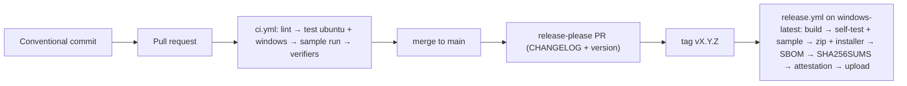

# CI/CD contract

Trunk-based: short branches, Conventional Commits, PRs gated by CI on Linux **and** Windows, releases cut by
release-please, Windows artifacts built only on GitHub-hosted `windows-latest` runners.

## ci.yml (both profiles)

| Job | Steps |
| --- | --- |
| lint (ubuntu) | Rust: `cargo fmt --check`, `cargo deny check advisories licenses bans sources` (a new RustSec advisory fails the build; an exception goes in `deny.toml` with the reason it does not apply and when it is revisited), `cargo clippy --workspace --all-targets -D warnings`. Python: `ruff format --check`, `ruff check`. Both: actionlint (with shellcheck) |
| test (matrix ubuntu + windows; Python also 3.11 + 3.13) | full test suite incl. docs drift test, `self-test`, sample run, `tests/verify_chain.py`, `tests/validate_reports.py` |
| build (windows) | Rust: release build of both exes, upload artifact. Python: Nuitka standalone smoke build + frozen `self-test` + `run.ps1` |

- `permissions: contents: read` at top level; jobs get more only when needed.
- `concurrency` cancels superseded runs.
- Lockfiles enforced: `cargo … --locked`, `uv sync --locked`.
- Toolchains pinned: Rust workflows run `rustup toolchain install` (reads `rust-toolchain.toml`; never
  `dtolnay/rust-toolchain@stable`), and a test fails if a workflow uses a floating `stable`. Python: the release and
  the CI `freeze-smoke` job use one patch version, `env: RELEASE_PYTHON: "3.13.x"` in both workflows (a test checks
  they agree).
- Sample script step (Linux): `examples/sample/run.sh` compares the tool's `hashes.csv` with
  `expected_hashes.csv` and fails on a difference (`RV_SAMPLE_OUT` redirects its output).
- Cross-profile golden step: `tests/golden/case-by-<other>.zip.b64` (base64 text so skill bundles contain no nested zip; a case folder written by the other profile,
  rebuilt with `tests/golden/regenerate.py <other project>`) is unpacked and checked with this profile's
  `verify-case` and `verify-log`; the test suite does the same. A zip, so git line endings and the scaffold's
  renaming never alter the digested bytes.
- Find the newest run folder with `find … -printf '%f\n' | sort | tail -n 1` (shellcheck rejects `ls | tail`).

## release.yml

1. `release-please` job on push to main (`contents: write`, `pull-requests: write`). Rust workspace: `release-type: simple`
   + `version.txt` + extra-file `Cargo.toml` jsonpath `$.workspace.package.version` (the `rust` type fails on a virtual
   workspace). Python: `release-type: python` + generic extra-files marked `# x-release-please-version`.
   One-time repo setting: *Settings → Actions → General → Allow GitHub Actions to create and approve pull requests*.
2. `windows` job when a release is created **or** on `workflow_dispatch` (test packaging without a tag):
   build → verify (`self-test`, `examples/sample/run.ps1`) → portable zip → Inno Setup (`ISCC.exe` is preinstalled)
   → SBOM (`cargo cyclonedx` / `cyclonedx-py` from `uv export`) → `SHA256SUMS` → `actions/attest-build-provenance`
   (`id-token: write`, `attestations: write`) → upload artifact → `gh release upload` when tagged.

Verified on GitHub-hosted runners with both templates (October 2026): Rust — CI green on ubuntu + windows, release job
green on `windows-latest` (build ≈5 min, SBOM ≈2 min); Python — CI green on ubuntu 3.11/3.13 + windows 3.13, Nuitka
freeze smoke test and the full release job (zip, Inno Setup, SBOM, SHA256SUMS, attestation) green on `windows-latest`.

## Installer (Inno Setup)

Per-user (`PrivilegesRequired=lowest`), `MinVersion=10.0`, x64, EN/ES/FR wizard, optional "add CLI to PATH"
(HKCU), Start-menu shortcut to the GUI and to the docs, a fresh `AppId` GUID per tool (scaffold regenerates it and adds it to `RAKVOR_APP_IDS` in `src/cli/tests/packaging.rs`, which lists every Rakvor tool's AppId so two installers never upgrade or uninstall each other; a new tool's AppId goes into that table in every tool repo).
WiX/MSI only if a client's IT requires MSI (WiX v6+ has a maintenance fee for revenue-making organisations).

## Signing

Unsigned → SmartScreen warning. The templates already contain two signing steps (executables before packaging,
installer after Inno Setup) that run only when the secret `SIGN_PFX_BASE64` exists (job env
`SIGN_ENABLED: ${{ secrets.SIGN_PFX_BASE64 != '' }}`; secrets cannot be used in `if:` directly). They decode the
PFX to `RUNNER_TEMP`, find the newest `signtool.exe` in the Windows Kits and sign with SHA-256 + an RFC 3161
timestamp (`/tr … /td SHA256`), so signatures outlive the certificate. Sign **before** zipping and before
`SHA256SUMS`, otherwise the published digests do not match. Alternative for the French entity: Azure Artifact
Signing (the Colombian entity is currently not eligible). Never commit keys; without the secret the release is
unsigned and the handoff must say so.

Trust features in CI: tests run with `RV_NO_TIMESTAMP=1` and a local TSA (`tests/fake_tsa.py`, needs `pyhanko`
installed in the job — the Rust profile installs it with pip and passes `RV_TEST_PYTHON`); a Windows-only
"real TSA smoke test" step with `continue-on-error: true` checks DigiCert without making CI flaky.

## Release checklist (manual, in docs/development.md)

`self-test` on Windows 10 and 11, GUI sample run + Open report, `SHA256SUMS` and `gh attestation verify`, human
review of the CHANGELOG entry.

## Release versioning without breaking `--locked`

Learned when the first release-please PR (0.2.0) was merged: bumping `[workspace.package] version` changed the
workspace crates' entries in `Cargo.lock`, and every `cargo … --locked` step failed. The same happens with a static
`version` in `pyproject.toml` and `uv sync --locked`. So the product version lives outside the lockfile:

- Rust: `version.txt` (release type `simple`); `src/core/build.rs` exports it as `RV_VERSION`;
  `TOOL_VERSION = env!("RV_VERSION")`; crate versions in `Cargo.toml` stay fixed; release.yml reads version.txt.
- Python: `dynamic = ["version"]` from `__init__.py` (`[tool.hatch.version]`), release type `simple`
  with `version.txt` + generic `x-release-please-version` markers; uv.lock then has no project version.
- `validate_project.py` checks both.

## Reading CI failures without the log download

Job logs are served from a blob host that sandboxes often cannot reach, while check-run **annotations** come
through the GitHub API. So the test steps tee their output and, on failure, re-emit the failing lines as
`::error::` annotations; read them with `gh api repos/<o>/<r>/check-runs/<job-id>/annotations`.
`tests/validate_reports.py` validates only files that have a report schema; domain outputs such as
`objects.json` are skipped (their digests are in the audit chain).
