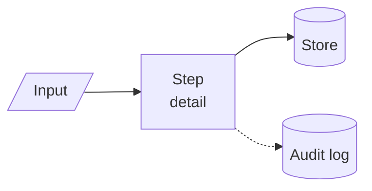

# Documentation style

Readers: examiners (how to run it), lawyers and clients (what results mean), developers (how to change it), and
**auditors** — customers, courts and opposing experts who inspect the tool. The tools are used locally by Rakvor and
not distributed, but they must be auditable, so every claim in the docs must match the code. Language: English.
Plain sentences, tables for reference material, **at least one Mermaid diagram per page** (GitHub renders
them; `mmdc` validates them).

## Pages

| Page | Must contain | Diagram |
| --- | --- | --- |
| README.md | one-paragraph description (between `<!-- forge:description -->` markers), what you get table, install (portable/installer/source), quick start, outputs tree, exit codes, docs index, layout, links | flowchart of the pipeline + outputs tree |
| CONTRIBUTING.md | workflow, Conventional Commits, pre-push commands, defensibility rules table, how to add a finding | gitGraph + sequenceDiagram |
| CHANGELOG.md | Keep a Changelog, `## [Unreleased]` on top, links at the bottom | — (exempt) |
| SECURITY.md | supported versions, private reporting, forensic scope, verifying a release | — (exempt) |
| docs/architecture.md | module table (which file to replace for a new tool), run sequence, states, concurrency/cancel | flowchart, sequenceDiagram, stateDiagram-v2 |
| docs/forensic-audit.md | log files, chain rule, actions table, evidence handling, ISO/IEC 27037 mapping, legal context | flowchart (chain), flowchart (evidence) |
| docs/reports.md | report kinds, contents table, severity/status, findings catalogue with shows/does-not-prove, schemas, PDF notes | flowchart (tree), pie (example severities) |
| docs/usage-cli.md | **generated** by `docs-cli` (do not edit) | flowchart of commands |
| docs/usage-gui.md | screenshot `docs/images/gui-main.png`, workflow, window table, audited UI actions | flowchart |
| docs/development.md | build/test, test pyramid, CI, packaging, release, signing, manual checklist | flowchart, sequenceDiagram |
| docs/adr/0001-language.md | generated by `decision_matrix.py`, edited for context | pie |
| docs/theory.md | **Part A** plain language for clients, lawyers and judges (analogies, no maths); **Part B** for examiners and opposing experts (algorithms, data structures, formulas, thresholds taken from the code, standards, references); one section per process the tool performs | ≥ 4: flowchart, sequenceDiagram, stateDiagram-v2 + annotated byte-layout code blocks |
| docs/admissibility.md | disclaimer (not legal advice, counsel review), reliability argument (testability, error/limits, independent oracles, standards, acceptance), one section per framework — Colombia, France/EU, ISO/IEC 27037/27041/27042/27043/17025, US/UK — each a requirements table mapped to the file/command that meets it or "examiner obligation" / "gap"; gap list with mitigations; examiner checklist before filing. Start from the sourced reference `claude/admissibility-research.md` in the Rakvor project (keep UNVERIFIED markers) | evidence lifecycle flowchart + where each control sits |
| docs/installation.md | portable zip and installer (Windows 10/11, per-user), verify SHA256SUMS, Authenticode and build provenance, native libraries, first-run self-test, offline use, build from source for auditors (pinned toolchain, `--locked`), uninstall, where local data lives | flowchart |
| docs/usage.md | end-to-end case walkthrough (intake into the case folder → analysis → reports → verify), CLI and GUI, reading every output, finding → next check → what not to conclude, troubleshooting by exit code/finding | sequenceDiagram |
| docs/case-folder.md | layout, events, verification (from `references/case-folder.md`) | flowchart |
| examples/README.md | sample files table with expected findings, how to run, expected summary | flowchart |

## Mermaid catalogue (GitHub-safe syntax)

- `flowchart LR|TB` — pipelines, folder trees (`OUT["&lt;OUT&gt;/"]` escapes angle brackets).
- `sequenceDiagram` with `autonumber` — run order, release process.
- `stateDiagram-v2` — GUI/run states.
- `pie showData` — scores, severity mix.
- `gitGraph` — branching workflow.
- `gantt` — delivery plans in the phase-2 plan.

Rules that keep diagrams rendering: quote labels containing `()`, `:` or `/`; use ` ` not `\n`;
no `%%{init}` themes (GitHub dark mode handles colours); ≤ 15 nodes per diagram.

## Writing rules

- Tables over bullet walls; numbers over adjectives ("≈5 min build", "61 bytes").
- Every finding documented with *what it shows* and *what it does not prove*.
- Commands in fenced blocks, Windows (`powershell`) and Linux (`bash`) when they differ.
- Relative links only to files that exist (validator checks).
- Product names: Windows 10/11, ISO/IEC 27037, BLAKE3, SHA-256.
