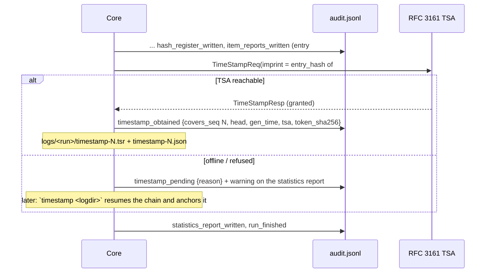

# Forensic audit contract

Goal: a second examiner can establish **what was done, to which files, by whom, with which exact tool build**,
and detect any later change to the record. The templates implement all of this; this page is what you must
not break when adding domain logic.

## Layout

```text
<OUT>/logs/<RUN-ID>/          RUN-ID = <UTC yyyymmddThhmmssZ>-<6 hex>
  audit.jsonl                 authoritative, hash-chained, one JSON object per line, append-only ("x" open: never reuse)
  audit.log                   same actions, readable: "<ts>  #00007  item_hashed  <path>  k=v …"
  hashes.csv                  index,path,size,<algo1>[,<algo2>],status,error   (absolute paths)
  environment.json            tool, version, compiler/python, target, every dependency@version, OS, host, OS user,
                              working dir, command line (or GUI settings), recorded_utc
```

## Chain algorithm (identical in every language)

```text
entry = {seq, ts_utc, run_id, actor, action, [item], details, prev_entry_hash}
entry_hash = SHA-256( json(entry without entry_hash, keys sorted at every level, separators "," ":",
                      UTF-8 not escaped, integers only) )
prev_entry_hash of seq 1 = 64 × "0"
```

Rust: `serde_json::Value` maps are BTreeMaps (do **not** enable `preserve_order`). Python:
`json.dumps(e, sort_keys=True, separators=(",", ":"), ensure_ascii=False)`. No floats in details (they
serialise differently across languages): use integers (ms, bytes) and strings.

Verification checks `seq` continuity, `prev_entry_hash` linkage and each `entry_hash`; a Rust-written log must
verify with the Python verifier and vice versa (`tests/verify_chain.py` is stdlib-only for that reason).

## Actions every tool records

| Order | Action | Details |
| --- | --- | --- |
| 1 | `run_started` | tool, version, frontend, algorithms, langs, case_id, inputs, input_list, recursive, out_dir |
| 2 | `ui_*` (GUI) | user actions with `at_utc` |
| 3 | `environment_recorded` | digests of environment.json |
| 4 | `inputs_resolved` | items, bytes (or `error` + `run_failed`) |
| per item | `item_started` → `item_hashed` (digests, bytes_read, `mtime_unchanged`) or `item_error` → domain actions → `item_analyzed` (findings, status) |
| after loop | `duplicate_group`, domain cross-item actions, `hash_register_written` (digests of hashes.csv) |
| trust | `signing_certificate_loaded` (if `--sign-cert`), `timestamp_obtained` or `timestamp_pending` (unless `--no-timestamp`) |
| reports | `item_reports_written` (folder + digest of every file incl. custody), `statistics_report_written` |
| end | `run_cancelled` (if any) and `run_finished` (totals, severities, elapsed_ms, cancelled) |

Domain logic adds its own actions between `item_started` and `item_analyzed` (e.g. `jpeg_carved` with
offset, length and digest of the carved file). **Every file the tool writes is hashed and its digest logged.**

## Evidence handling

- Open evidence read-only (`File::open`, `open(path, "rb")`); never write next to the evidence.
- Do not follow symbolic links (no escape outside the selected folders).
- Compare modification time before/after hashing → `mtime_unchanged`.
- Stream in 1 MiB chunks: memory use is constant whatever the file size (8 GB laptops, 500 GB images).
- One read feeds both digests and the analyzer's first 4 KiB; a second pass (carving) must be justified and logged.
- Absolute paths everywhere (`std::path::absolute`, `os.path.abspath`) — no `\\?\` prefixes in reports.

## What the chain does not prove — and the trusted timestamp

The chain alone proves internal consistency, not the time of writing. So every run anchors it (on by default):



- The imprint sent is the chain head itself (the `entry_hash` of entry #N, already a SHA-256; declared as SHA-256,
  never hashed again), taken **right before the statistics report**, so the statistics report can print the
  timestamp result. `verify-log` re-checks every token: message imprint == stored head, nonce, the entry at
  `covers_seq` still exists with that hash.

## Truncation: `verify-log` contract

A hash chain cannot show that entries were removed from its end, so `verify-log` must never claim to detect
truncation from the chain alone. It compares the end of the log with the records kept outside it:

- **Timestamp**: for every `timestamp-<K>.json`, entry #K must exist (else `truncated: … covers entry #K, which is not
  in the log`, exit 3) and its hash be the token's imprint; every `timestamp_obtained` entry must still have its
  token file with the recorded SHA-256 (deleting tokens is how a truncation below them would be hidden).
- **Case log**: when the log folder is `<CASE>/runs/<tool>/<RUN-ID>/logs` and `<CASE>/case.json` exists, the case log
  must be intact and its `run_finished` for this run gives `audit_entries` M and `audit_head`: entry #M must exist
  with that hash (else `truncated: the case log records M entries at run_finished, but the log ends at entry #N`)
  and only `timestamp_obtained` may follow it.
- Output after `OK`: one line naming the highest anchor — `truncation: the final entry #N is anchored by …` or
  `truncation: entries up to #K are anchored by …; n entries after it (…) cannot be proven complete` — or, with no
  anchor, exactly `truncation not detectable without a timestamp or case record` (exit 0). Same wording in both
  profiles (Rust `src/core/src/verify.rs`, Python `core/verify.py`).
- Recorded outputs (shared `src/core/src/outputs.rs`, byte-identical in every Rust tool like `trust.rs`): `verify-log`
  and `verify-case` re-hash every file the audit log records (`environment_recorded`, `hash_register_written`,
  `item_reports_written`, `statistics_report_written`, `output_written {file}`, `timeline_written`, `report_written`,
  `rsmf_written`, `trace_written`; the module documentation lists every shape) with every recorded algorithm; the
  latest entry for a file wins. Missing, edited or replaced → problem (exit 3), named; a recorded path that is
  absolute, has `..`, `\` or `:`, or resolves outside the run folder (symlink, junction) is rejected, not read.
  Output: `outputs: N verified of M recorded (algorithms)`. A new tool that records outputs under a new action
  name extends `outputs.rs` in every repo at once. The Python profile has no equivalent yet.
- `timestamp <logdir>` uses `AuditLog::resume` / `AuditLog.resume`: it re-verifies the chain, then appends
  `timestamp_obtained` (or a new `timestamp_pending`) with the next seq. Never rewrite earlier entries.
- `--tsa-url` (default `http://timestamp.digicert.com`), `--no-timestamp` / env `RV_NO_TIMESTAMP=1` for tests and
  air-gapped work (logged as such). Accept only http/https URLs.
- Parse TSTInfo leniently: real TSAs send `genTime` with fractional seconds that strict ASN.1 types reject.
- Tests use `tests/fake_tsa.py` (pyhanko's DummyTimeStamper + a throwaway PKI: `ca.pem`, `tsa.pem`,
  `examiner.p12` password `test`) on 127.0.0.1; `openssl ts -verify -data … -in timestamp-N.tsr -CAfile ca.pem` gives
  an independent check. CI may add an informative real-TSA smoke step with `continue-on-error`.
- Token verification (shared `trust.rs`, byte-identical in every Rust tool; copy it from the template, never fork it):
  driven by the log's `timestamp_obtained` entries and fail-closed when a recorded token file is missing or differs.
  The token's CMS signature is always checked; its chain only with `--tsa-ca FILE` (otherwise the output says
  `chain not checked`). The chain check applies RFC 3161 §2.3 (TSA EKU critical and timeStamping only) and RFC 5280
  (pathLen, keyCertSign, unknown critical extensions rejected, directoryName name constraints), builds paths with
  backtracking (depth ≤ 8, key-rollover intermediates) and supports RSA signers only. Unreadable bundle → exit 1;
  signature or chain failure → exit 3. **Revocation is never checked**: say so in the docs, with the
  `openssl verify -crl_check -attime` recipe and the note that `-attime` also applies to the CRL's validity dates.
  `tests/fixtures/tsa-chains/make_chains.py` regenerates the chain fixtures and `expected.json` (an OpenSSL oracle);
  when you change trust.rs, change it in every tool repo and in the template together.
  The Python profile implements the same rules in `core/trust.py` (`verify_token`, `validate_chain`, same
  messages) and is graded by the same `tests/fixtures/tsa-chains` (copied byte for byte; `tests/test_tsa_chains.py`):
  a rule change goes into both profiles and the shared fixtures in one change. Python's PDF signing (pyHanko on
  `cryptography`, i.e. OpenSSL) already uses RSA blinding.
- Limitation `TIMESTAMP_PROVES_EXISTENCE_ONLY`: the token proves the log existed at that time, not that it is true.

## Signed PDF reports

- `--sign-cert <file.p12|.pfx>` = the examiner's own certificate; password from `--sign-pass-env VAR` (default
  `RV_SIGN_PASSWORD`) or an interactive prompt **without echo**. The password is never logged, never in
  environment.json.
- Audit `signing_certificate_loaded` {subject, fingerprint_sha256} before any report; wrong password →
  `run_failed` and exit 1 before touching the evidence. Every report prints the subject **and** the SHA-256
  fingerprint (JSON: `run.pdf_signer_certificate_sha256`).
- PAdES-style detached CMS over the PDF ByteRange. Rust: own PDF writer reserves a `/Contents` placeholder and
  fills it in place (cms + rsa + p12-keystore; RSA keys only — say so in the docs; the key always signs through
  `BlindedSigningKey`, RSA blinding with OS randomness, because cms's builder calls rsa 0.9's unblinded `Signer`); the placeholders are located
  inside the signature dictionary at the object offset the writer recorded, never by searching the whole file
  (page text may contain the same bytes). Python: pyhanko.
- Both profiles validate every signed PDF of a test run with pyHanko (intact + valid; untrusted test CA accepted):
  Python in `tests/test_trust.py`, Rust through `RV_TEST_PYTHON` and `tests/validate_pdf_signature.py`.
- HTML and JSON are not signed; their digests are in the audit chain, which is timestamped.

## Custody form per item

`--jurisdiction co|fr` (GUI: dropdown) writes per item `custody.json` + `custody.<es|fr>.html/pdf` +
`custody.en.html/pdf`: Colombia follows the Fiscalía "registro de cadena de custodia" fields (Ley 906 de 2004,
Manual de cadena de custodia), France the scellé/expertise vocabulary (CPP art. 156 ff.). Pre-filled: case, item
number and name, size, both digests, acquisition/processing UTC times, tool and version, actor, audit entries for
that item; blank signature lines for the transfers that happen on paper. Wording lives in i18n `custody`.

## ISO/IEC 27037 mapping (put in docs)

| Principle | Implementation |
| --- | --- |
| Auditability | every action logged with actor, UTC time, chain hash |
| Repeatability | environment.json with exact versions; deterministic algorithms |
| Reproducibility | independent verifier; standard algorithms; JSON schemas |
| Justifiability | findings state what they show and do **not** prove; limitations on every report |
| Preservation | read-only access, hashes of inputs and of every output |

Colombia: Ley 906 de 2004 (cadena de custodia), Manual de cadena de custodia of the Fiscalía; Ley 527 de 1999
(mensajes de datos). France: Code de procédure pénale art. 156 ff. (expertise). Mention them as context, not as
legal advice.
