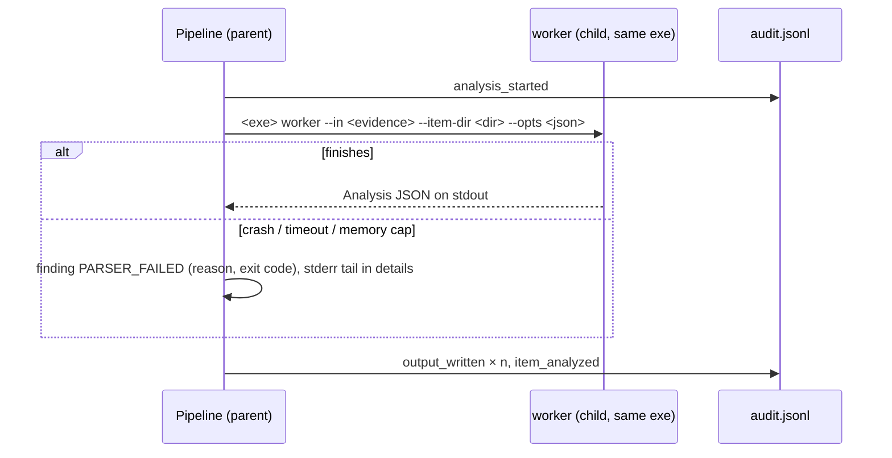

# Heavy analyzers: whole-file parsing, native libraries, worker processes

Read this when the domain logic needs more than the first 4 KiB of each item (PDF, Office, EVTX, images, archives),
uses a native library (PDFium, libyal, libewf), or can hang/crash on hostile input. Learned building rv-pdfauth.

## The contract stays, the analyzer grows

The scaffold calls `analyzer::analyze_item(&AnalyzeCtx)` (Rust) / `analyze_item(ctx)` (Python) once per readable
item, after hashing. `AnalyzeCtx` carries the path, size, first 4 KiB, an empty `item_dir` inside the item's
report folder, and `DomainOptions`. The analysis returns `Analysis { findings, details, outputs }`:

- `details` (JSON) feeds the technical report and is logged in `item_analyzed`;
- `outputs` lists every file it wrote under `item_dir` with a `kind`; the pipeline hashes each one with the
  run's algorithms and records `output_written` — the analyzer itself never touches the audit log.

A second, read-only pass over the evidence (memory map) is allowed when the format needs random access; the
pipeline logs `analysis_started` before it, so the extra read is visible in the record.

## Freeze the interfaces before parallel agents start

Before splitting the core between agents, commit: the domain data model (a separate crate/module with
`#![forbid(unsafe_code)]` for the parser), `analyze_item`'s signature, `DomainOptions` field names (the CLI
flags and GUI settings map 1:1 onto them) and output kinds. Agents may add fields, never rename. Give each agent
its own `CARGO_TARGET_DIR` and a worktree.

## Isolation: one worker process per item

- The child is the same executable (`argv[1] == "worker"` handled before clap/eframe), so nothing extra ships.
- Limits: Windows Job Object (`JOB_OBJECT_LIMIT_PROCESS_MEMORY`) + wall-clock timeout; Unix `RLIMIT_AS`.
- Only the parent writes the audit log; a crash costs one item, never the run or the chain.
- Unit tests use `Isolation::InProcess`; one CLI test injects a fault (debug-only env var) to prove the path.

## Containers: one file, many items (mbox, archives, PST)

- Register the container as evidence exactly as received; each inner item is a *derived* item named
  `<container path>#<n>@<offset>`, and its reports and custody form cite the container's digests, the index and how
  to get the item back, so anyone can re-extract it.
- **Untransformed slices** (an mbox message, a stored/uncompressed archive entry): record the byte range (where it
  starts, how many bytes); the independent verifier (`tests/verify_chain.py`) re-hashes that range of the container
  and must not open the name as a file. rv-mailauth's CI failed on exactly this while every Rust test passed.
- **Transformed items** (deflated ZIP entries, PST blocks, anything decoded): the item's bytes are not a range of the
  container, so a range hash proves nothing about them. Record reproducible extraction metadata instead (entry
  name, method, the container's digest, the extracted item's digests) and have the verifier extract with an
  independent library and hash the extracted bytes.
- A cap on inner items (`--max-mbox-messages`) must still end the last listed item at the next boundary; dropping
  the unlisted separators made the last item run to the end of the file, so its hashes covered several items.

## Worker options stay small

- A worker gets only what its own item needs on the command line. Passing a run-wide cache (rv-mailauth's DNS keys
  fetched so far) grows `--opts` with the batch until it hits the OS limit (about 32 KB on Windows), and valid
  items then fail with `spawn_failed`. Keep caches in the parent; select per item, or pass a file.

## Native libraries

- Licence first: MIT/Apache/BSD only for Apache-2.0 deliverables. Excluded by default: MuPDF (AGPL), Poppler and
  Xpdf (GPL). Enforce with `cargo-deny` (Rust) or `pip-licenses` (Python) in CI.
- Pin the binary (release tag + SHA-256 in `third_party/<lib>/VERSION.txt`), fetch it with a script in CI, ship
  it next to the exe, add its licence to `NOTICE`, record its digest in `environment.json`.
- Missing library at runtime → the feature is skipped with a logged reason and a limitation on the report,
  never a crash.
- Third-party binaries may contain hand-written assembly (e.g. libjpeg-turbo SIMD in PDFium); that is accepted
  and declared — the "no hand-written assembly" rule is about our code.

## Ground truth for findings

Ship `examples/sample/expected_findings.json` (`{"file": ["CODE", …]}`) generated together with the synthetic
samples by a committed, deterministic script (`tests/make_samples.py`). A test asserts the analyzer produces
exactly those codes; `validate_project.py` checks the file exists and that each sample's run matches it.
Use mature tools in the other language as **test oracles** (e.g. pikepdf/qpdf, pyhanko for PDF) — compare
counts and offsets in CI, never ship them.

## Fuzzing

Parsers of hostile formats get a fuzz target (`cargo-fuzz` / `atheris`) and, as a stable-toolchain fallback,
a test that feeds thousands of random mutations of the samples and asserts no panic.
