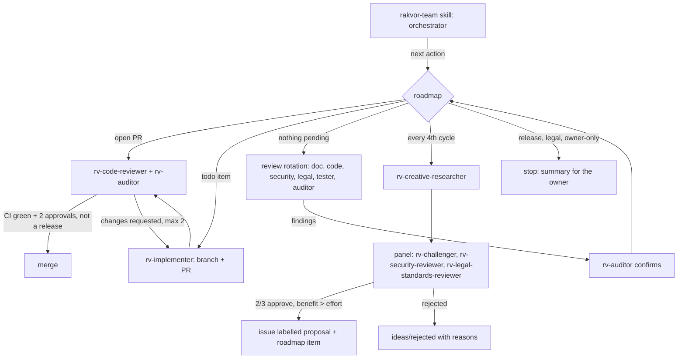

# Rakvor development team

A team of Claude Code agents that keeps improving the Rakvor suite. The orchestrator works through
`C:\Users\david\Rakvor\roadmap\ROADMAP.md` (private repo `Panacota96/rakvor-roadmap`) until it is empty or an
owner gate is reached.



| Agent | Role | Writes |
| --- | --- | --- |
| `rv-doc-reviewer` | Docs, quick guides and CLI help match the code; EN/ES/FR | findings |
| `rv-code-reviewer` | Correctness, shared-file identity, tests; approves PRs | findings |
| `rv-security-reviewer` | SSDF, ASVS, SLSA, supply chain; idea panel | findings, scores |
| `rv-legal-standards-reviewer` | ISO 27037/41/42/43, 17025, NIST, CO/FR/US admissibility, licence; idea panel | findings, scores |
| `rv-tester` | QA harness, edge cases, large inputs | findings, synthetic data |
| `rv-auditor` | Independent re-check; approves PRs; confirms findings | findings |
| `rv-implementer` | The only one that writes code: a branch, checks and a PR | code, PRs |
| `rv-creative-researcher` | Feature research, full proposals | idea files |
| `rv-challenger` | Devil's advocate on the idea panel | scores |

## Install and run

```powershell
python -I scripts/install_team.py C:\Users\david\Rakvor
```

Then open a Claude Code session in `C:\Users\david\Rakvor`:

- `/rakvor-team` runs one cycle.
- `/loop /rakvor-team` keeps going until a stop condition.

## What the team may and may not do
- **May:**
  - open branches and PRs;
  - merge a non-release PR after green CI, two approvals (`rv-code-reviewer`, `rv-auditor`) and a clean Codex
    review;
  - create `proposal` issues for ideas the panel accepted;
  - commit to the roadmap repo.
- **May not:**
  - release, tag, push to `main` of a tool repo, force-push or delete branches;
  - remove legal draft markers;
  - add GPL code;
  - put secrets or personal data anywhere.

The rules every agent follows are in [RULES.md](RULES.md).
